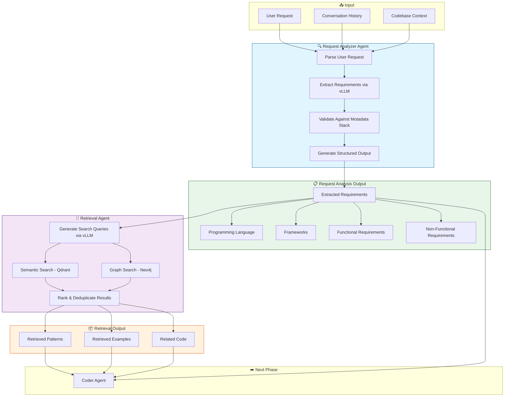
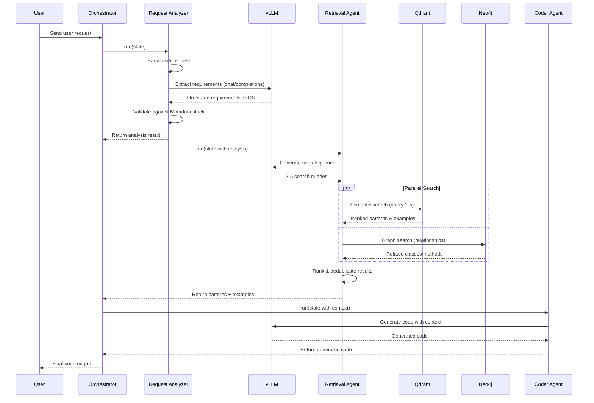

# Request Analyzer & Retrieval Agent Design

## Overview

These two agents work together in the **PRE Phase** of the agentic pipeline to:
1. **Request Analyzer**: Understand and validate user requests
2. **Retrieval Agent**: Fetch relevant context from the codebase

---

## 1. Request Analyzer Agent

### Purpose
Transform natural language user requests into structured, validated requirements that downstream agents can use.

### Input Schema
```python
{
    "user_request": str,           # Natural language request
    "conversation_history": list,  # Previous messages for context
    "codebase_context": {
        "primary_language": str,   # e.g., "Java"
        "frameworks": list,        # e.g., ["Vert.x"]
        "architectural_style": str # e.g., "Event-Driven"
    }
}
```

### Output Schema
```python
{
    "status": "VALID" | "INVALID" | "NEEDS_CLARIFICATION",
    "extracted_requirements": {
        "programming_language": str,
        "frameworks": list[str],
        "architecture_pattern": str,
        "functional_requirements": list[str],
        "non_functional_requirements": {
            "performance": str,
            "security": str
        },
        "organizational_constraints": list[str]
    },
    "clarification_questions": list[str],  # If status is NEEDS_CLARIFICATION
    "confidence_score": float  # 0.0-1.0
}
```

### Validation Rules
| Rule | Action |
|------|--------|
| Language not Java | Flag as NEEDS_CLARIFICATION |
| Unknown framework | Flag as INVALID |
| Contradictory requirements | Flag as NEEDS_CLARIFICATION |
| Vague request | Generate clarification questions |

### vLLM Integration
- **Model**: `motadata-coder`
- **Temperature**: 0.3 (low for consistency)
- **Max Tokens**: 1000
- **Output Format**: JSON only

---

## 2. Retrieval Agent

### Purpose
Fetch relevant code patterns, examples, and context from RAG (Qdrant + Neo4j) to ground code generation.

### Input Schema
```python
{
    "request_analysis": {
        "extracted_requirements": {...}  # From Request Analyzer
    },
    "task_type": "NEW_FEATURE" | "BUG_FIX" | "REFACTOR" | "ENHANCEMENT"
}
```

### Output Schema
```python
{
    "status": "SUCCESS" | "PARTIAL" | "FAILED",
    "retrieved_patterns": [
        {
            "pattern_name": str,
            "file_path": str,
            "snippet": str,
            "relevance_score": float
        }
    ],
    "retrieved_examples": [
        {
            "example_name": str,
            "file_path": str,
            "code_snippet": str,
            "relevance_score": float
        }
    ],
    "search_queries_used": list[str],
    "coverage_score": float  # 0.0-1.0
}
```

### Search Strategy
1. **Generate Queries**: Use vLLM to create 3-5 targeted search queries
2. **Semantic Search**: Query Qdrant for similar code patterns
3. **Graph Search**: Query Neo4j for related classes/methods
4. **Rank & Deduplicate**: Sort by relevance, remove duplicates

### RAG API Endpoints Used
| Endpoint | Purpose |
|----------|---------|
| `POST /search/semantic` | Vector similarity search |
| `POST /search/graph` | Graph traversal (callers/callees) |
| `POST /search/hybrid` | Combined search |
| `POST /verify` | Anti-hallucination check |

---

## Data Flow Diagram



---

## Sequence Diagram: Request Analyzer & Retrieval Agent Interaction



---

## Configuration

```yaml
request_analyzer:
  vllm_url: "http://localhost:8000"
  model: "motadata-coder"
  temperature: 0.3
  max_tokens: 1000
  timeout: 30s

retrieval_agent:
  vllm_url: "http://localhost:8000"
  rag_url: "http://localhost:8081"
  model: "motadata-coder"
  search_top_k: 5
  min_confidence: 0.3
  timeout: 30s
```

---

## Next Steps

1. Update Retrieval Agent to use correct RAG API endpoints
2. Add hybrid search support
3. Implement anti-hallucination verification
4. Add caching for repeated queries

