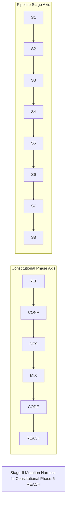

# 4-Layer Architecture — Directory Philosophy

## Purpose & Scope

This document provides **structural clarity** for the m-coder repository layout. It defines the four layers, directory mapping, allowed/forbidden boundaries, and axis separation between constitutional phases and pipeline stages. **No doctrine change.** Constitutional semantics (REF, CONF, DES, MIX, CODE, REACH), dominance rules, exemplar counts, and policy gates remain defined in canonical sources only.

## 4 Layers Overview

| Layer | Name | Role |
|-------|------|------|
| 1 | Governance (Constitution) | Semantic authority; doctrine; GREG |
| 2 | ML Compilation | Base→variants→mutation→freeze→SFT pipeline |
| 3 | Runtime | Enforcement; Phase-05 CODE realization |
| 4 | Observation | Drift detection; collapse vectors; GREG triggers |

## Directory Mapping

| Layer | Directory | Role |
|-------|-----------|------|
| 1 | `governance/` | Constitution, phases 01–06, GREG ratification, golden exemplar doctrine |
| 2 | `ml/` | Compilation bases, variants, mutation harness, dataset compiler, freeze artifacts, SFT |
| 3 | `runtime/` | Enforcement stack; integrations; Phase-05 CODE semantics |
| 4 | `observation/` | Drift probes; collapse vector tracking; ledger reconciliation; GREG audit evidence |

## Allowed vs Forbidden per Layer

### Layer-1: governance/

**Allowed:** Constitutional manifest, phase definitions, GREG protocol, golden exemplar doctrine, dominance hierarchy, boundary invariance doctrine, review packages.

**Forbidden:** ML code, dataset artifacts, runtime code, compilation harnesses, training scripts, mutation implementation.

### Layer-2: ml/

**Allowed:** Exemplar/variant mapping, Stage-6 (6A/6B/6C) mutation specs and code, dataset compiler, freeze checklists, SFT configs, generated outputs.

**Forbidden:** Redefining constitutional phase semantics; governance-locked doctrine (read-only reference); runtime enforcement code.

**Compilation DAG and lineage:** See [docs/COMPILATION_DAG_AND_LINEAGE_V0_1.md](COMPILATION_DAG_AND_LINEAGE_V0_1.md) for provenance schemas.

### Layer-3: runtime/

**Allowed:** Plan gate, judge gate, authority validator, irreversibility detector, execution control, ledger emission, RAG/orchestrator integrations.

**Forbidden:** Redefining doctrine; training pipelines; dataset compilation.

**Plan and ledger schemas:** See [docs/RUNTIME_PLAN_AND_LEDGER_V0_1.md](RUNTIME_PLAN_AND_LEDGER_V0_1.md) for v0.1 schema spec.

### Layer-4: observation/

**Allowed:** Drift probes, collapse vector tracking, ledger reconciliation, coverage analytics, GREG audit evidence.

**Forbidden:** Authoring doctrine; relaxing boundaries; redefining phase semantics. Observation can **only** trigger GREG; it cannot author exemplars or change judgment.

## Axis Separation

Two orthogonal axes must not be conflated:

### Constitutional Phase Axis (Semantic)

These phases define **how judgment must behave** (Layer-1 semantics):

- Phase-1 (REF) — Legitimacy refusal
- Phase-2 (CONF) — Bounded allowance
- Phase-3 (DES) — Design reasoning only
- Phase-4 (MIX) — Collision arbitration
- Phase-5 (CODE) — Enforcement encoding
- Phase-6 (REACH) — Endurance proof (governance-level)

### Pipeline Stage Axis (Operational)

These stages describe **workflow steps** (Layer-2 preparation):

- Stage-1: Structural mapping
- Stage-2: Artifact extraction
- Stage-3: Base exemplar mapping
- Stage-4: Variant generation
- Stage-5: Variant stability gate
- Stage-6: Mutation harness (pre-SFT stress)
  - Stage-6A: Single-step mutation
  - Stage-6B: Systemic hardening
  - Stage-6C: Agent-loop mutation
- Stage-7: Dataset compilation
- Stage-8: SFT training

### Explicit Rule

**Mutation Stage-6 ≠ Constitutional Phase-6 (REACH).**

- Stage-6 is a pipeline mutation workflow.
- Constitutional Phase-6 (REACH) is governance-level endurance semantics.
- Stage-6C (agent-loop mutation) is a pipeline stage; it tests compiled behavior against doctrine. It never redefines doctrine.

## References

- [Golden Exemplars Architecture Map](architecture/Golden_Exemplars_Architecture_Map.md) — 4 judgment layers, phases, GREG
- `motadata-coder-a-complete-guide_v1.7.md` — Appendix H: 4-Layer System Map (Two Phase Axes)

---

**Removal note:** Legacy reorg/audit planning directories (`repo_audit/`, `repo_reorg_plan/`) archived to `archive/reorg/` after reorg completion.
