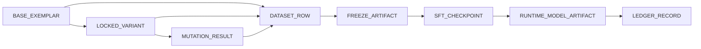

# Compilation DAG and Lineage v0.1 — Specification

## Purpose

Provenance plumbing for the ML compilation pipeline. Tracks base exemplars → variants → Stage-6 mutation → dataset rows → freeze → SFT checkpoint → runtime model → ledger. **No doctrine change.** Constitutional semantics remain in canonical sources.

## What is a DAG?

A **Directed Acyclic Graph (DAG)** is a graph of nodes and directed edges with no cycles. Each edge goes from one node to another; you cannot follow edges and return to a node you already visited.

- **Directed:** Edges have a direction (A → B).
- **Acyclic:** No loops. The graph flows forward only.

## Why DAG Fits Lineage

Lineage is **forward-only**. Each node (base, variant, mutation result, dataset row, freeze artifact, checkpoint, model, ledger) derives from upstream nodes. There are no semantic rewriting loops: once a node is produced, downstream nodes reference it by identity. The DAG structure prevents circular dependencies and enforces a clear provenance chain.

## Node Types and Edges

| Node Type | Role | Typical Inputs |
|-----------|------|----------------|
| BASE_EXEMPLAR | Golden base exemplar | — |
| LOCKED_VARIANT | Stress variant of a base | BASE_EXEMPLAR |
| MUTATION_RESULT | Stage-6 mutation output | LOCKED_VARIANT |
| DATASET_ROW | Compiled row in dataset | BASE_EXEMPLAR, LOCKED_VARIANT |
| FREEZE_ARTIFACT | Deterministic freeze | DATASET_ROW (aggregate) |
| SFT_CHECKPOINT | Trained checkpoint | FREEZE_ARTIFACT |
| RUNTIME_MODEL_ARTIFACT | Adapter / serving bundle | SFT_CHECKPOINT |
| LEDGER_RECORD | Runtime ledger row link | RUNTIME_MODEL_ARTIFACT |

## Deterministic Identity Rules

- **boundary_phrase_hash** = sha256(exact boundary string)
- **node_id** = sha256(canonical_json(node_without_node_id))
- **Canonicalization:** Stable JSON with sorted keys, UTF-8 encoding (same as plan/ledger).

## Freeze Gate Contract + Checklist

The freeze manifest gates SFT training:

- `policy_summary.freeze_allowed` must be true.
- `fail_count` must be 0 when `freeze_allowed` is true (R-L4).
- `determinism.canonicalization` = `stable_json_sorted_keys_utf8`.
- `boundary_set_hash` = sha256(sorted(boundary_phrase_hashes)) from upstream (R-L5).

## Collapse Propagation Policy

Collapse vectors (REF_SOFTENING, CONF_TO_DES, BOUNDARY_ALIASING, etc.) propagate through the DAG. A node’s `collapse.collapse_vector_result` (PASS|FAIL|WARN|NA) indicates whether collapse constraints are satisfied. Propagation rules are defined in pipeline docs; lineage records the state.

## Failure States (Hard Stops)

- R-L1: `boundary_phrase_hash` ≠ sha256(boundary_phrase) → invalid node.
- R-L2: `dataset_row.phase_semantic_label` does not match referenced variant/base → invalid.
- R-L3: `dataset_row` missing `base_id` or `variant_id` → invalid.
- R-L4: `freeze_allowed` true with `fail_count` > 0 → invalid manifest.
- R-L5: `boundary_set_hash` does not match sha256(sorted upstream boundary hashes) → invalid.

## Schema Locations

- `ml/lineage/schemas/lineage.node.v0.1.schema.json`
- `ml/lineage/schemas/freeze.manifest.v0.1.schema.json`
- `ml/lineage/schemas/node_types.v0.1.json`
- `ml/lineage/schemas/collapse_vectors.v0.1.json`
- `ml/lineage/schemas/surfaces.v0.1.json` (set equality with runtime)
- `ml/lineage/schemas/examples/`

## Invalid Examples (Runtime-Rule Coverage)

| File | Target Rule | Violation |
|------|-------------|-----------|
| `invalid_boundary_hash_mismatch_schema_valid.json` | R-L1 | boundary_phrase_hash ≠ sha256(boundary_phrase) |
| `invalid_freeze_non_deterministic_schema_valid.json` | R-L4 | freeze_allowed true with fail_count > 0 |
| `invalid_semantic_label_mismatch_schema_valid.json` | R-L2 | dataset_row phase label does not match referenced variant |
