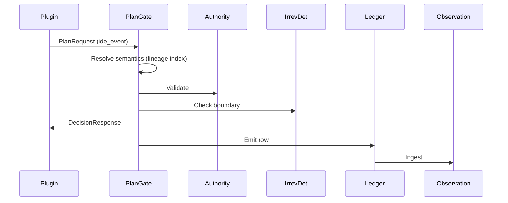

# JetBrains Plugin Flow v0.1 — IDE Enforcement Architecture

## Purpose

Plugin-facing request/response contracts for the local plan-gate. The plugin is a **client** (Layer-3 Runtime + Layer-4 Observation consumption only); it cannot author doctrine, infer phases, or soften REF.

## DAG and Lineage (Why Acyclic)

A **Directed Acyclic Graph (DAG)** has nodes and directed edges with no cycles. Lineage is forward-only: base exemplars to variants to mutation to freeze to checkpoint to model to ledger. There is no history rewrite; once a node is produced, downstream nodes reference it by identity.

## IDE Enforcement Architecture

| Component | Role |
|-----------|------|
| Plugin | Intercepts IDE actions; captures ide_event; sends PlanRequest |
| Local plan-gate | Resolves semantics via lineage index; invokes authority + irreversibility |
| Authority validator | Checks approvals, scope, evidence |
| Irreversibility detector | Boundary position (pre vs cross) |
| Ledger emitter | Writes ledger row; plan_hash join |
| Observation ingest | Drift baselines; reconciliation |

## Sequence Diagram

## What Cannot Happen Inside Plugin

- Cannot infer phases. Plan-gate resolves via lineage.
- Cannot soften REF. REF must yield REFUSAL.
- Cannot edit boundary phrases.
- Cannot guess semantics. Provenance: lineage_index or unresolved only.

## R-L1 Boundary Hashing

See runtime/ide/schemas/boundary_hashing.v0.1.json: UTF-8, \n, no trim, SHA-256 hex.

## R-L2 Semantic Label Rule

Phase labels resolved only via lineage index or freeze manifest.

## Ledger Integration

Join key: (request_id, plan_hash). Drift metrics and GREG triggers.

## Deployment Modes

- Shadow: log-only
- Block: enforce REF + conditional blocks
- CI backstop: plugin not sole enforcement

## Phase Alignment

See [docs/PHASE_ALIGNMENT_TABLE_V0_1.md](PHASE_ALIGNMENT_TABLE_V0_1.md) for constitutional phases, compilation stages, runtime gates, and observation artifacts.

## Schema Locations

- runtime/ide/schemas/plan_request.v0.1.schema.json
- runtime/ide/schemas/decision_response.v0.1.schema.json
- runtime/ide/schemas/ide_event.v0.1.schema.json
- runtime/ide/schemas/boundary_hashing.v0.1.json

## Rules R-IDE1 to R-IDE3

| Rule | Constraint |
|------|------------|
| R-IDE1 | boundary_phrase_hash == sha256(canonicalize(phrase)) |
| R-IDE2 | REF phase => decision REFUSAL |
| R-IDE3 | provenance_resolution.resolved_via != guessed |
