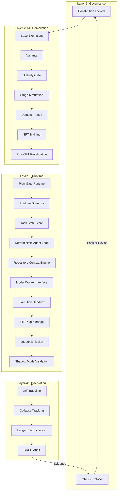

# Layer-2 / Layer-3 / Layer-4 Milestone Roadmap

## Related Documents

- [docs/ARCHITECTURE_4_LAYER.md](ARCHITECTURE_4_LAYER.md) — Directory philosophy, layer boundaries, axis separation
- [docs/COMPILATION_DAG_AND_LINEAGE_V0_1.md](COMPILATION_DAG_AND_LINEAGE_V0_1.md) — Compilation DAG and lineage schemas (Layer-2 provenance)
- [docs/architecture/Golden_Exemplars_Architecture_Map.md](architecture/Golden_Exemplars_Architecture_Map.md) — Golden Exemplars system map

---

## A. Overview

**Entry point:** [MASTER_SYSTEM_SPEC.md](MASTER_SYSTEM_SPEC.md)

This roadmap defines **entry**, **exit**, and **failure** conditions for milestones across Layers 2 (ML Compilation), 3 (Runtime), and 4 (Observation). It does **not** alter phase semantics, dominance rules, exemplar counts, or policy. Constitutional semantics (REF, CONF, DES, MIX, CODE, REACH) and the pipeline stage axis (base → variants → stability → Stage-6 mutation → freeze → SFT) remain as defined in canonical sources.

---

## B. Layer-2 Milestones (ML Compilation)

| Milestone | Entry | Exit | Failure |
|-----------|-------|------|---------|
| **M2.1 Base exemplar completion** | Constitutional lock (Phases 01–05); GREG readiness | All bases mapped; Phase-3 summary PASS; boundary anchors locked | Bases incomplete; validation fails; boundary mismatch |
| **M2.2 Variant stability** | M2.1 complete | Phase-4 variant summary PASS; no softened language; boundary exact | Variants fail stability; phase drift in variant outputs |
| **M2.3 Mutation harness v1** | M2.2 complete | Stage-6A/6B harness runs; ledger populated; taxonomy coverage | Harness crashes; ledger schema invalid; coverage gap |
| **M2.4 Collapse vector validation** | M2.3 complete | Stage-6C agent-loop harness passes; collapse vectors classified; pass rate ≥ threshold | Collapse rate exceeds gate; unclassified collapses; REF fatigue or boundary relocation |
| **M2.5 Deterministic dataset freeze** | M2.4 complete | Freeze checklist passes; dataset compiled; manifest locked | Freeze blocked; phase balance fails; dominance rule coverage gap |
| **M2.6 SFT training** | M2.5 complete | Adapter trained; loss stable; structural invariance audit passes | Training divergence; invariance collapse; overfitting |
| **M2.7 Post-SFT mutation revalidation** | M2.6 complete | Post-SFT ledger vs pre-SFT diff acceptable; no rollback criteria triggered | REF collapse; boundary relocation; MIX→CONF collapse above threshold |

---

## C. Layer-3 Milestones (Runtime)

| Milestone | Entry | Exit | Failure |
|-----------|-------|------|---------|
| **M3.0 Plan-Gate Runtime** | M2.7 complete; frozen adapter | Plan object and decision contracts wired into a running runtime service; IDE/CLI/CI can call it; schemas plan.v0.1 and decision_response.v0.1 enforced | Plan/decision contracts incomplete; gate unreachable or fail-open; schema or rule validation missing |
| **M3.1 Runtime Governor** | M3.0 complete | Central Runtime Governor owns loop control and REF/CONF/CODE routing; all decisions pass governance invariants; no uncontrolled recursion | Any path bypasses governor; REF/CONF routing can be skipped; fail-open behavior under gate failure |
| **M3.2 Task State Store** | M3.1 complete | Deterministic per-task state store in place (task ids, stages, checkpoints); runtime behavior replayable from task state + ledger | Task state incomplete or lossy; behavior not reconstructable; divergence between state store and ledger |
| **M3.3 Deterministic Agent Loop** | M3.2 complete | Runtime-owned propose/evaluate/execute loop implemented; loop termination conditions explicit; no model-controlled recursion or self-triggering | Agent loop can diverge or hang; model can trigger its own calls; termination depends solely on model text ending |
| **M3.4 Repository Context Engine** | M3.3 complete | Runtime-owned context retrieval for repositories/code/RAG; model only sees curated bundles; context is versioned and reproducible | Model can self-fetch context or tools; non-deterministic context; context cannot be tied back to source revision |
| **M3.5 Execution Sandbox** | M3.4 complete | Isolated sandbox executor for tools/tests/commands under runtime control; irreversible actions guarded by authority/boundary checks and ledgered | Irreversible effects can occur outside sandbox or without ledger emission; sandbox not clearly separated from live environments |
| **M3.6 Model Worker Interface** | M3.5 complete | Narrow, versioned interface between runtime and model worker with bounded prompts, budgets, and structured outputs; model cannot mutate task state or environment directly | Model can affect control flow or environment directly; unbounded prompts; ad-hoc free-form responses without contracts |
| **M3.7 IDE Plugin Bridge** | M3.6 complete | IDE plugins route developer actions through Plan-Gate Runtime and Runtime Governor; plugin honors runtime decisions (block/allow/bound) | IDE actions can bypass the governor; inconsistent enforcement between IDE and non-IDE flows |
| **M3.8 Ledger Emission** | M3.7 complete | Ledger_row.v0.1 emitted for every runtime decision; links to plan_hash; end-to-end decisions observable by Layer-4 | Any runtime path executes without a ledger row; missing fields; inability to join runtime behavior to plans |
| **M3.9 Shadow Mode Validation** | M3.8 complete | Full runtime-governed agent loop runs in shadow mode; REF/CONF invariants hold; coverage across key workflows; deviations surfaced for governance review | Shadow mode missing or partial; REF/CONF violations; coverage gaps; no systematic comparison between current and governed behavior |

**M3.7 reference:** [docs/JETBRAINS_PLUGIN_FLOW_V0_1.md](JETBRAINS_PLUGIN_FLOW_V0_1.md) — IDE plan-gate contracts. **M3.0 / M3.8:** CI Backstop Gate (`runtime/ci_gate/`) and Plan-Gate Service (`runtime/plan_gate_service/`) implement the local gate and HTTP endpoint and emit ledger rows. **M3.9 / M4.3:** [docs/SHADOW_MODE_PROTOCOL_V0_1.md](SHADOW_MODE_PROTOCOL_V0_1.md) — shadow mode and ingestion batch. **M4.1 Drift baseline:** [observation/baseline/](../observation/baseline/README.md) — Shadow Baseline Runner.

*Implementation build order and current status use different IDs; see [LIVE_ROADMAP_TRACKER.md](LIVE_ROADMAP_TRACKER.md) §4.3 and §6 (e.g. M3.0 Context Engine, M3.1 Orchestrator, M3.2 Sandbox, M3.3 Plan-Gate Integration, M3.4 IDE Plugin).*

### What Cannot Ship Without REF Enforcement

- Production execution **cannot** ship if REF (refusal under illegitimacy or missing authority) is not enforced at runtime. Authority validator must block action when scope is invalid or authority is missing. No “best-effort” or advisory-only REF.

### Runtime SAFE Definition

- **Runtime is SAFE** when: (1) REF is enforced (no action under illegitimacy); (2) Irreversibility detector blocks at boundaries; (3) Ledger emits phase + boundary + allow/block per run; (4) Phase-05 CODE semantics are honored (fail-closed, ownership checks). Runtime cannot redefine doctrine; it implements it.

---

## D. Layer-4 Milestones (Observation)

| Milestone | Entry | Exit | Failure |
|-----------|-------|------|---------|
| **M4.1 Drift baseline capture** | M3.6 complete; runtime in shadow | Baseline verdict distribution captured; per-phase, per-surface metrics | Baseline incomplete; missing phases |
| **M4.2 Collapse vector live tracking** | M4.1 complete | Collapse vectors tracked in production; drift probes running | Probes fail; tracking gaps |
| **M4.3 Ledger reconciliation dashboard** | M4.2 complete | Pre/post ledgers reconciled; diff visible; anomalies flagged | Reconciliation fails; dashboard incomplete |
| **M4.4 GREG audit automation** | M4.3 complete | GREG-trigger automation runs on drift thresholds; evidence package produced | Automation missing; thresholds wrong |
| **M4.5 Constitutional version lock signal** | M4.4 complete | Lock signal emitted when evidence suffices; no drift above threshold | Signal blocked; evidence insufficient |

### What Constitutes Drift (High Level)

- **Drift** is observed behavior that diverges from constitutional expectation: REF collapses, boundary softening, MIX→CONF collapse, CODE abstraction drift, or phase migration in model output. Measured via verdict distribution, collapse vectors, and ledger diff.

### What Triggers Constitutional Rollback

- REF collapse above threshold; boundary relocation detected; MIX→CONF collapse above threshold; CODE erosion. Rollback = freeze deployment; revert to last approved checkpoint/dataset; do **not** change doctrine.

### What Escalates to Governance Revision (Rare, Last Resort)

- Persistent drift despite dataset/harness fixes; structural evidence that doctrine itself is incomplete or inconsistent. Escalation is **rare**. Only governance (GREG, constitutional manifest) may authorize exemplar or phase changes. Observation **never** authors doctrine.

---

## E. Current Position Snapshot

### Snapshot Table

| Layer | Status |
|-------|--------|
| **Governance** | Locked (Phases 01–05; Phase-06 hardening defined) |
| **Compilation** | Complete / Locked (Stage-6C cure validated; dataset frozen; SFT training and post-SFT revalidation complete; see `docs/LIVE_ROADMAP_TRACKER.md`) |
| **Runtime** | In progress (runtime emulator and state machine contracts implemented; broader runtime stack under active buildout; see `docs/LIVE_ROADMAP_TRACKER.md`) |
| **Observation** | Partial (governance-level drift suite exists; production observation not yet wired) |

### What Is Left

- Runtime Plan/Judge/Authority/Irreversibility implementation (Layer-3)
- Repository Context Engine, Execution Sandbox, Model Worker Interface, IDE/CI integration
- Shadow mode validation and ledger emission wired through the runtime loop
- Observation drift baseline, collapse vector tracking, ledger reconciliation, and GREG automation (Layer-4)

### CONF→DES Issue Closed (Patch-2)

The CONF→DES drift issue is **closed**. Multiple SFT patch attempts did not collapse drift; the cure was **deterministic CONF runtime rendering** in Stage-6C. Result: severity 80 S0, CONF→DES 0, S2/S3 0. Lesson: Some policy phases (REF, CONF) belong in runtime governance, not in unconstrained generation. Stage-6C now enforces CONF as a governed runtime phase.

### Critical Risk Zone

- **Pre-freeze gap:** **Closed for the current Golden Exemplars corpus.** Dataset is frozen and immutable (`FREEZE_CERTIFICATE_v1.json`); any change to bases/variants requires a new freeze.
- **Runtime gap:** No REF enforcement at execution; model could act under illegitimacy.
- **Observation gap:** No production drift baseline; GREG cannot run on live evidence.

### Estimated Sequencing Order

1. M3.0–M3.3 Plan-Gate Runtime, Runtime Governor, Task State Store, Deterministic Agent Loop
2. M3.4–M3.8 Repository Context Engine, Execution Sandbox, Model Worker Interface, IDE Plugin Bridge, Ledger Emission
3. M3.9 Shadow Mode Validation
4. M4.1–M4.5 Observation baseline, tracking, GREG automation

---

## F. Executive Roadmap Visual (Mermaid)

---

*This document is structural only. No doctrine change.*
