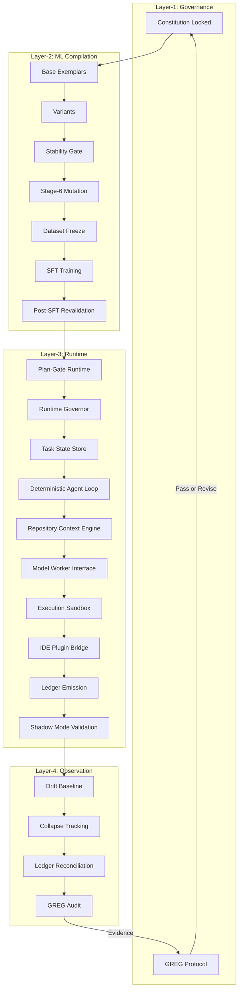

# Layer-2 / Layer-3 / Layer-4 Milestone Roadmap

**Doc status:** canonical-current. Milestone entry/exit/failure conditions are canonical; live status is in [LIVE_ROADMAP_TRACKER.md](LIVE_ROADMAP_TRACKER.md).

## Related Documents

- [docs/ARCHITECTURE_4_LAYER.md](ARCHITECTURE_4_LAYER.md) — Directory philosophy, layer boundaries, axis separation
- [docs/COMPILATION_DAG_AND_LINEAGE_V0_1.md](COMPILATION_DAG_AND_LINEAGE_V0_1.md) — Compilation DAG and lineage schemas (Layer-2 provenance)
- [docs/architecture/Golden_Exemplars_Architecture_Map.md](architecture/Golden_Exemplars_Architecture_Map.md) — Golden Exemplars system map

---

## A. Overview

**Entry point:** [MASTER_SYSTEM_SPEC.md](MASTER_SYSTEM_SPEC.md)

This roadmap defines **entry**, **exit**, and **failure** conditions for milestones across Layers 2 (ML Compilation), 3 (Runtime), and 4 (Observation). It does **not** alter phase semantics, dominance rules, exemplar counts, or policy. Constitutional semantics (REF, CONF, DES, MIX, CODE, REACH) and the pipeline stage axis (base → variants → stability → Stage-6 mutation → freeze → SFT) remain as defined in canonical sources.

---

## B. Layer-2 Milestones (ML Compilation)

| Milestone | Entry | Exit | Failure |
|-----------|-------|------|---------|
| **M2.1 Base exemplar completion** | Constitutional lock (Phases 01–05); GREG readiness | All bases mapped; Phase-3 summary PASS; boundary anchors locked | Bases incomplete; validation fails; boundary mismatch |
| **M2.2 Variant stability** | M2.1 complete | Phase-4 variant summary PASS; no softened language; boundary exact | Variants fail stability; phase drift in variant outputs |
| **M2.3 Mutation harness v1** | M2.2 complete | Stage-6A/6B harness runs; ledger populated; taxonomy coverage | Harness crashes; ledger schema invalid; coverage gap |
| **M2.4 Collapse vector validation** | M2.3 complete | Stage-6C agent-loop harness passes; collapse vectors classified; pass rate ≥ threshold | Collapse rate exceeds gate; unclassified collapses; REF fatigue or boundary relocation |
| **M2.5 Deterministic dataset freeze** | M2.4 complete | Freeze checklist passes; dataset compiled; manifest locked | Freeze blocked; phase balance fails; dominance rule coverage gap |
| **M2.6 SFT training** | M2.5 complete | Adapter trained; loss stable; structural invariance audit passes | Training divergence; invariance collapse; overfitting |
| **M2.7 Post-SFT mutation revalidation** | M2.6 complete | Post-SFT ledger vs pre-SFT diff acceptable; no rollback criteria triggered | REF collapse; boundary relocation; MIX→CONF collapse above threshold |

---

## C. Layer-3 Milestones (Runtime) — Canonical numbering

**Source of truth:** [LIVE_ROADMAP_TRACKER.md](LIVE_ROADMAP_TRACKER.md) §4.3.1. This table uses the same canonical M3.0–M3.18 model.

| Milestone | Entry | Exit | Failure |
|-----------|-------|------|---------|
| **M3.0** Deterministic Runtime Emulator | L2.* | Plan-gate emulator + shadow runner + invariant tests | Emulator incomplete; invariants violated |
| **M3.1** Deterministic Agent State Transition Table | Plan-Gate contract | State enum, terminal states, stop reasons, transition matrix | State/transition spec missing or inconsistent |
| **M3.2** Repository Context Engine | L2.* | Context bundles versioned and reproducible | Non-deterministic context; missing provenance |
| **M3.3** Agent Loop Orchestrator | M3.2, M3.1 | Loop controller; no model-controlled recursion | Bypass path; uncontrolled recursion |
| **M3.4** Execution Sandbox | M3.2–M3.3 | Isolated executor; REFUSED/BLOCKED/EXECUTED; ledger | Execution outside sandbox; no ledger |
| **M3.5** Plan-Gate Integration | M3.2–M3.4 | All paths through Plan-Gate; four postures; decisions ledgered | Bypass; posture missing |
| **M3.6** Internal Plan-Gate Decomposition | M3.5 | AuthorityValidator, IrreversibilityDetector, JudgeGate | External contract changed |
| **M3.7** IDE Plugin Integration | M3.5 | Plugin → Plan-Gate → ledger; /v0/execute | Bypass; no decision ledgering |
| **M3.8** Ledger Emission / Replay | M3.5 | Ledger completeness; replay; join contract | Missing ledger path; no replay |
| **M3.9** Shadow Mode Validation | M3.0–M3.8 | Shadow runner; no boundary crossed; plan and ledger per run | boundary_verdict=crossed; missing plan/ledger |
| **M3.10** Sandbox driver abstraction | M3.4 | Driver interface; pluggable backends | — |
| **M3.11** Container sandbox runtime | M3.10 | Container-based sandbox | — |
| **M3.12** Documentation ingestion | M3.0–M3.9 | Ingest documentation into observation/context | — |
| **M3.13** Jira ingestion | M3.0–M3.9 | Ingest Jira data | — |
| **M3.14** PR ingestion | M3.0–M3.9 | Ingest PR data | — |
| **M3.15** Jira cleaning pipeline | M3.13 | Clean and normalize Jira data | — |
| **M3.16** PR signal extraction | M3.14 | Extract signals from PR data | — |
| **M3.17** Task schema | M3.0–M3.9 | Task representation schema | — |
| **M3.18** Task evaluation harness | M3.17 | Harness for task evaluation | — |

*M3.0–M3.9 are complete on main (tag `layer3-runtime-governed-v1`). M3.10–M3.18 are follow-on. See LIVE_ROADMAP_TRACKER.md §4.3 and §6 for status and evidence.*

### What Cannot Ship Without REF Enforcement

- Production execution **cannot** ship if REF (refusal under illegitimacy or missing authority) is not enforced at runtime. Authority validator must block action when scope is invalid or authority is missing. No “best-effort” or advisory-only REF.

### Runtime SAFE Definition

- **Runtime is SAFE** when: (1) REF is enforced (no action under illegitimacy); (2) Irreversibility detector blocks at boundaries; (3) Ledger emits phase + boundary + allow/block per run; (4) Phase-05 CODE semantics are honored (fail-closed, ownership checks). Runtime cannot redefine doctrine; it implements it.

---

## D. Layer-4 Milestones (Observation)

| Milestone | Entry | Exit | Failure |
|-----------|-------|------|---------|
| **M4.1 Drift baseline capture** | M3.9 complete; runtime in shadow | Baseline verdict distribution captured; per-phase, per-surface metrics | Baseline incomplete; missing phases |
| **M4.2 Collapse vector live tracking** | M4.1 complete | Collapse vectors tracked in production; drift probes running | Probes fail; tracking gaps |
| **M4.3 Ledger reconciliation dashboard** | M4.2 complete | Pre/post ledgers reconciled; diff visible; anomalies flagged | Reconciliation fails; dashboard incomplete |
| **M4.4 GREG audit automation** | M4.3 complete | GREG-trigger automation runs on drift thresholds; evidence package produced | Automation missing; thresholds wrong |
| **M4.5 Constitutional version lock signal** | M4.4 complete | Lock signal emitted when evidence suffices; no drift above threshold | Signal blocked; evidence insufficient |

### What Constitutes Drift (High Level)

- **Drift** is observed behavior that diverges from constitutional expectation: REF collapses, boundary softening, MIX→CONF collapse, CODE abstraction drift, or phase migration in model output. Measured via verdict distribution, collapse vectors, and ledger diff.

### What Triggers Constitutional Rollback

- REF collapse above threshold; boundary relocation detected; MIX→CONF collapse above threshold; CODE erosion. Rollback = freeze deployment; revert to last approved checkpoint/dataset; do **not** change doctrine.

### What Escalates to Governance Revision (Rare, Last Resort)

- Persistent drift despite dataset/harness fixes; structural evidence that doctrine itself is incomplete or inconsistent. Escalation is **rare**. Only governance (GREG, constitutional manifest) may authorize exemplar or phase changes. Observation **never** authors doctrine.

---

## E. Current Position Snapshot

### Snapshot Table

| Layer | Status |
|-------|--------|
| **Governance** | Locked (Phases 01–05; Phase-06 hardening defined) |
| **Compilation** | Complete / Locked (Stage-6C cure validated; dataset frozen; SFT training and post-SFT revalidation complete; see `docs/LIVE_ROADMAP_TRACKER.md`) |
| **Runtime** | **M3.0–M3.9 complete on main** (tag `layer3-runtime-governed-v1`); M3.10–M3.18 follow-on. See `docs/LIVE_ROADMAP_TRACKER.md` §4.3. |
| **Observation** | Partial (governance-level drift suite exists; production observation not yet wired) |

### What Is Left

- Runtime Plan/Judge/Authority/Irreversibility implementation (Layer-3)
- Repository Context Engine, Execution Sandbox, Model Worker Interface, IDE/CI integration
- Shadow mode validation and ledger emission wired through the runtime loop
- Observation drift baseline, collapse vector tracking, ledger reconciliation, and GREG automation (Layer-4)

### CONF→DES Issue Closed (Patch-2)

The CONF→DES drift issue is **closed**. Multiple SFT patch attempts did not collapse drift; the cure was **deterministic CONF runtime rendering** in Stage-6C. Result: severity 80 S0, CONF→DES 0, S2/S3 0. Lesson: Some policy phases (REF, CONF) belong in runtime governance, not in unconstrained generation. Stage-6C now enforces CONF as a governed runtime phase.

### Critical Risk Zone

- **Pre-freeze gap:** **Closed for the current Golden Exemplars corpus.** Dataset is frozen and immutable (`FREEZE_CERTIFICATE_v1.json`); any change to bases/variants requires a new freeze.
- **Runtime gap:** No REF enforcement at execution; model could act under illegitimacy.
- **Observation gap:** No production drift baseline; GREG cannot run on live evidence.

### Estimated Sequencing Order (canonical M3.0–M3.18)

1. M3.0–M3.9 (complete on main; see LIVE_ROADMAP_TRACKER.md)
2. M3.10–M3.18 follow-on (sandbox driver, container, ingestion, task schema, harness)
3. M4.1–M4.5 Observation baseline, tracking, GREG automation

---

## F. Executive Roadmap Visual (Mermaid)

---

*This document is structural only. No doctrine change.*
