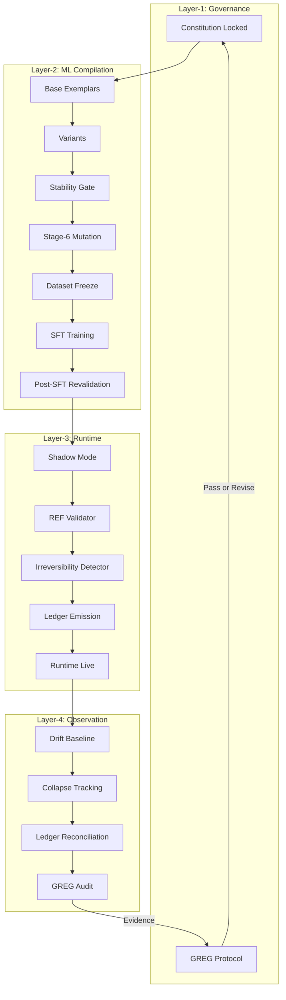

# Layer-2 / Layer-3 / Layer-4 Milestone Roadmap

## Related Documents

- [docs/ARCHITECTURE_4_LAYER.md](ARCHITECTURE_4_LAYER.md) — Directory philosophy, layer boundaries, axis separation
- [docs/architecture/Golden_Exemplars_Architecture_Map.md](architecture/Golden_Exemplars_Architecture_Map.md) — Golden Exemplars system map

---

## A. Overview

This roadmap defines **entry**, **exit**, and **failure** conditions for milestones across Layers 2 (ML Compilation), 3 (Runtime), and 4 (Observation). It does **not** alter phase semantics, dominance rules, exemplar counts, or policy. Constitutional semantics (REF, CONF, DES, MIX, CODE, REACH) and the pipeline stage axis (base → variants → stability → Stage-6 mutation → freeze → SFT) remain as defined in canonical sources.

---

## B. Layer-2 Milestones (ML Compilation)

| Milestone | Entry | Exit | Failure |
|-----------|-------|------|---------|
| **M2.1 Base exemplar completion** | Constitutional lock (Phases 01–05); GREG readiness | All bases mapped; Phase-3 summary PASS; boundary anchors locked | Bases incomplete; validation fails; boundary mismatch |
| **M2.2 Variant stability** | M2.1 complete | Phase-4 variant summary PASS; no softened language; boundary exact | Variants fail stability; phase drift in variant outputs |
| **M2.3 Mutation harness v1** | M2.2 complete | Stage-6A/6B harness runs; ledger populated; taxonomy coverage | Harness crashes; ledger schema invalid; coverage gap |
| **M2.4 Collapse vector validation** | M2.3 complete | Stage-6C agent-loop harness passes; collapse vectors classified; pass rate ≥ threshold | Collapse rate exceeds gate; unclassified collapses; REF fatigue or boundary relocation |
| **M2.5 Deterministic dataset freeze** | M2.4 complete | Freeze checklist passes; dataset compiled; manifest locked | Freeze blocked; phase balance fails; dominance rule coverage gap |
| **M2.6 SFT training** | M2.5 complete | Adapter trained; loss stable; structural invariance audit passes | Training divergence; invariance collapse; overfitting |
| **M2.7 Post-SFT mutation revalidation** | M2.6 complete | Post-SFT ledger vs pre-SFT diff acceptable; no rollback criteria triggered | REF collapse; boundary relocation; MIX→CONF collapse above threshold |

---

## C. Layer-3 Milestones (Runtime)

| Milestone | Entry | Exit | Failure |
|-----------|-------|------|---------|
| **M3.1 Plan object spec** | M2.7 complete; frozen adapter | Plan object schema defined; authority/irreversibility hooks specified | Spec incomplete; hooks undefined |
| **M3.2 Authority validator implementation** | M3.1 complete | Authority checks enforce REF/ownership; no bypass paths | Bypass paths; REF not enforced |
| **M3.3 Irreversibility detector** | M3.2 complete | Irreversibility detector blocks at boundaries; Phase-05 CODE semantics honored | Boundary bypass; detector silent on crossing |
| **M3.4 IDE plugin integration** | M3.3 complete | Plan/Judge/Authority integrated in IDE flow; tool calls gated | Integration incomplete; gates bypassed |
| **M3.5 Runtime ledger emission** | M3.4 complete | Ledger rows emitted per run; phase + boundary + allow/block recorded | No emission; missing fields; inconsistent format |
| **M3.6 Shadow mode validation** | M3.5 complete | Shadow mode runs without user impact; ledger captures behavior; no REF violations | REF violations in shadow; ledger gaps |

### What Cannot Ship Without REF Enforcement

- Production execution **cannot** ship if REF (refusal under illegitimacy or missing authority) is not enforced at runtime. Authority validator must block action when scope is invalid or authority is missing. No “best-effort” or advisory-only REF.

### Runtime SAFE Definition

- **Runtime is SAFE** when: (1) REF is enforced (no action under illegitimacy); (2) Irreversibility detector blocks at boundaries; (3) Ledger emits phase + boundary + allow/block per run; (4) Phase-05 CODE semantics are honored (fail-closed, ownership checks). Runtime cannot redefine doctrine; it implements it.

---

## D. Layer-4 Milestones (Observation)

| Milestone | Entry | Exit | Failure |
|-----------|-------|------|---------|
| **M4.1 Drift baseline capture** | M3.6 complete; runtime in shadow | Baseline verdict distribution captured; per-phase, per-surface metrics | Baseline incomplete; missing phases |
| **M4.2 Collapse vector live tracking** | M4.1 complete | Collapse vectors tracked in production; drift probes running | Probes fail; tracking gaps |
| **M4.3 Ledger reconciliation dashboard** | M4.2 complete | Pre/post ledgers reconciled; diff visible; anomalies flagged | Reconciliation fails; dashboard incomplete |
| **M4.4 GREG audit automation** | M4.3 complete | GREG-trigger automation runs on drift thresholds; evidence package produced | Automation missing; thresholds wrong |
| **M4.5 Constitutional version lock signal** | M4.4 complete | Lock signal emitted when evidence suffices; no drift above threshold | Signal blocked; evidence insufficient |

### What Constitutes Drift (High Level)

- **Drift** is observed behavior that diverges from constitutional expectation: REF collapses, boundary softening, MIX→CONF collapse, CODE abstraction drift, or phase migration in model output. Measured via verdict distribution, collapse vectors, and ledger diff.

### What Triggers Constitutional Rollback

- REF collapse above threshold; boundary relocation detected; MIX→CONF collapse above threshold; CODE erosion. Rollback = freeze deployment; revert to last approved checkpoint/dataset; do **not** change doctrine.

### What Escalates to Governance Revision (Rare, Last Resort)

- Persistent drift despite dataset/harness fixes; structural evidence that doctrine itself is incomplete or inconsistent. Escalation is **rare**. Only governance (GREG, constitutional manifest) may authorize exemplar or phase changes. Observation **never** authors doctrine.

---

## E. Current Position Snapshot

### Snapshot Table

| Layer | Status |
|-------|--------|
| **Governance** | Locked (Phases 01–05; Phase-06 hardening defined) |
| **Compilation** | Pre-freeze (bases mapped; variants in progress; Stage-6 harness built; not yet frozen) |
| **Runtime** | Architected, not implemented |
| **Observation** | Governance-level only (drift suite exists; production observation not yet wired) |

### What Is Left

- Stage-6 mutation harness full validation and pass-rate gates
- Deterministic dataset freeze and manifest lock
- SFT training (Stage-8) and post-SFT revalidation
- Runtime Plan/Judge/Authority/Irreversibility implementation
- Shadow mode and ledger emission
- Observation drift baseline and GREG automation

### Critical Risk Zone

- **Pre-freeze gap:** Dataset not yet frozen; any change to bases/variants invalidates downstream. Mutation harness must pass before freeze.
- **Runtime gap:** No REF enforcement at execution; model could act under illegitimacy.
- **Observation gap:** No production drift baseline; GREG cannot run on live evidence.

### Estimated Sequencing Order

1. M2.4 Collapse vector validation (Stage-6C pass)
2. M2.5 Deterministic dataset freeze
3. M2.6 SFT training
4. M2.7 Post-SFT mutation revalidation
5. M3.1 Plan object spec
6. M3.2–M3.6 Runtime implementation and shadow mode
7. M4.1–M4.5 Observation baseline, tracking, GREG automation

---

## F. Executive Roadmap Visual (Mermaid)

---

*This document is structural only. No doctrine change.*
