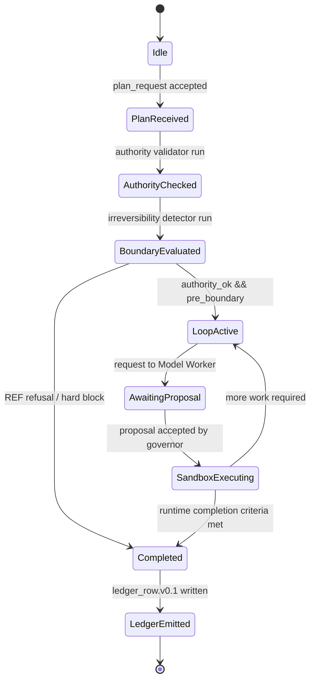

## Runtime Agent Architecture — Runtime-Governed Agent Loop

This document describes the **runtime-governed agent architecture** for Layer-3. It does not change phase semantics, dominance rules, or boundary doctrine; it explains how the runtime enforces the existing constitution in a deterministic agent loop.

The core principle is simple: **the model proposes, the runtime decides.** The runtime owns control flow, state transitions, authority and boundary enforcement, and completion criteria. The model is a bounded worker that produces structured proposals over runtime-owned context.

---

## Overview

- **Runtime-governed phases:** REF and CONF remain governed runtime phases as defined in governance; the Runtime Governor encodes their enforcement (refusal dominance, conditional allowance up to boundaries, fail-closed behavior).
- **Model-expressive phases under orchestration:** DES and CODE remain model-expressive, but all DES/CODE behavior flows through runtime-owned contracts (plans, decisions, ledger) and never bypasses authority or boundary checks.
- **Deterministic loop:** A deterministic state machine drives the agent loop, so that behavior can be reconstructed from task state and ledger rows.
- **Bounded model worker:** The model operates behind a narrow Model Worker Interface; it never executes tools, mutates repositories, or commits irreversible actions directly.

---

## Deterministic Runtime State Machine

Layer-3 is implemented as a deterministic state machine that drives the agent loop. States and transitions are runtime-owned; the model cannot introduce new states or transitions.

Example high-level state machine:

Properties:

- **Deterministic transitions:** Given the same plan, authority/boundary results, model proposals, and sandbox outcomes, the state machine must follow the same path.
- **REF dominance:** If authority fails or illegitimacy is detected, transitions short-circuit to REF refusal and `Completed` with `terminal_posture=refuse`; downstream states cannot override this.
- **No model-controlled recursion:** The model can request additional steps only through structured outputs; the Runtime Governor decides whether to loop or terminate.

---

## Runtime-Owned Context Retrieval (Repository Context Engine)

The **Repository Context Engine** owns all interactions with the codebase and external knowledge sources. Its responsibilities include:

- Building stable, versioned views of repositories (paths, diffs, symbols, tests) for a given request.
- Running RAG/index queries and packaging results into structured context bundles.
- Ensuring that every context bundle used in the agent loop is tied to a concrete revision and can be reconstructed later.

The model never directly issues file system, VCS, or RAG calls. Instead:

- The Runtime Governor determines which context bundles are needed for the next loop step.
- The Repository Context Engine prepares those bundles.
- The Model Worker receives only the curated bundle as part of its prompt payload.

This keeps context **deterministic, replayable, and auditable** for Layer-4.

---

## Bounded Model Worker (Model Worker Interface)

The **Model Worker Interface** defines the only way the runtime talks to the model. It is a narrow, versioned contract:

- **Inputs:**
  - Constitutional pins (read-only references such as phase expectations, boundary descriptions).
  - Task metadata (task id, high-level goal, current loop state).
  - Context bundle from the Repository Context Engine (files, diffs, tests, diagnostics).
  - Budget parameters (token limit, maximum steps, timeouts).
- **Outputs:**
  - Structured proposals in schema-constrained form (for example: plan steps, code edits, test suggestions, or evaluation judgments).
  - Optional explanations or justifications as text fields, but never imperative commands to execute tools directly.

Invariants:

- The model **cannot** mutate task state or environment directly.
- The model **cannot** decide completion; it can only recommend that a task might be done.
- All outputs must be machine-validated by the runtime before they affect state or trigger sandbox execution.

---

## Execution Sandbox

The **Execution Sandbox** is the only place where tools, tests, and code can run with side effects:

- All executions (test runs, build commands, code formatters, analyzers) are invoked by the Runtime Governor through sandbox interfaces.
- Sandboxed actions are associated with:
  - The current task and loop state.
  - The plan and decision that authorized them.
  - Any relevant authority/boundary context.

Irreversible or high-risk actions must:

- Be classified by the irreversibility detector as crossing or approaching a boundary.
- Pass authority checks before execution.
- Be recorded via ledger_row.v0.1, including boundary phrase and plan_hash linkage.

Sandbox properties:

- Isolated from production environments except through governed, logged channels.
- Configured so that failures are fail-closed for governance (for example, failure to obtain boundary classification blocks execution).

---

## Task State Persistence (Task State Store)

The **Task State Store** is the persistent record of the agent loop for each task:

- Tracks:
  - Task identifier and metadata.
  - Current finite-state-machine state (Idle, PlanReceived, AuthorityChecked, etc.).
  - History of model proposals and which ones the runtime accepted or rejected.
  - Sandbox executions and their outcomes.
  - Final runtime decision and associated ledger event ids.
- Must be:
  - **Deterministic:** Given the same sequence of decisions, the same state is reached.
  - **Reconstructable:** Combined with the ledger, it allows auditors to replay how the runtime reached a decision.
  - **Aligned with contracts:** States must be compatible with plan.v0.1, decision_response.v0.1, and ledger_row.v0.1.

The Task State Store is the backbone that turns the agent from a loose collection of calls into a **governed state machine**.

---

## Runtime-Governed Agent Loop Summary

Putting it together:

- The **Runtime Governor** drives a deterministic state machine over tasks, calling the **Repository Context Engine**, **Model Worker**, and **Execution Sandbox** as needed.
- The **Task State Store** and **ledger_row.v0.1** records ensure that every loop step is traceable and replayable under governance.
- The **Model Worker Interface** keeps the model bounded: it proposes; the runtime decides.
- This architecture ensures that Layer-3 **implements** constitutional doctrine for REF/CONF/DES/MIX/CODE at runtime without redefining it.

