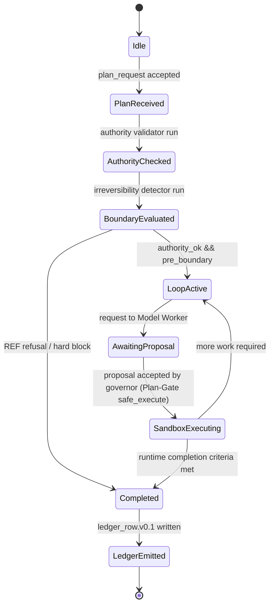

## Runtime Agent Architecture — Runtime-Governed Agent Loop

This document describes the **runtime-governed agent architecture** for Layer-3. It does not change phase semantics, dominance rules, or boundary doctrine; it explains how the runtime enforces the existing constitution in a deterministic agent loop.

The core principle is simple: **the model proposes, the runtime decides.** The runtime owns control flow, state transitions, authority and boundary enforcement, and completion criteria. The model is a bounded worker that produces structured proposals over runtime-owned context.

---

## Overview

- **Runtime-governed phases:** REF and CONF remain governed runtime phases as defined in governance; the Runtime Governor encodes their enforcement (refusal dominance, conditional allowance up to boundaries, fail-closed behavior).
- **Model-expressive phases under orchestration:** DES and CODE remain model-expressive, but all DES/CODE behavior flows through runtime-owned contracts (plans, decisions, ledger) and never bypasses authority or boundary checks.
- **Deterministic loop:** A deterministic state machine drives the agent loop, so that behavior can be reconstructed from task state and ledger rows.
- **Bounded model worker:** The model operates behind a narrow Model Worker Interface; it never executes tools, mutates repositories, or commits irreversible actions directly.

---

## Deterministic Runtime State Machine (Conceptual View)

Layer-3 is implemented as a deterministic state machine that drives the agent loop. States and transitions are runtime-owned; the model cannot introduce new states or transitions.

Canonical state and transition definitions live in `docs/RUNTIME/RUNTIME_STATE_TRANSITIONS.md` and the schemas `runtime/state/schemas/state_enums.v0.1.json` and `runtime/state/schemas/transition_matrix.v0.1.json`. The diagram below is illustrative only; if there is any discrepancy, the canonical spec and schemas win.

Example high-level state machine:



Properties:

- **Deterministic transitions:** Given the same plan, authority/boundary results, model proposals, and sandbox outcomes, the state machine must follow the same path.
- **REF dominance:** If authority fails or illegitimacy is detected, transitions short-circuit to REF refusal and `Completed` with `terminal_posture=refuse`; downstream states cannot override this.
- **No model-controlled recursion:** The model can request additional steps only through structured outputs; the Runtime Governor decides whether to loop or terminate.

---

## Runtime-Owned Context Retrieval (Repository Context Engine)

The **Repository Context Engine** owns all interactions with the codebase and external knowledge sources. Its responsibilities include:

- Building stable, versioned views of repositories (paths, diffs, symbols, tests) for a given request.
- Running RAG/index queries and packaging results into structured context bundles.
- Ensuring that every context bundle used in the agent loop is tied to a concrete revision and can be reconstructed later.

The model never directly issues file system, VCS, or RAG calls. Instead:

- The Runtime Governor determines which context bundles are needed for the next loop step.
- The Repository Context Engine prepares those bundles.
- The Model Worker receives only the curated bundle as part of its prompt payload.

This keeps context **deterministic, replayable, and auditable** for Layer-4.

---

## Bounded Model Worker (Model Worker Interface)

The **Model Worker Interface** defines the only way the runtime talks to the model. It is a narrow, versioned contract:

- **Inputs:**
  - Constitutional pins (read-only references such as phase expectations, boundary descriptions).
  - Task metadata (task id, high-level goal, current loop state).
  - Context bundle from the Repository Context Engine (files, diffs, tests, diagnostics).
  - Budget parameters (token limit, maximum steps, timeouts).
- **Outputs:**
  - Structured proposals in schema-constrained form (for example: plan steps, code edits, test suggestions, or evaluation judgments).
  - Optional explanations or justifications as text fields, but never imperative commands to execute tools directly.

Invariants:

- The model **cannot** mutate task state or environment directly.
- The model **cannot** decide completion; it can only recommend that a task might be done.
- All outputs must be machine-validated by the runtime before they affect state or trigger sandbox execution.

---

## Plan-Gate (M3.3)

The **Plan-Gate** is the mandatory pre-sandbox decision gate. No execution path may bypass it. The execution chain is:

```
request → Plan-Gate → runtime decision → LoopController transition → sandbox (if allowed) → ledger evidence
```

### Postures

Plan-Gate determines the runtime posture for each request:

- **refuse** — Governance/runtime denies before sandbox; sandbox must not run; refusal ledger row persisted.
- **defer** — Request deferred; transition returns `valid=False`, `stop_reason="deferred"`; plangate_deferred persisted; sandbox does not run.
- **bounded_allow** — First-class Plan-Gate posture: governed, non-sandbox, bounded-safe outcome; transition returns `valid=False`, `stop_reason="bounded_allow"`; plangate_bounded_allow persisted; sandbox does not run. Distinct from defer; reserved for future CONF-phase bounded execution semantics. In MVP, no dedicated bounded sandbox profile yet — richer bounded execution (e.g. read-only, test-only) is future work.
- **safe_execute** — Request allowed; transition to sandbox proceeds; plangate_safe_execute persisted, then sandbox runs.

Only **safe_execute** may reach the Execution Sandbox.

### Governance Alignment

- **DES** → reasoning only.
- **CONF** → bounded safe action.
- **CODE** → execution via sandbox only, and only after Plan-Gate returns safe_execute.

### Implementation

- **PlanGateDecision** (`runtime/plangate/plangate_decision.py`): posture, authority_ok, boundary_detected, irreversible, reason.
- **PlanGateService** (`runtime/plangate/plangate_service.py`): `evaluate(request)` → PlanGateDecision; deterministic rule-based (no LLM).
- **LoopController**: Before `validated_to_sandbox`, calls `PlanGateService.evaluate()`; refuses if Plan-Gate not configured; persists plangate_* and (when applicable) sandbox_* ledger rows.
- **Ledger**: Event types `plangate_refused`, `plangate_deferred`, `plangate_bounded_allow`, `plangate_safe_execute`; linkage to sandbox rows via `request_id`.

**Future follow-up:** `bounded_allow` may later map to a restricted sandbox profile (e.g. read-only inspection, test-only execution, limited command set); that is explicitly out of scope for the current M3.3 scope.

---

## Execution Sandbox (CODE Phase)

The **Execution Sandbox** (M3.2) is the **CODE phase** of the constitutional runtime. It is the only place where tools, tests, and code can run with side effects:

```
DES → propose
CONF → authorize
CODE → execute (sandboxed)
```

Execution must **never happen outside the sandbox**.

### Sandbox Architecture

The sandbox is implemented as a local deterministic runner with strict guardrails:

- **SandboxRunner**: Executes commands in isolated working directories using subprocess with `shell=False`
- **SandboxPolicy**: Defines allowed commands, time limits, and environment restrictions
- **SandboxResult**: Captures stdout/stderr, exit codes, artifacts, and execution time
- **SandboxLedgerEmitter**: Emits ledger entries for every execution

All executions (test runs, build commands, code formatters, analyzers) are invoked by the Runtime Governor through sandbox interfaces:

```python
from runtime.sandbox import execute_sandbox_action

result = execute_sandbox_action(
    task_id="task-123",
    command=["pytest", "tests/"],
    working_dir=Path("/repo"),
)
```

### Sandbox Constraints

Sandboxed actions are associated with:

- The current task and loop state.
- The plan and decision that authorized them.
- Any relevant authority/boundary context.

The sandbox enforces:

- **Command allowlist**: Only pre-approved commands can execute (pytest, python, ruff, black, mypy, etc.)
- **Timeout limits**: Maximum execution time enforced (default 30s)
- **Environment filtering**: Secrets and sensitive env vars are stripped
- **Output capture**: stdout/stderr captured with size limits
- **Artifact tracking**: New files created during execution are recorded

### Irreversible Actions

Irreversible or high-risk actions must:

- Be classified by the irreversibility detector as crossing or approaching a boundary.
- Pass authority checks before execution.
- Be recorded via ledger_row.v0.1, including boundary phrase and plan_hash linkage.

### Fail-Closed Behavior

Sandbox properties are fail-closed:

- **Policy violations** raise `SandboxPolicyViolation` before execution starts
- **Timeouts** raise `SandboxTimeout` and kill the process
- **Execution errors** raise `SandboxExecutionError` with original error preserved
- Missing boundary classification blocks execution

### Ledger Integration

Every sandbox execution emits a ledger entry:

```json
{
  "schema_version": "sandbox_execution.v0.1",
  "event": {
    "event_id": "sbx-abc123...",
    "event_type": "sandbox_execution",
    "timestamp_utc": "2026-03-11T12:00:00Z",
    "task_id": "task-123"
  },
  "execution": {
    "command": ["pytest", "tests/"],
    "exit_code": 0,
    "execution_time_ms": 4231,
    "success": true,
    "artifact_count": 2
  },
  "policy": {
    "policy_name": "default"
  }
}
```

### Orchestrator Integration

The sandbox integrates with the **Agent Loop Orchestrator** via state transitions:

```
CONF_APPROVED
     ↓
CODE_EXECUTION (via SandboxExecutor)
     ↓
SANDBOX_RESULT
```

The orchestrator calls `execute_sandbox_action()` after CONF approval:

```python
executor = SandboxExecutor()
action = SandboxAction(
    task_id=task_id,
    command=["pytest", "tests/"],
    working_dir=working_dir,
)
result = executor.execute_sandbox_action(action)
```

Results are recorded in both the task state and ledger for deterministic replay.

---

## Task State Persistence (Task State Store)

The **Task State Store** is the persistent record of the agent loop for each task:

- Tracks:
  - Task identifier and metadata.
  - Current finite-state-machine state (Idle, PlanReceived, AuthorityChecked, etc.).
  - History of model proposals and which ones the runtime accepted or rejected.
  - Sandbox executions and their outcomes.
  - Final runtime decision and associated ledger event ids.
- Must be:
  - **Deterministic:** Given the same sequence of decisions, the same state is reached.
  - **Reconstructable:** Combined with the ledger, it allows auditors to replay how the runtime reached a decision.
  - **Aligned with contracts:** States must be compatible with plan.v0.1, decision_response.v0.1, and ledger_row.v0.1.

The Task State Store is the backbone that turns the agent from a loose collection of calls into a **governed state machine**.

---

## M3.2 Constitutional Audit Note

**What M3.2 now proves**

- **REFUSED**: Governance/runtime denies before sandbox; sandbox is not launched; a refusal ledger row is persisted (LoopController + SandboxLedgerStore).
- **BLOCKED**: Request reaches sandbox path; policy disallows command/path; command does not execute; a blocked ledger row is persisted.
- **EXECUTED**: Request is allowed; command runs inside sandbox; artifacts captured; an execution ledger row is persisted.

**Mapping to governance-first runtime**

- REFUSED = runtime/orchestrator refusal (e.g. no executor, invalid guard_inputs); first-class outcome with ledger evidence.
- BLOCKED = sandbox policy enforcement; distinct from refusal; evidence in same local store.
- EXECUTED = CODE phase under runtime control; no bypass path.

**Out of scope for MVP**

- Production-grade container isolation; full M3.5 ledger/replay/observation bridge; IDE plugin-first demo (plugin follows CLI).

**Why CLI-first demo**

- Canonical demo starts from runtime CLI and/or test harness so that governed correctness (quality, accuracy, reliability) is proven in the runtime layer before layering plugin UX. Plugin-first would risk hiding gaps behind UI; CLI-first keeps evidence and linkage explicit.

---

## Runtime-Governed Agent Loop Summary

Putting it together:

- The **Runtime Governor** drives a deterministic state machine over tasks, calling the **Repository Context Engine**, **Model Worker**, and **Execution Sandbox** as needed.
- The **Task State Store** and **ledger_row.v0.1** records ensure that every loop step is traceable and replayable under governance.
- The **Model Worker Interface** keeps the model bounded: it proposes; the runtime decides.
- This architecture ensures that Layer-3 **implements** constitutional doctrine for REF/CONF/DES/MIX/CODE at runtime without redefining it.

