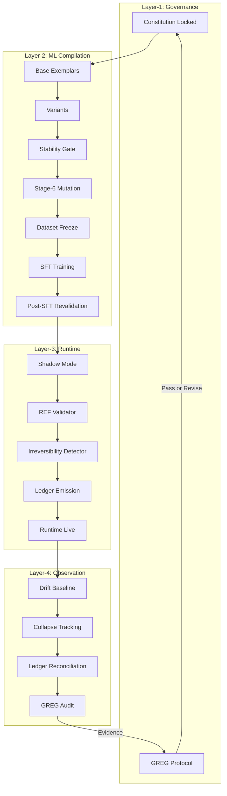

# System Execution Roadmap — End-to-End Flow and Live Progress Tracker

**Entry point:** [MASTER_SYSTEM_SPEC.md](MASTER_SYSTEM_SPEC.md)

---

## A. End-to-End Flow

**Artifact exchange:** Layer-1 provides doctrine and exemplars. Layer-2 consumes doctrine, produces freeze manifest and SFT checkpoint. Layer-3 consumes checkpoint, emits ledger. Layer-4 consumes ledger and baseline, produces drift evidence for GREG.

---

## B. Milestone Table

| Milestone | Layer | Entry | Exit | Failure | Status | Owner | Evidence |
|-----------|-------|-------|------|---------|--------|-------|----------|
| M2.1 Base exemplar completion | L2 | Constitutional lock; GREG readiness | All bases mapped; Phase-3 summary PASS; boundary anchors locked | Bases incomplete; validation fails; boundary mismatch | LOCKED | L2 / Governance | `docs/LIVE_ROADMAP_TRACKER.md` §4.2.1 (S1–S3 complete); `motadata-coder-a-complete-guide_v1.7.md` §10.2 |
| M2.2 Variant stability | L2 | M2.1 complete | Phase-4 variant summary PASS; no softened language; boundary exact | Variants fail stability; phase drift | LOCKED | L2 / Compilation | `docs/LIVE_ROADMAP_TRACKER.md` §4.2.1; variant stability gate evidence |
| M2.3 Mutation harness v1 | L2 | M2.2 complete | Stage-6A/6B harness runs; ledger populated; taxonomy coverage | Harness crashes; ledger schema invalid; coverage gap | LOCKED | L2 / Compilation | `docs/LIVE_ROADMAP_TRACKER.md` §4.2.2 (Stage-6 mutation taxonomy); Stage-6A/6B harness artifacts |
| M2.4 Collapse vector validation | L2 | M2.3 complete | Stage-6C agent-loop harness passes; collapse vectors classified; pass rate ≥ threshold | Collapse rate exceeds gate; unclassified collapses | LOCKED | L2 / Compilation | `docs/LIVE_ROADMAP_TRACKER.md` §4.2.2 and §6.1; `ml/artifacts/LAYER2_RELEASE_VERIFICATION.json` (`conf_to_des = 0`) |
| M2.5 Deterministic dataset freeze | L2 | M2.4 complete | Freeze checklist passes; dataset compiled; manifest locked | Freeze blocked; phase balance fails; dominance coverage gap | LOCKED | L2 / Compilation | `docs/LIVE_ROADMAP_TRACKER.md` §6.1; `ml/training/FREEZE_CERTIFICATE_v1.json` (Stage-7 compiler output) |
| M2.6 SFT training | L2 | M2.5 complete | Adapter trained; loss stable; structural invariance audit passes | Training divergence; invariance collapse | LOCKED | L2 / Compilation | `docs/LIVE_ROADMAP_TRACKER.md` §4.2.2 and §6.1; `ml/artifacts/LAYER2_RELEASE_VERIFICATION.json` |
| M2.7 Post-SFT mutation revalidation | L2 | M2.6 complete | Post-SFT ledger vs pre-SFT diff acceptable; no rollback criteria | REF collapse; boundary relocation; MIX-to-CONF collapse | LOCKED | L2 / Compilation | `docs/LIVE_ROADMAP_TRACKER.md` §4.2.2 and §6.1 (Layer-2 release verification PASS) |
| *Layer-3 (Runtime)* | L3 | — | — | — | — | — | **Layer-3 M3.0–M3.9 complete on main** (tag `layer3-runtime-governed-v1`). Canonical numbering M3.0–M3.18. See [LIVE_ROADMAP_TRACKER.md](LIVE_ROADMAP_TRACKER.md) §4.3.1, §6. |
| M4.1 Drift baseline capture | L4 | M3.9 complete | Baseline verdict distribution captured; per-phase, per-surface metrics | Baseline incomplete; missing phases | NOT STARTED | L4 / Observation | — |
| M4.2 Collapse vector live tracking | L4 | M4.1 complete | Collapse vectors tracked in production; probes running | Probes fail; tracking gaps | NOT STARTED | L4 / Observation | — |
| M4.3 Ledger reconciliation dashboard | L4 | M4.2 complete | Pre/post ledgers reconciled; diff visible; anomalies flagged | Reconciliation fails | NOT STARTED | L4 / Observation | — |
| M4.4 GREG audit automation | L4 | M4.3 complete | GREG-trigger automation on drift thresholds; evidence package produced | Automation missing; thresholds wrong | NOT STARTED | L4 / Observation | — |
| M4.5 Constitutional version lock signal | L4 | M4.4 complete | Lock signal emitted when evidence suffices; no drift above threshold | Signal blocked; evidence insufficient | NOT STARTED | L4 / Observation | — |

---

## C. Artifact Matrix

| Artifact | Produced By | Consumed By | Version Pinned | Immutable After |
|----------|-------------|-------------|----------------|-----------------|
| Constitutional manifest | L1 | All layers | GREG ratification | Ratification |
| Golden exemplars | L1 | L2 | GREG lock | Lock |
| Base exemplars | L2 | L2 (variants) | Stage-3 | Freeze |
| Variants | L2 | L2 (mutation) | Stage-4 | Freeze |
| Mutation ledger | L2 | L2 (freeze), L4 | Stage-6C | Ledger final |
| Freeze manifest | L2 | L2 (SFT), L3, L4 | Stage-7 | Freeze |
| SFT checkpoint | L2 | L3 | Stage-8 | Runtime lock |
| Plan object | L3 | L3, L4 | v0.1 | Per request |
| Ledger row | L3 | L4 | v0.1 | Append-only |
| Drift report | L4 | GREG | Per run | — |
| Evidence package | L4 | GREG | Per threshold | — |

---

## D. Critical Risk Zones

- **Pre-freeze gap:** **Closed for the Golden Exemplars corpus.** Dataset is frozen and immutable (`FREEZE_CERTIFICATE_v1.json`); any change to bases/variants requires a new freeze.
- **Post-SFT invariance risk:** Training may introduce phase drift, boundary softening, or REF collapse. Post-SFT revalidation is mandatory (covered by `LAYER2_RELEASE_VERIFICATION.json` for the current adapter).
- **Runtime bypass risk:** No REF enforcement at execution; model could act under illegitimacy. Production cannot ship without REF enforcement.
- **Drift detection blind spots:** No production drift baseline; GREG cannot run on live evidence until M4.1 complete.

---

## E. Live Progress Tracker

| Layer | Milestone | Status | % Complete | Evidence Link | Blockers | Next Action |
|-------|-----------|--------|------------|---------------|----------|-------------|
| L1 | Governance lock | COMPLETE / LOCKED | 100 | GREG ratification; `governance/CONSTITUTIONAL_MANIFEST_v1.0.md` | — | — |
| L2 | M2.1–M2.7 Layer-2 ML Compilation | COMPLETE / LOCKED | 100 | `docs/LIVE_ROADMAP_TRACKER.md` §4.2.1, §4.2.2, §6.1; `ml/artifacts/LAYER2_RELEASE_VERIFICATION.json`; `ml/training/FREEZE_CERTIFICATE_v1.json` | — | Hand-off to Layer-3 runtime implementation |
| L3 | Layer-3 M3.0–M3.18 (canonical) | COMPLETE (M3.0–M3.9) | — | **M3.0–M3.9 complete on main** (tag `layer3-runtime-governed-v1`). M3.10–M3.18 follow-on. See [LIVE_ROADMAP_TRACKER.md](LIVE_ROADMAP_TRACKER.md) §4.3.1, §6. | — | — |
| L4 | M4.1–M4.5 Observation | NOT STARTED | 0 | — | Depends on M3.9 | Implement ledger ingestion, drift baseline, collapse tracking, reconciliation, and GREG automation |

**Status key:** Not Started | In Progress | Complete | Blocked

---

## Definition of Constitutional Completion

**Constitutional completion** is the exact state at which:

1. **Layer-2 is formally closed:** Freeze manifest locked; SFT training complete; post-SFT revalidation passed; no rollback criteria triggered; adapter and dataset immutable.

2. **Layer-3 is SAFE:** REF enforced; irreversibility detector blocks at boundaries; ledger emits phase + boundary + allow/block per run; Phase-05 CODE semantics honored; shadow mode validated; no bypass paths.

3. **Layer-4 immune system active:** Drift baseline captured; collapse vectors tracked in production; ledger reconciliation operational; GREG-trigger automation runs on thresholds; lock signal emitted when evidence suffices.

4. **System eligible for production lock:** All milestones M2.1–M2.7, Layer-3 per [LIVE_ROADMAP_TRACKER.md](LIVE_ROADMAP_TRACKER.md) §4.3 and §6, M4.1–M4.5 complete; GREG has admissible evidence; no drift above threshold; constitutional version lock signal emitted.

At constitutional completion, the system may proceed to production deployment with continuous drift monitoring and GREG-triggered governance review on threshold violation.
