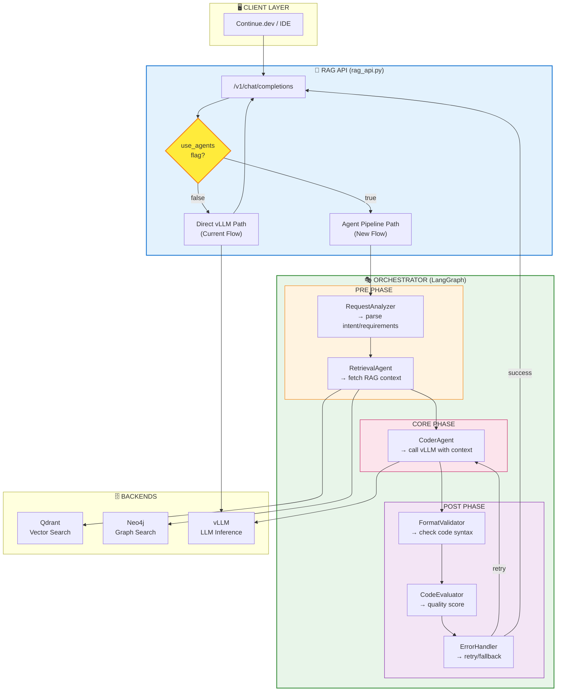
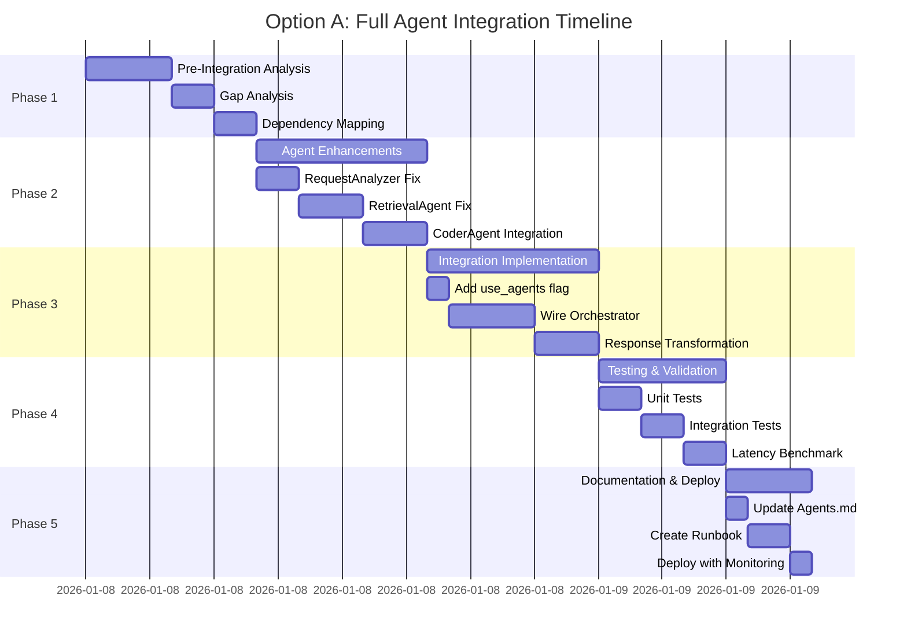

# Option A: Full Agent Integration - Precision Implementation Plan

## Executive Summary

| Metric | Value |
|--------|-------|
| **Expected Latency Impact** | +200-500ms per request |
| **Benefit** | Higher quality, validated code with retry logic |
| **Risk Level** | Medium (mitigated by feature flag) |
| **Estimated Effort** | ~30 developer hours |
| **Rollback Strategy** | `use_agents=false` (instant) |

---

## Current State Analysis

### Current Flow (Direct vLLM)
```
RAG API  ──────────────────────────►  vLLM  ──────►  Response
           (no agents in between)            (no quality check)
```

### Target State (Agent Pipeline)
```
RAG API  ──►  Orchestrator  ──►  [PRE]  ──►  [CORE]  ──►  [POST]  ──►  Response
                                  │           │           │
                                  ▼           ▼           ▼
                              Analyzer    CoderAgent   Validator
                              Retrieval               Evaluator
                                                     ErrorHandler
```

### Critical Gaps

| Agent | Gap | Impact | Fix Required |
|-------|-----|--------|--------------|
| **RetrievalAgent** | Uses separate RAG endpoint, duplicates rag_api.py logic | Redundant calls, inconsistent context | Refactor to use internal hybrid search |
| **CoderAgent** | Calls vLLM directly at `localhost:8000` | Bypasses rag_api.py prompt engineering | Share system prompt building logic |
| **RequestAnalyzer** | Dummy implementation, returns hardcoded values | No real intent detection | Wire to rag_api.py's `_detect_request_intent()` |
| **FormatValidator** | Basic regex only | Misses Java AST validation | Add tree-sitter or basic syntax check |

---

## Architecture Diagrams

### Target Architecture


### Implementation Timeline


---

## Phase 1: Pre-Integration Analysis

### 1.1 Dependency Map

```python
# Required imports in rag_api.py
from orchestrator.langgraph_orchestrator import Orchestrator

# Shared utilities needed
- _detect_request_intent()      # Already exists (line 1248)
- _build_system_prompt()        # Refactor from lines 1252-1310
- _perform_hybrid_search()      # Already exists (hybrid search logic)
- HybridResult dataclass        # Already exists (line 130+)
```

---

## Phase 2: Agent Enhancements

### 2.1 RequestAnalyzer Fix

**File**: `rag/src/orchestrator/agents/request_analyzer.py`

```python
# CHANGE: Import intent detection from rag_api.py
from api.rag_api import _detect_request_intent, _extract_requirements

async def run(self, state: dict) -> dict:
    user_request = state.get("user_request", "")
    intent = _detect_request_intent(user_request)  # Reuse existing logic
    requirements = _extract_requirements(user_request)  # New utility
    ...
```

### 2.2 RetrievalAgent Fix

**File**: `rag/src/orchestrator/agents/retrieval_agent.py`

```python
# CHANGE: Instead of calling RAG API via HTTP, call internal function
# Before (redundant HTTP call):
async with httpx.AsyncClient() as client:
    response = await client.post("http://localhost:8081/v1/query", ...)

# After (direct internal call):
from api.rag_api import perform_hybrid_search_internal
results = await perform_hybrid_search_internal(query, top_k=3)
```

### 2.3 CoderAgent Integration

**File**: `rag/src/orchestrator/agents/coder_agent.py`

```python
# CHANGE: Use shared prompt building
from api.rag_api import _build_code_generation_prompt

async def run(self, state: dict) -> dict:
    # Get retrieval context from previous agent
    retrieval_results = state.get("retrieval_results", {})
    user_request = state.get("user_request", "")
    
    # Build prompt using shared logic (same as rag_api.py)
    messages = _build_code_generation_prompt(user_request, retrieval_results)
    
    # Call vLLM
    code = await self._call_vllm(messages)
    ...
```

---

## Phase 3: Integration Implementation

### 3.1 Add Feature Flag to Request Model

**File**: `rag/src/api/rag_api.py` (Line 174-186)

```python
class ChatCompletionRequest(BaseModel):
    # ... existing fields ...
    use_agents: bool = Field(
        default=False,  # OFF by default - opt-in only
        description="Enable agentic pipeline (higher quality, +200-500ms latency)"
    )
```

### 3.2 Wire Orchestrator into Chat Completions Endpoint

**File**: `rag/src/api/rag_api.py` (Around line 1550)

```python
if request.use_agents:
    # ========== AGENTIC PATH ==========
    from orchestrator.langgraph_orchestrator import Orchestrator
    
    orchestrator = Orchestrator()
    
    # Transform request to orchestrator format
    result = await orchestrator.process_request(
        user_request=user_query,
        conversation_history=[
            {"role": m.role, "content": m.content} 
            for m in request.messages
        ],
        codebase_context={
            "workspace_root": request.workspace_root,
            "open_files": request.open_files,
            "rag_results": hybrid_results if request.use_rag else []
        }
    )
    
    # Transform orchestrator output to OpenAI format
    return _transform_orchestrator_response(result, request)

else:
    # ========== DIRECT PATH (Current Flow) ==========
    # ... existing direct vLLM call logic ...
```

### 3.3 Response Transformation

```python
def _transform_orchestrator_response(
    orchestrator_result: dict, 
    request: ChatCompletionRequest
) -> ChatCompletionResponse:
    """Transform orchestrator output to OpenAI-compatible format"""
    
    return ChatCompletionResponse(
        id=f"chatcmpl-{uuid.uuid4().hex[:8]}",
        object="chat.completion",
        created=int(time.time()),
        model=request.model,
        choices=[{
            "index": 0,
            "message": {
                "role": "assistant",
                "content": orchestrator_result.get("generated_code", "")
            },
            "finish_reason": "stop"
        }],
        usage={
            "prompt_tokens": 0,
            "completion_tokens": 0,
            "total_tokens": 0
        },
        rag_context={
            "grounded": True,
            "agent_pipeline": True,
            "quality_score": orchestrator_result.get("quality_score", 0.0),
            "phases_completed": orchestrator_result.get("phases_completed", []),
            "attempts": orchestrator_result.get("generation_attempts", 1)
        }
    )
```

---

## Phase 4: Testing & Validation

### 4.1 Test Cases

| Test ID | Description | Expected Latency | Pass Criteria |
|---------|-------------|------------------|---------------|
| T1 | Simple question with `use_agents=false` | < 2s | Same as current |
| T2 | Simple question with `use_agents=true` | < 2.5s | Response + quality_score |
| T3 | Code generation with `use_agents=true` | < 5s | Valid Java code + validation passed |
| T4 | Error case with retry | < 10s | Retry count = 2, final success |
| T5 | Streaming with agents | < 3s first token | SSE works |

### 4.2 Latency Benchmark Script

```bash
#!/bin/bash
# benchmark_agents.sh

for mode in "direct" "agents"; do
  use_agents=$([[ $mode == "agents" ]] && echo "true" || echo "false")
  
  for i in {1..10}; do
    time curl -s http://localhost:8081/v1/chat/completions \
      -H "Content-Type: application/json" \
      -d "{
        \"messages\": [{\"role\": \"user\", \"content\": \"Create a UserAPI endpoint\"}],
        \"use_agents\": $use_agents
      }" > /dev/null
  done 2>&1 | grep real | awk '{print $2}'
done
```

---

## Phase 5: Documentation & Deployment

### 5.1 Runbook

```markdown
# Agent Pipeline Runbook

## Enable Agents
\`\`\`json
{"use_agents": true}
\`\`\`

## Disable Agents (Fallback)
\`\`\`json
{"use_agents": false}
\`\`\`

## Monitor Latency
- Dashboard: http://localhost:3000/agents
- Alert threshold: > 5s avg

## Common Issues
1. Timeout → Increase orchestrator timeout
2. Quality score < 0.5 → Check retrieval results
3. Retry loop → Check vLLM health
```

---

## Risks & Mitigations

| Risk | Impact | Probability | Mitigation |
|------|--------|-------------|------------|
| Latency too high | User experience | Medium | Timeout at 30s, async option |
| Agent failure cascades | No response | Low | ErrorHandler + direct fallback |
| Breaking existing flow | Production issues | Low | Feature flag OFF by default |
| Memory pressure | OOM | Low | Single orchestrator instance, lazy load |

---

## Success Metrics

| Metric | Current (Direct) | Target (Agent) | Measurement |
|--------|------------------|----------------|-------------|
| Response latency (p50) | ~1.5s | ~2.5s | Acceptable +1s |
| Response latency (p99) | ~4s | ~6s | Monitor |
| Code quality score | N/A | > 0.7 | New metric |
| Retry rate | N/A | < 10% | Monitor |
| Format validation pass | N/A | > 95% | New metric |

---

---

## Detailed Implementation Checklist

### Phase 1: Pre-Integration Analysis ✓
- [x] Identify gaps in existing agents
- [x] Map dependencies between rag_api.py and orchestrator
- [x] Document shared utilities needed
- [ ] Create integration test skeleton

### Phase 2: Agent Enhancements
- [ ] RequestAnalyzer: Wire to `_detect_request_intent()`
- [ ] RetrievalAgent: Replace HTTP calls with internal function
- [ ] CoderAgent: Share prompt building logic
- [ ] FormatValidator: Enhance syntax validation
- [ ] ErrorHandler: Add retry logic with exponential backoff
- [ ] CodeEvaluator: Implement quality scoring

### Phase 3: Integration Implementation
- [ ] Add `use_agents` flag to ChatCompletionRequest
- [ ] Create orchestrator wrapper in rag_api.py
- [ ] Implement response transformation function
- [ ] Add error handling and fallback logic
- [ ] Test feature flag toggle

### Phase 4: Testing & Validation
- [ ] Unit tests for each agent
- [ ] Integration tests for full pipeline
- [ ] Latency benchmarks (direct vs agents)
- [ ] Stress testing (concurrent requests)
- [ ] Error scenario testing

### Phase 5: Documentation & Deployment
- [ ] Update docs/guides/Agents.md with integration status
- [ ] Create operational runbook
- [ ] Set up monitoring and alerting
- [ ] Deploy with feature flag OFF
- [ ] Gradual rollout (10% → 50% → 100%)

---

## Code Integration Points

### File: `rag/src/api/rag_api.py`

**Changes Required:**
1. Add `use_agents` field to `ChatCompletionRequest` (line ~180)
2. Extract `_build_system_prompt()` as reusable function (line ~1252)
3. Extract `_detect_request_intent()` as reusable function (line ~1248)
4. Add `perform_hybrid_search_internal()` function
5. Add orchestrator integration in `/v1/chat/completions` endpoint
6. Add `_transform_orchestrator_response()` function

**Estimated Lines of Code:** 150-200 lines

### File: `rag/src/orchestrator/agents/request_analyzer.py`

**Changes Required:**
1. Import `_detect_request_intent` from rag_api
2. Replace hardcoded intent detection with real logic
3. Add requirement extraction from user query

**Estimated Lines of Code:** 20-30 lines

### File: `rag/src/orchestrator/agents/retrieval_agent.py`

**Changes Required:**
1. Replace HTTP calls to RAG API with internal function calls
2. Use `perform_hybrid_search_internal()` directly
3. Remove redundant Qdrant/Neo4j client initialization

**Estimated Lines of Code:** 30-40 lines

### File: `rag/src/orchestrator/agents/coder_agent.py`

**Changes Required:**
1. Import `_build_code_generation_prompt` from rag_api
2. Use shared prompt building logic
3. Maintain vLLM call logic (already correct)

**Estimated Lines of Code:** 10-20 lines

### File: `rag/src/orchestrator/agents/format_validator.py`

**Changes Required:**
1. Enhance regex-based validation
2. Add basic AST validation for Java
3. Check for common syntax errors

**Estimated Lines of Code:** 40-60 lines

### File: `rag/src/orchestrator/agents/error_handler.py`

**Changes Required:**
1. Implement exponential backoff retry logic
2. Add fallback to direct vLLM call
3. Log retry attempts for monitoring

**Estimated Lines of Code:** 50-80 lines

---

## Deployment Strategy

### Stage 1: Development (Local Testing)
```bash
# Enable agents locally
curl -X POST http://localhost:8081/v1/chat/completions \
  -H "Content-Type: application/json" \
  -d '{"messages": [...], "use_agents": true}'
```

### Stage 2: Staging (Internal Testing)
- Deploy with `use_agents=false` (default)
- Run integration tests
- Benchmark latency
- Validate quality scores

### Stage 3: Production (Gradual Rollout)
```
Day 1-2:   10% of requests → use_agents=true
Day 3-4:   50% of requests → use_agents=true
Day 5+:   100% of requests → use_agents=true (if metrics good)
```

### Rollback Plan
```bash
# Instant rollback if issues detected
# Set use_agents=false in all requests
# No code changes needed - just configuration
```

---

## Monitoring & Observability

### Key Metrics to Track

1. **Latency**
   - p50, p95, p99 response times
   - Time per agent phase
   - vLLM call duration

2. **Quality**
   - Code validation pass rate
   - Quality score distribution
   - Retry rate

3. **Reliability**
   - Error rate by phase
   - Fallback activation rate
   - Timeout rate

### Logging Strategy

```python
# Log structure for each request
{
    "request_id": "...",
    "use_agents": true/false,
    "phase": "PRE|CORE|POST",
    "agent": "RequestAnalyzer|RetrievalAgent|...",
    "duration_ms": 123,
    "status": "SUCCESS|FAILED",
    "quality_score": 0.85,
    "retry_count": 0
}
```

---

## FAQ & Troubleshooting

### Q: Why add agents if latency increases?
**A:** Higher quality code with validation, retry logic, and better error handling. Worth the +200-500ms for production use.

### Q: Can I use agents for streaming?
**A:** Yes, but orchestrator must complete before streaming starts. First token latency will be higher.

### Q: What if an agent fails?
**A:** ErrorHandler catches it and either retries or falls back to direct vLLM call.

### Q: How do I disable agents in production?
**A:** Set `use_agents=false` in request. No code changes needed.

### Q: Will agents work with Continue.dev?
**A:** Yes, Continue.dev sends requests to RAG API. Just set `use_agents=true` in the request.

---

## Next Steps

1. **Start Phase 1** - Begin implementing the agent enhancements
2. **Generate code changes** - Show exact diffs for all files
3. **Create the test suite first** - Build tests before implementation
4. **Review a specific phase** in more detail

