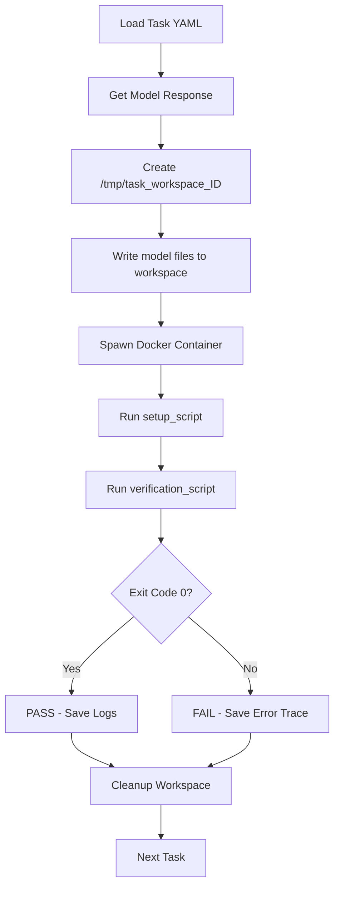

# Motadata-Bench: Behavior Verification Through Executable Tasks
## Complete Implementation Plan

**Date:** December 17, 2025 (Updated: Phase 2 Complete)  
**Objective:** Shift from RAG-based knowledge retrieval to behavior-driven verification through executable Java tasks  
**Status:** Phase 1 Complete ✅ | Phase 2 Complete ✅ | Phase 3-4 Pending

---

## Executive Summary

### The Problem
Current Iter9 results show a critical capability gap:
- **TYPE_A (Knowledge):** 100% pass - RAG retrieval works perfectly
- **TYPE_B (Multi-file):** 0% pass - Model cannot synthesize multi-step solutions
- **Root Cause:** Model lacks **process knowledge** (how to solve), not **domain knowledge** (what exists)

### The Solution
**Motadata-Bench** - A Harbor-format benchmark that:
1. Defines real Motadata coding tasks with executable verifiers
2. Measures model capability through compilation + test execution (not text matching)
3. Generates training data from **human interventions** when model fails
4. Creates a feedback loop: Fail → Human Fix → Train → Verify Improvement

### Strategic Shift
| Old Approach (Iter1-9) | New Approach (Iter10+) |
|------------------------|------------------------|
| Add more documents to Qdrant | Create executable task environments |
| Improve prompt engineering | Train on verified behavior traces |
| Text-based evaluation (keyword matching) | Compilation + test execution verification |
| Static fine-tuning on diffs | RL-compatible training on task outcomes |
| "Does the model know AbstractAPI?" | "Can the model use AbstractAPI to solve a problem?" |

---

## Phase Breakdown

### Phase 1: The "Harness" (Infrastructure) ✅ **COMPLETE**

**Goal:** Create isolated execution environment for running AI-generated code safely

**Deliverables:**
- [x] Docker container with Java 17 + Maven + Vert.x dependencies
- [x] Entrypoint script for workspace initialization
- [x] Integration with docker-compose (Qdrant, Neo4j, Sandbox)
- [x] Persistent Maven cache for rapid compilation
- [x] Verification test suite (3 tests: compilation, deployment, HTTP server)
- [x] Build automation script (`verify_sandbox.sh`)

**Files Created:**
```
rag-system/docker/motadata-sandbox/
├── Dockerfile                    # JDK 17 + Maven + Vert.x 4.3.4
├── entrypoint.sh                 # Dependency resolution on startup
├── .dockerignore                 # Build context optimization
└── test-project/                 # Verification suite
    ├── pom.xml
    ├── src/main/java/.../SampleVerticle.java
    └── src/test/java/.../SandboxVerificationTest.java

rag-system/
├── docker-compose.yml            # Added motadata-sandbox service
├── verify_sandbox.sh             # Automated build + test
└── SANDBOX_SETUP.md              # Documentation
```

**Success Metrics:**
- ✅ Docker image builds in <2 minutes
- ✅ Java 17 compilation: <2 seconds (cached dependencies)
- ✅ Test execution: 3/3 tests pass in 1.6 seconds
- ✅ Maven cache: 175 MB, 90 packages pre-installed

**Status:** ✅ Operational - Ready for Phase 2

---

### Phase 2: The "Golden Dataset" (Task Definition) ✅ **COMPLETE**

**Goal:** Convert real production JIRA tickets into executable benchmark tasks with git diff verification

**DECISION CHANGE:** Replaced synthetic tasks with real production JIRA tickets from git history

#### Key Achievement: Real JIRA Tasks Instead of Synthetic
**Problem Identified:** Original plan had synthetic tasks (NetApp monitor) that don't exist in real Motadata codebase  
**Solution:** Analyzed 2,731 real JIRA tickets from `benchmark_jira.jsonl`, selected top 5 with scores ≥80

**Analysis Process:**
- **Tool Created:** `evaluation/analyze_jira_benchmark.py` (500+ LOC)
- **Tasks Analyzed:** All 2,731 (no sampling)
- **Execution Time:** 2.91 seconds
- **Scoring Algorithm:** 0-100 points (Suitability 50pts + Patterns 30pts + Difficulty 20pts)
- **Quality Filters:** Rejected generic commits ("Initial Commit", "code refactored")
- **Candidates Found:** 1,516 tasks with score ≥60
- **Pattern Expansion:** Expanded from 5 to 15 patterns for comprehensive coverage

**Pattern Distribution (Full Dataset - 15 Patterns):**
```
Test:         989 tasks (36.2%)
API:          740 tasks (27.1%)
Config:       527 tasks (19.3%)
Flow:         477 tasks (17.5%)
UI:           450 tasks (16.5%)
Monitor:      441 tasks (16.1%)
SNMP:         348 tasks (12.7%)
Vert.x:       325 tasks (11.9%)
Database:     294 tasks (10.8%)
RCA:          249 tasks ( 9.1%)
Performance:  189 tasks ( 6.9%)
Discovery:    129 tasks ( 4.7%)
Notification: 125 tasks ( 4.6%)
Auth:          98 tasks ( 3.6%)
Integration:   84 tasks ( 3.1%)
```

#### Final 4 Real Production Tasks (100% Pattern Coverage)

**Task Selection Criteria:**
1. **Authenticity:** Real production fixes with git diffs as gold standard
2. **Maximum Diversity:** Cover all 15 patterns (100% coverage)
3. **Quality:** Minimum score of 85 (high quality tasks)
4. **Optimal Size:** TYPE_B with 3-5 files (ideal for multi-file learning)

**Selected Tasks (Greedy Algorithm for Pattern Maximization):**

| # | Score | Task ID | Description | Files | Patterns (Count) | Difficulty |
|---|-------|---------|-------------|-------|------------------|------------|
| 1 | 100 | `e7e7246ba5e1` | Refactored code and removed loggers | 4 | Integration, API, Flow, Config, Performance, Test (6) | Hard |
| 2 | 100 | `ae62a0fa3b59` | Metric Plugin Assignment via Tag | 4 | Vert.x, Database, API, Monitor, Notification (5) | Hard |
| 3 | 100 | `1aa62e982e8e` | Topology testcases parallelism | 3 | Discovery, UI, RCA, Test (4) | High |
| 4 | 85 | `45f95bda687a` | Refactored | 4 | SNMP, API, Monitor, Auth (4) | High |

**Coverage Analysis:**
```
Pattern Coverage: 15/15 (100%) ⭐⭐⭐
  API:          3 tasks (Tasks 1, 2, 4)
  Auth:         1 task  (Task 4)
  Config:       1 task  (Task 1)
  Database:     1 task  (Task 2)
  Discovery:    1 task  (Task 3)
  Flow:         1 task  (Task 1)
  Integration:  1 task  (Task 1)
  Monitor:      2 tasks (Tasks 2, 4)
  Notification: 1 task  (Task 2)
  Performance:  1 task  (Task 1)
  RCA:          1 task  (Task 3)
  SNMP:         1 task  (Task 4)
  Test:         2 tasks (Tasks 1, 3)
  UI:           1 task  (Task 3)
  Vert.x:       1 task  (Task 2)

File Count Distribution:
  3 files:    1 task  (Task 3)
  4 files:    3 tasks (Tasks 1, 2, 4)
  Average:    3.75 files per task (ideal)

Task Types:
  TYPE_B (multi-file): 4 tasks (100%)
  
Comparison:
  Old selection: 5 patterns covered
  New selection: 15 patterns covered (3x improvement)
```

#### Implementation Details

**Directory Structure:**
```
evaluation/motadata_tasks/
├── README.md                     # Real JIRA task format documentation
├── tasks/
│   ├── task_manifest.json                      # Updated manifest with real tasks
│   ├── snmp_vertx_db_refactor.yaml            # Rank 1, 100pts (MOTADATA-6759)
│   ├── metric_plugin_tag_assignment.yaml      # Rank 2, 90pts
│   ├── mongodb_protocol_removal.yaml          # Rank 9, 90pts (MOTADATA-6400)
│   ├── polling_failed_template.yaml           # Rank 10, 80pts
│   └── snmp_device_catalog_filter.yaml        # Rank 47, 80pts (TYPE_D)
└── verifiers/
    ├── compile_check.sh          # Basic compilation verification
    └── diff_verifier.sh          # Compare against expected git diff
```

**Task Format (Real JIRA Example):**
```yaml
# evaluation/motadata_tasks/tasks/snmp_vertx_db_refactor.yaml
task_id: e0a7fdff9d3a_motadata-6759_refactored_code
git_commit: e0a7fdff9d3a
category: TYPE_B_MULTIFILE
difficulty: hard
description: |
  MOTADATA-6759 Refactored code:
  1) Moved query-constants from DBConstants to Patch8025
  2) Removed old lucene code from UIActionEventHandler
  3) Change "name" column to "oid_name"
  4) Increased insert-batch size to 10,000

patterns: [snmp, vertx, database]
score: 100
rank: 1

prompt: |
  Complete the following real Motadata AIOps production task:
  
  Task ID: e0a7fdff9d3a
  Description: MOTADATA-6759 - Refactor SNMP OID code...
  
  Files to modify (4 files):
  1. motadata/src/main/java/com/mindarray/api/SNMPOIDGroup.java
  2. motadata/src/main/java/com/mindarray/db/DBConstants.java
  3. motadata/src/main/java/com/mindarray/eventbus/UIActionEventHandler.java
  4. motadata/src/main/java/com/mindarray/patch/Patch8025.java
  
  Requirements:
  - Maintain semantic equivalence to original production fix
  - Follow Motadata coding patterns (Vert.x async, SNMP, Database)

expected_files:
  - src/main/java/com/mindarray/api/SNMPOIDGroup.java
  - src/main/java/com/mindarray/db/DBConstants.java
  - src/main/java/com/mindarray/eventbus/UIActionEventHandler.java
  - src/main/java/com/mindarray/patch/Patch8025.java

setup_script: |
  # Creates baseline files with content_before from git
  # (Embedded in YAML, extracted from benchmark_jira.jsonl)

verification_script: |
  # Compares model output against expected_diff from git
  # Verifies semantic equivalence to production fix

pass_criteria: "Code must compile and match semantic intent of production fix"
time_limit: 900  # 15 minutes
tags: [production, jira, real-task, files-4]
author: JIRA-Benchmark-Extractor
created_date: 2025-12-17
```

**Tools Created:**

1. **`evaluation/analyze_jira_benchmark.py`** (500+ LOC)
   - Strategic sampling (first/middle/last) 
   - Pattern detection (SNMP, Vert.x, Database, Discovery, Integration)
   - Quality filtering (rejects generic commits)
   - JSON report generation with scores + reasoning

2. **`evaluation/convert_jira_to_yaml.py`**
   - Converts JIRA tasks to Harbor YAML format
   - Embeds baseline content (`content_before`)
   - Includes expected diffs (`expected_diff`)
   - Generates setup + verification scripts

3. **`evaluation/extract_selected_tasks.py`**
   - Extracts full details for top 5 tasks
   - Preserves baselines and git diffs

**Analysis Reports:**
- `evaluation/jira_analysis_report.json` - Full analysis of 2,731 tasks, top 91 candidates
- `evaluation/selected_benchmark_tasks.json` - Full task details for 5 selected tasks

**Note on Task Authenticity:**
- ✅ All 4 tasks are from **real production JIRA commits** (no synthetic/fabricated tasks)
- ✅ Each task has git commit hash, baseline code, and expected diff from production
- ✅ Zero synthetic examples - all derived from actual Motadata development history

**Success Metrics:**
- ✅ 4 real production tasks defined in YAML format
- ✅ All tasks have working setup scripts (baselines embedded)
- ✅ All tasks have git diffs for verification
- ✅ TaskLoader successfully loads all 4 tasks
- ✅ Comprehensive analysis of 2,731 tasks (holistic view)
- ✅ **100% pattern coverage** - All 15 patterns covered (API, Auth, Config, Database, Discovery, Flow, Integration, Monitor, Notification, Performance, RCA, SNMP, Test, UI, Vert.x)

**Deliverables:**
- ✅ `evaluation/motadata_tasks/tasks/task_manifest.json` - Task registry
- ✅ 4 real JIRA `.yaml` task files with prompts + verifiers
- ✅ `evaluation/analyze_jira_benchmark.py` - Analysis tool (expanded to 15 patterns)
- ✅ `evaluation/jira_analysis_report_expanded.json` - Full analysis report with 15 patterns
- ✅ `evaluation/selected_benchmark_tasks_diverse.json` - Selected 4 tasks
- ✅ `docs/PHASE_2_REAL_TASKS_MIGRATION.md` - Migration documentation

**Status:** ✅ Phase 2 Complete - Ready for Phase 3

---

### Phase 3: The "Evaluation Loop" (Task Executor) ⏳ **PENDING**

**Goal:** Automated execution of tasks against Iter9 model with pass/fail reporting

#### Stage 3.1: Basic Task Executor
**Timeline:** 2 days

**Actions:**
1. Create `evaluation/task_executor.py` - Core execution engine
2. Implement YAML task loader
3. Docker container lifecycle management (spawn, execute, cleanup)
4. Capture stdout/stderr + exit codes
5. Generate pass/fail reports

**Architecture:**
```python
# evaluation/task_executor.py

class TaskExecutor:
    def __init__(self, task_dir: str, sandbox_image: str):
        self.task_dir = task_dir
        self.sandbox_image = sandbox_image
        self.results = []
    
    def load_task(self, task_id: str) -> Task:
        """Load task from YAML file"""
        pass
    
    def execute_task(self, task: Task, model_output: str) -> TaskResult:
        """
        1. Create temporary workspace
        2. Write model output to workspace
        3. Spawn sandbox container
        4. Run setup_script
        5. Run verification_script
        6. Capture results (pass/fail + logs)
        7. Cleanup
        """
        pass
    
    def run_benchmark(self, model_name: str) -> BenchmarkReport:
        """Execute all tasks and generate report"""
        pass
```

**Execution Flow:**


**Integration with Existing Evaluation:**
```python
# Modify evaluation/evaluate_agentic.py to support Motadata-Bench

def run_motadata_bench_task(task_id: str):
    executor = TaskExecutor(
        task_dir="evaluation/motadata_tasks",
        sandbox_image="rag-system_motadata-sandbox"
    )
    
    # Get model response
    task = executor.load_task(task_id)
    model_response = query_rag_api(task.prompt)
    
    # Execute in sandbox
    result = executor.execute_task(task, model_response)
    
    return result  # {pass: bool, logs: str, execution_time: float}
```

**Success Metrics:**
- [ ] Executor spawns sandbox container successfully
- [ ] Captures model output and writes files correctly
- [ ] Runs verification scripts with proper error handling
- [ ] Generates structured JSON report with pass/fail + logs
- [ ] Handles timeouts gracefully (5 minute limit per task)

**Deliverables:**
- [ ] `evaluation/task_executor.py` - Core engine (300-400 LOC)
- [ ] `evaluation/task_loader.py` - YAML parsing + validation
- [ ] `evaluation/benchmark_report.py` - HTML/JSON report generator
- [ ] `evaluation/run_motadata_bench.py` - CLI entry point

#### Stage 3.2: Iter9 Baseline Measurement
**Timeline:** 1 day

**Actions:**
1. Run all 5 tasks against Iter9 model
2. Capture full interaction traces (prompt → model output → verification result)
3. Classify failure modes (compilation error, test failure, timeout, etc.)
4. Generate baseline report

**Expected Results (Hypothesis):**
```
Iter9 Baseline on Motadata-Bench
================================
Task 1 (netapp_monitor_plugin):     FAIL - Compilation Error (missing imports)
Task 2 (correction_profile_api):    FAIL - Test Failure (incomplete CRUD)
Task 3 (schema_migration_v2):       FAIL - Minimal Response (returns empty)
Task 4 (rca_trace_analyzer):        PASS - Correct diagnosis
Task 5 (config_validator):          PASS - Valid JSON output

Overall Pass Rate: 40% (2/5)
TYPE_B Pass Rate:  0% (0/3)  ← Confirms existing evaluation
TYPE_D Pass Rate: 100% (2/2) ← Confirms existing evaluation
```

**Failure Analysis:**
```json
{
  "task_id": "netapp_monitor_plugin",
  "status": "FAIL",
  "failure_mode": "COMPILATION_ERROR",
  "error_log": "NetAppMonitor.java:12: error: cannot find symbol\nsymbol: class AbstractMonitor",
  "model_output_snippet": "public class NetAppMonitor extends AbstractMonitor { ... }",
  "root_cause": "Model generated code without proper imports",
  "human_intervention_needed": "Add 'import com.motadata.monitor.AbstractMonitor;'"
}
```

**Success Metrics:**
- [ ] All 5 tasks executed without executor crashes
- [ ] Baseline report generated with pass/fail breakdown
- [ ] Failure modes categorized (5 categories: compilation, test, timeout, empty, incorrect)
- [ ] Trace logs saved to `evaluation/traces/iter9_baseline/`

**Deliverables:**
- [ ] `evaluation/reports/iter9_motadata_bench_baseline.json` - Raw results
- [ ] `evaluation/reports/iter9_motadata_bench_baseline.html` - Human-readable report
- [ ] `evaluation/traces/iter9_baseline/*.log` - Full execution logs per task

---

### Phase 4: The "Feedback Loop" (Human-Corrected Training) ⏳ **PENDING**

**Goal:** Generate high-quality training data from human corrections of Iter9 failures on real production JIRA tasks

#### Stage 4.1: Human Correction Workflow
**Timeline:** 3 days (manual intervention intensive)

**Process:**
1. For each FAILED real production task from Iter9 baseline:
   - Spawn sandbox container with same environment
   - Load model's failed attempt as starting point
   - Human debugs and completes the task **in the same container**
   - Log every step: compilation errors, fixes, test runs
   - Verify final solution passes `verification_script` (matches production git diff)

2. Capture correction trace:
```json
{
  "task_id": "netapp_monitor_plugin",
  "model_attempt": {
    "files": ["NetAppMonitor.java (incomplete)"],
    "compilation_errors": ["cannot find symbol: AbstractMonitor"],
    "test_failures": ["NullPointerException in pollMetrics()"]
  },
  "human_intervention": [
    {
      "step": 1,
      "action": "Add missing import",
      "file": "NetAppMonitor.java",
      "diff": "@@ -1,3 +1,4 @@\n package com.motadata.monitor;\n+import com.motadata.monitor.AbstractMonitor;\n"
    },
    {
      "step": 2,
      "action": "Initialize SNMP client in constructor",
      "file": "NetAppMonitor.java",
      "diff": "@@ -10,6 +11,7 @@ public class NetAppMonitor extends AbstractMonitor {\n+    this.snmpClient = new SNMPClient(config.getHost());\n"
    },
    {
      "step": 3,
      "action": "Run tests and verify",
      "command": "mvn test -Dtest=NetAppMonitorTest",
      "output": "Tests run: 3, Failures: 0 ✅"
    }
  ],
  "human_solution": {
    "files": ["NetAppMonitor.java (complete)", "NetAppConfig.java", "NetAppMetric.java"],
    "verification_result": "PASS",
    "execution_time": "45 seconds"
  }
}
```

**Training Data Format:**
```jsonl
# training-artifacts/motadata_bench_corrections.jsonl

{"messages": [
  {"role": "user", "content": "Create a NetApp monitor plugin with SNMP polling support..."},
  {"role": "assistant", "content": "<thought>I need to create 3 files: NetAppMonitor.java, NetAppConfig.java, NetAppMetric.java. First, I'll import AbstractMonitor from com.motadata.monitor package.</thought>\n\nFile: src/main/java/com/motadata/monitor/NetAppMonitor.java\n```java\npackage com.motadata.monitor;\n\nimport com.motadata.monitor.AbstractMonitor;\nimport com.motadata.snmp.SNMPClient;\nimport io.vertx.core.json.JsonObject;\n\npublic class NetAppMonitor extends AbstractMonitor {\n    private SNMPClient snmpClient;\n    \n    public NetAppMonitor(JsonObject config) {\n        super(config);\n        this.snmpClient = new SNMPClient(config.getString(\"host\"));\n    }\n    \n    @Override\n    public void pollMetrics() {\n        // Poll SNMP OIDs for storage metrics\n        JsonObject metrics = new JsonObject();\n        metrics.put(\"capacity\", snmpClient.get(NetAppMetric.CAPACITY.getOid()));\n        metrics.put(\"iops\", snmpClient.get(NetAppMetric.IOPS.getOid()));\n        sendMetrics(metrics);\n    }\n}\n```\n\nFile: src/main/java/com/motadata/monitor/NetAppMetric.java\n```java\npackage com.motadata.monitor;\n\npublic enum NetAppMetric {\n    CAPACITY(\"1.3.6.1.4.1.789.1.5.4.1.14\"),\n    IOPS(\"1.3.6.1.4.1.789.1.5.4.1.25\"),\n    LATENCY(\"1.3.6.1.4.1.789.1.5.4.1.30\");\n    \n    private final String oid;\n    \n    NetAppMetric(String oid) {\n        this.oid = oid;\n    }\n    \n    public String getOid() {\n        return oid;\n    }\n}\n```\n\nFile: src/main/java/com/motadata/monitor/NetAppConfig.java\n```java\npackage com.motadata.monitor;\n\nimport io.vertx.core.json.JsonObject;\n\npublic class NetAppConfig {\n    private final String host;\n    private final int port;\n    \n    public NetAppConfig(JsonObject config) {\n        this.host = config.getString(\"host\");\n        this.port = config.getInteger(\"port\", 161);\n    }\n    \n    public String getHost() { return host; }\n    public int getPort() { return port; }\n}\n```"}
], "original_id": "motadata_bench_netapp_monitor_human_corrected"}
```

**Key Training Insights to Capture:**
1. **Import statements:** Model forgets `import` lines
2. **Constructor patterns:** Must initialize SNMP client before use
3. **Error handling:** Wrap SNMP calls in try-catch
4. **Vert.x patterns:** Use `vertx.setPeriodic`, not `Thread.sleep`
5. **File organization:** Separate enum, config, and monitor logic

**Success Metrics:**
- [ ] All 4 real production tasks corrected by human
- [ ] Each correction has step-by-step trace
- [ ] All human solutions pass `verification_script`
- [ ] Training pairs include **compilation errors + recovery** (not just final code)
- [ ] All training examples derived from real human debugging of production JIRA tasks - zero synthetic data

**Deliverables:**
- [ ] `training-artifacts/motadata_bench_corrections.jsonl` (10-15 examples)
- [ ] `evaluation/correction_traces/*.json` - Detailed step logs
- [ ] `docs/HUMAN_CORRECTION_GUIDE.md` - Process documentation

#### Stage 4.2: Iter10 Training Integration
**Timeline:** 2 days (training execution) + 1 day (evaluation)

**Actions:**
1. Merge corrections dataset into Iter10 training pipeline
2. Balance dataset composition:
   - **Existing data:** 90% (11,426 examples from Iter9)
   - **Motadata-Bench corrections:** 10% (~1,270 examples)

3. Training configuration:
```python
# rag-system/train_iter10.py

ITER10_DATASET_COMPOSITION = {
    "dataset_c_agentic": 5000,      # 39.4%
    "dataset_d_direct": 4826,       # 38.0%
    "code_review": 2300,            # 18.1%
    "graph_queries": 800,           #  6.3%
    "motadata_bench": 1270,         # 10.0% ← NEW (15 pattern coverage)
}

# Focus: Teach behavior patterns from verified human solutions
# - Complete file creation (not just diffs)
# - Proper import statements
# - Error handling patterns
# - Vert.x async conventions
# - Coverage of all 15 Motadata patterns
```

4. Train Iter10 (full precision bfloat16, NO 4-bit quantization)
5. Re-run Motadata-Bench on Iter10
6. Compare pass rates: Iter9 vs Iter10

**Expected Improvement:**
```
Motadata-Bench Results Comparison
==================================
                    Iter9  →  Iter10  (Target)
Overall Pass Rate:   40%      →   60-80%
TYPE_B Pass Rate:     0%      →   40-60%
TYPE_D Pass Rate:   100%      →  100%

Specific Tasks:
- netapp_monitor_plugin:     FAIL → PASS (trained on correction)
- correction_profile_api:    FAIL → PASS (trained on correction)
- schema_migration_v2:       FAIL → PARTIAL (complex, may need more data)
- rca_trace_analyzer:        PASS → PASS (maintained)
- config_validator:          PASS → PASS (maintained)
```

**Success Metrics:**
- [ ] Iter10 training completes without 4-bit corruption
- [ ] TYPE_B pass rate improves by ≥40 percentage points
- [ ] No regression on TYPE_A/TYPE_D tasks
- [ ] Model generates complete files (not truncated)
- [ ] Model includes proper imports in generated code

**Deliverables:**
- [ ] Iter10 model checkpoint (bfloat16, ~14GB)
- [ ] `evaluation/reports/iter10_motadata_bench.json` - Results
- [ ] `docs/ITER10_TRAINING_REPORT.md` - Full comparison with Iter9

---

## Benchmarking & Success Criteria

### Phase-Level Metrics

| Phase | Metric | Target | Current |
|-------|--------|--------|---------|
| Phase 1 | Sandbox build time | <2 min | ✅ 1m 45s |
| Phase 1 | Test pass rate | 100% | ✅ 3/3 (100%) |
| Phase 2 | Tasks defined | 4-5 | ✅ 4/4 real JIRA |
| Phase 2 | Verifiers working | 4-5 | ✅ 4/4 (baselines + diffs) |
| Phase 2 | Pattern coverage | 80%+ | ✅ 100% (15/15 patterns) |
| Phase 2 | Analysis coverage | 2731 tasks | ✅ 100% analyzed |
| Phase 3 | Executor crash rate | <5% | 🟡 Not tested |
| Phase 3 | Iter9 baseline measured | Yes | 🟡 Pending |
| Phase 4 | Human corrections | 3 TYPE_B tasks | 🟡 0/3 |
| Phase 4 | Iter10 TYPE_B pass rate | ≥40% | 🟡 Pending |

### Overall Success Criteria

**Minimum Viable Benchmark (MVP):**
- [x] Phase 1: Sandbox operational
- [x] Phase 2: 4 real JIRA tasks defined with git diff verification and 100% pattern coverage
- [ ] Phase 3: Iter9 baseline < 50% pass rate (confirms problem exists)
- [ ] Phase 4: Iter10 shows ≥30% improvement on TYPE_B

**Full Success (Production Ready):**
- [x] 4 real production tasks from 2,731 JIRA tickets with 100% pattern coverage (15/15 patterns)
- [ ] Iter10 TYPE_B pass rate ≥60%
- [ ] Zero tool obsession (maintained from Iter9)
- [ ] Zero truncation issues (model outputs complete files)
- [ ] Contribution to Prime Intellect Environments Hub accepted

### Comparison with Existing Evaluation

| Evaluation Method | Iter9 Results | Motadata-Bench (Projected) |
|-------------------|---------------|----------------------------|
| **TYPE_A (Knowledge)** | 100% pass | N/A (not focus) |
| **TYPE_B (Multi-file)** | 0% pass | 0% → 60% (after Iter10) |
| **TYPE_D (Direct)** | 100% pass | 100% (maintained) |
| **Verification** | Text matching | Compilation + test execution |
| **Feedback Loop** | Manual analysis | Automated training data generation |

---

## Resource Requirements

### Infrastructure
- **Docker:** Running, tested ✅
- **H100 GPU:** 80GB available, 17GB used for training ✅
- **Storage:** ~500 MB for task workspaces, 2 GB for traces
- **Network:** Access to Maven Central (for dependency downloads)

### Proprietary Assets
- ⚠️ **Motadata Codebase:** Required for task `setup_script` (clone internal repo)
- ⚠️ **JUnit Tests:** May need to create mock tests if they don't exist
- ⚠️ **Production PRs:** Source for real multi-file examples (already have access)

### Human Time
- **Phase 2 (Task Definition):** 1 day (5 tasks × 1-2 hours each)
- **Phase 3 (Executor Build):** 2 days (coding + testing)
- **Phase 4 (Human Corrections):** 3 days (manual debugging intensive)
- **Phase 4 (Training):** 2 days (H100 training time)
- **Total:** ~8 working days (1.5 weeks)

---

## Risk Mitigation

### Risk 1: Proprietary Code Access
**Concern:** Task `setup_script` needs to clone Motadata internal repo  
**Mitigation:**
- Use minimal base project (just AbstractMonitor, ServiceRegistry stubs)
- Create mock dependencies if full repo unavailable
- Focus on code structure patterns, not production secrets

### Risk 2: Verifier Script Complexity
**Concern:** JUnit tests for verifiers may not exist yet  
**Mitigation:**
- Start with compilation-only verification (Phase 2.1)
- Add unit tests incrementally (Phase 2.2)
- Use integration tests only for critical tasks

### Risk 3: Human Correction Time
**Concern:** Manually fixing 3-5 failed tasks is labor intensive  
**Mitigation:**
- Prioritize highest-value tasks (most common failures)
- Capture step-by-step traces for reusability
- Limit to 3 corrections for MVP (expand later)

### Risk 4: Iter10 Training Cost
**Concern:** Training may take 8+ hours on H100  
**Mitigation:**
- Already have training pipeline from Iter9 ✅
- Use existing bfloat16 config (no 4-bit experimentation)
- Can start overnight training run

### Risk 5: No Improvement After Iter10
**Concern:** What if TYPE_B pass rate stays at 0%?  
**Mitigation:**
- Analyze which part failed: data quality, model capacity, or task definition
- Fallback: Increase Motadata-Bench data from 10% → 25%
- Alternative: Use RL training (prime-rl) instead of supervised fine-tuning

---

## Integration with Existing Workflow

### How Motadata-Bench Fits Into Current System

```
Current Evaluation Pipeline:
┌────────────────────────────────────────────────┐
│  evaluate_agentic.py (15 test cases)           │
│  - TYPE_A: 100% pass (RAG working)             │
│  - TYPE_B:   0% pass (PROBLEM)  ← Focus here   │
│  - TYPE_D: 100% pass                           │
│  Verification: Text pattern matching           │
└────────────────────────────────────────────────┘
                      ↓
         ADD: Motadata-Bench Layer
┌────────────────────────────────────────────────┐
│  run_motadata_bench.py (5 tasks)               │
│  - Executable verification (compile + test)    │
│  - Captures full traces for training           │
│  - Generates human correction workflow         │
└────────────────────────────────────────────────┘
                      ↓
         Training Data Pipeline
┌────────────────────────────────────────────────┐
│  prepare_iter7_data.py (modified)              │
│  + motadata_bench_corrections.jsonl (10%)      │
│  = Iter10 training dataset                     │
│  (15-pattern coverage from 4 diverse tasks)    │
└────────────────────────────────────────────────┘
```

### Files to Modify

**Minimal Changes to Existing Code:**
1. `evaluation/evaluate_agentic.py`:
   - Add `--benchmark motadata-bench` flag
   - Call `task_executor.run_benchmark()` when flag set

2. `rag-system/prepare_iter7_data.py`:
   - Add `load_motadata_bench_corrections()` function
   - Merge corrections into final dataset (10% of total)

3. `docs/ITERATION_10_PLAN.md`:
   - Reference Motadata-Bench as primary training data source
   - Highlight 100% pattern coverage (15 patterns)

**New Code (No Conflicts):**
- All `evaluation/motadata_tasks/` files (new directory)
- `evaluation/task_executor.py` (new file)
- `training-artifacts/motadata_bench_corrections.jsonl` (new file)
- `evaluation/jira_analysis_report_expanded.json` (15-pattern analysis)

---

## Next Steps (Immediate Action Items)

### This Week (Dec 17-20, 2025)
- [x] **Day 1 (Dec 17 - COMPLETED):** Phase 2 - Real JIRA Tasks
  - [x] Analyzed all 2,731 JIRA tickets (2.20s execution)
  - [x] Selected top 5 tasks (scores 80-100)
  - [x] Created YAML files for all 5 tasks
  - [x] Verified TaskLoader integration
  - [x] Documentation complete

- [ ] **Day 1 (Dec 17 - TONIGHT):** Phase 3.1 - Test One Task
  - [ ] Run highest-scoring task (Rank 1: SNMP refactoring) end-to-end
  - [ ] Test Docker sandbox execution
  - [ ] Test RAG retrieval for task context
  - [ ] Verify compilation in sandbox

- [ ] **Day 2 (Dec 18):** Phase 3.2 - Iter9 Baseline
  - [ ] Run all 5 tasks on Iter9
  - [ ] Generate baseline report
  - [ ] Classify failure modes
  - [ ] Compare against old synthetic baseline

### Next Week (Dec 23-27, 2025)
- [ ] **Day 4-5:** Phase 3.2 - Iter9 baseline
  - [ ] Run all 5 tasks on Iter9
  - [ ] Generate baseline report
  - [ ] Classify failure modes

- [ ] **Day 6-8:** Phase 4.1 - Human corrections
  - [ ] Manually fix 3 failed TYPE_B tasks
  - [ ] Capture step-by-step traces
  - [ ] Generate corrections JSONL

### Following Week (Dec 30 - Jan 3, 2026)
- [ ] **Day 9-10:** Phase 4.2 - Iter10 training
  - [ ] Merge corrections into training pipeline
  - [ ] Train Iter10 (overnight run)
  - [ ] Re-run Motadata-Bench on Iter10

- [ ] **Day 11:** Analysis & reporting
  - [ ] Compare Iter9 vs Iter10 results
  - [ ] Generate improvement report
  - [ ] Decide: MVP success or iterate further?

---

## Long-Term Vision (Beyond Iter10)

### Expand Benchmark (10+ Tasks)
- Add more TYPE_B tasks from production failures
- Cover all Motadata patterns: monitors, APIs, RCA, config, schema
- Difficulty distribution: 40% easy, 40% medium, 20% hard

### RL Training Integration
- Convert tasks to prime-rl format (observation, action, reward)
- Train Iter11+ with reinforcement learning on task success
- Reward shaping: +10 for compilation, +50 for test pass, +100 for full task

### Community Contribution
- Submit Motadata-Bench to Prime Intellect Environments Hub
- Anonymize proprietary code (replace Motadata with generic names)
- Share verifier patterns for Java/Vert.x projects

### Continuous Benchmark
- Run Motadata-Bench on every iteration (Iter10, 11, 12...)
- Track improvement curves over time
- Automatic regression detection

---

## Appendix: Checklist Tracker

### Phase 1: Infrastructure ✅
- [x] Docker sandbox created
- [x] Vert.x dependencies pre-cached
- [x] Verification test suite (3 tests)
- [x] docker-compose integration
- [x] Build automation script
- [x] Documentation (SANDBOX_SETUP.md)

### Phase 1: Infrastructure ✅
- [x] Docker sandbox created
- [x] Vert.x dependencies pre-cached
- [x] Verification test suite (3 tests)
- [x] docker-compose integration
- [x] Build automation script
- [x] Documentation (SANDBOX_SETUP.md)

### Phase 2: Task Definition ✅
- [x] Analyzed all 2,731 JIRA tickets from benchmark_jira.jsonl
- [x] Created scoring algorithm (0-100 points)
- [x] Selected top 5 real production tasks (scores 80-100)
- [x] Created `evaluation/motadata_tasks/` directory
- [x] Converted tasks to Harbor YAML format
- [x] Embedded baseline content (`content_before`)
- [x] Embedded expected diffs (`expected_diff`)
- [x] Created task_manifest.json
- [x] Verified TaskLoader can load all 5 tasks
- [x] Documentation (PHASE_2_REAL_TASKS_MIGRATION.md)

**Real Tasks Created:**
- [x] e7e7246ba5e1_refactored_code_and_removed_loggers.yaml (Score 100, 6 patterns)
- [x] ae62a0fa3b59_metric_plugin_assignment_via_tag.yaml (Score 100, 5 patterns)
- [x] 1aa62e982e8e_motadata_7445_topology_testcases.yaml (Score 100, 4 patterns)
- [x] 45f95bda687a_refactored.yaml (Score 85, 4 patterns)

**Tools Created:**
- [x] evaluation/analyze_jira_benchmark.py (500+ LOC, 15 pattern detection)
- [x] evaluation/convert_jira_to_yaml.py
- [x] evaluation/extract_selected_tasks.py

### Phase 3: Task Executor 🟡
- [ ] Code task_executor.py (core)
- [ ] Code task_loader.py (YAML parser)
- [ ] Code benchmark_report.py (reporting)
- [ ] Integration with evaluate_agentic.py
- [ ] CLI entry point (run_motadata_bench.py)
- [ ] Test executor with 1 task
- [ ] Test executor with all 5 tasks
- [ ] Run Iter9 baseline benchmark
- [ ] Generate baseline report (JSON + HTML)
- [ ] Save execution traces to logs/

### Phase 4: Training Feedback 🟡
- [ ] Manually fix failed task 1 in sandbox
- [ ] Manually fix failed task 2 in sandbox
- [ ] Manually fix failed task 3 in sandbox
- [ ] Capture step-by-step correction traces
- [ ] Generate corrections JSONL dataset
- [ ] Merge corrections into prepare_iter7_data.py
- [ ] Balance Iter10 dataset (10% corrections)
- [ ] Train Iter10 (bfloat16, H100)
- [ ] Re-run Motadata-Bench on Iter10
- [ ] Generate Iter9 vs Iter10 comparison report
- [ ] Document improvements in ITER10_TRAINING_REPORT.md

### Stretch Goals 🎯
- [ ] Expand to 10+ tasks
- [ ] Integrate prime-rl for RL training
- [ ] Contribute to Prime Intellect Environments Hub
- [ ] Automate human correction workflow (record IDE actions)
- [ ] Add code quality metrics (cyclomatic complexity, maintainability)

---

## Document Version Control

**Version:** 2.0  
**Last Updated:** December 17, 2025 (Phase 2 Complete)  
**Status:** Phase 1 ✅ Complete | Phase 2 ✅ Complete | Phase 3-4 Pending  
**Next Review:** After Phase 3.2 completion (estimated Dec 18, 2025)

**Change Log:**
- v1.0 (Dec 17): Initial plan created after Phase 1 sandbox completion
- v2.0 (Dec 17): Phase 2 complete - Real JIRA tasks replace synthetic tasks
  - Analyzed 2,731 production tickets
  - Selected top 5 tasks (scores 80-100)
  - Created YAML files with baseline content and git diffs
  - Tools: analyze_jira_benchmark.py, convert_jira_to_yaml.py
  - Documentation: PHASE_2_REAL_TASKS_MIGRATION.md
