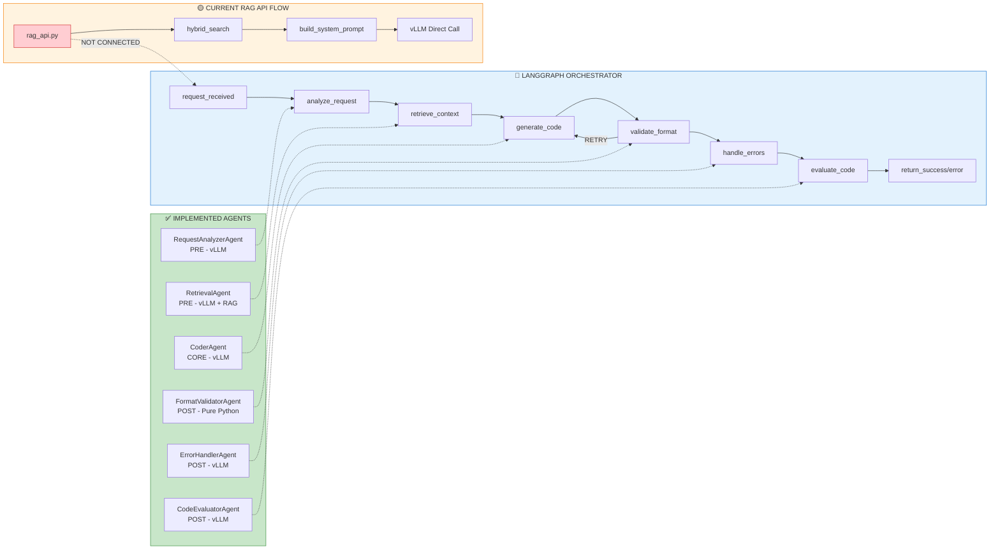
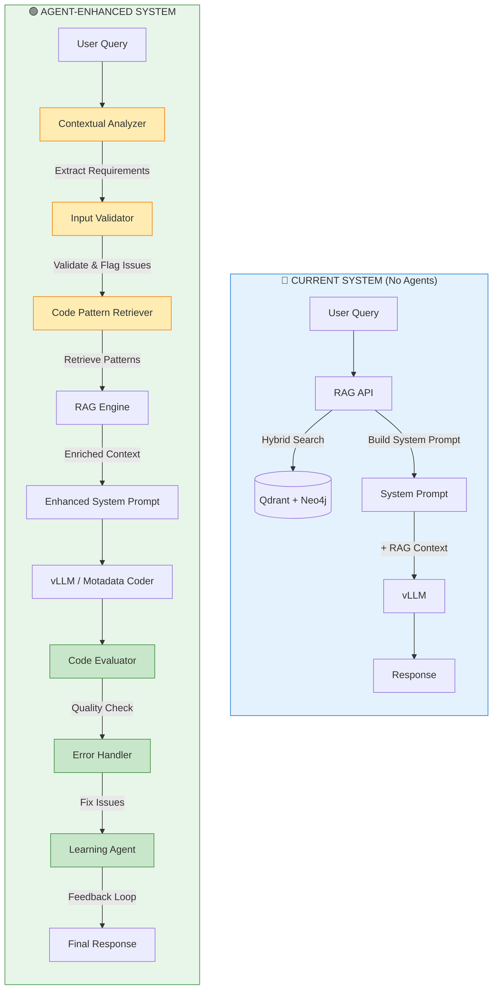
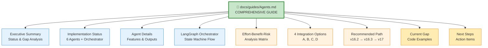

# Agent Specifications & Integration Analysis

## Executive Summary

**Status:** ✅ All 6 agents are **IMPLEMENTED** but **NOT INTEGRATED** into the RAG API.

- **RequestAnalyzerAgent** - Extracts structured requirements
- **RetrievalAgent** - Retrieves patterns via RAG with anti-hallucination checks
- **CoderAgent** - Generates code with context
- **FormatValidatorAgent** - Validates search/replace blocks (pure Python)
- **ErrorHandlerAgent** - Detects and fixes errors
- **CodeEvaluatorAgent** - Scores code quality

**Current Gap:** `rag_api.py` bypasses the LangGraph orchestrator and calls vLLM directly.

**Latency Impact:** Full agent pipeline adds ~4-5 seconds (50% increase)

### Architecture Diagram



---

## Contextual Analyzer (Pre)
**Role:** Understand user intent and extract technical and organizational requirements.

**Description:**
Analyzes the user’s input and conversation history to identify:
- Programming language
- Framework
- Architectural style
- Constraints
- Non-functional requirements
- Organizational coding standards

Produces a structured representation of the task to guide downstream agents and the LLM.

**Prompt:**
> You are a Contextual Analyzer for a code-generation system.
> Analyze the user request and extract:
> - Programming language(s)
> - Frameworks/libraries
> - Architecture or design pattern
> - Functional requirements
> - Non-functional requirements
> - Organizational or style constraints
> Output the result as structured JSON.
> **Do NOT generate code.**

---

## Input Validator (Pre)
**Role:** Validate correctness, feasibility, and completeness of the request.

**Description:**
Checks whether the extracted requirements are logically consistent, feasible with the specified technologies, and complete. Flags missing or conflicting constraints and requests clarification when necessary.

**Prompt:**
> You are an Input Validator for a code-generation system.
> Given structured requirements:
> - Identify missing, conflicting, or infeasible constraints
> - Check for security or policy violations
> - Decide whether the request is valid, needs clarification, or should be rejected
> Return a validation status with issues and clarification questions (if any).
> **Do NOT generate code.**

---

## Code Pattern Retriever (Pre)
**Role:** Retrieve relevant organizational coding patterns and examples.

**Description:**
Searches a curated knowledge base (repositories, templates, style guides) to find coding patterns aligned with the validated requirements. Supplies authoritative references to ground the LLM’s generation.

**Prompt:**
> You are a Code Pattern Retriever for a RAG-based system.
> Using the validated requirements:
> - Retrieve relevant organizational coding patterns
> - Retrieve example snippets and templates
> - Identify patterns that must or must not be used
> Return the results as structured references for code generation.
> **Do NOT generate new code.**

---

## Code Evaluator (Post)
**Role:** Assess quality and adherence to best practices.

**Description:**
Reviews the generated code for:
- Readability
- Maintainability
- Performance
- Security
- Architectural alignment with organizational standards

Produces actionable feedback and quality scores.

**Prompt:**
> You are a Code Evaluator.
> Review the provided code and evaluate:
> - Code quality and readability
> - Performance and scalability
> - Security considerations
> - Adherence to architecture and organizational standards
> List violations, risks, and improvement suggestions.
> **Do NOT rewrite the code unless explicitly asked.**

---

## Error Handler (Post)
**Role:** Detect and fix errors in generated code.

**Description:**
Identifies syntax, logical, and runtime issues in the generated code. Proposes minimal, targeted fixes while preserving the original structure and intent.

**Prompt:**
> You are an Error Handler for generated code.
> Analyze the code for:
> - Syntax errors
> - Logical flaws
> - Type or dependency issues
> - Runtime risks
> Propose minimal fixes and explain each correction.
> **Avoid full rewrites unless unavoidable.**

---

## Learning Agent (Post)
**Role:** Enable continuous learning and improvement.

**Description:**
Collects explicit user feedback and implicit usage signals, transforming them into insights for improving retrieval quality, prompts, and future fine-tuning.

**Prompt:**
> You are a Feedback Loop Facilitator.
> Collect and analyze user feedback on generated code.
> Identify recurring issues, preferences, and improvement opportunities.
> Summarize insights that can improve future retrieval, prompting, and fine-tuning.
> **Do NOT generate or modify code.**

---

# Implementation Status & Analysis

## Current Architecture

### What's Implemented ✅

All 6 agents are **fully implemented** with production-ready code:

| Agent | Phase | Implementation | LLM Calls | Status |
|-------|-------|-----------------|-----------|--------|
| **RequestAnalyzerAgent** | PRE | `orchestrator/agents/request_analyzer.py` | 1 vLLM | ✅ Complete |
| **RetrievalAgent** | PRE | `orchestrator/agents/retrieval_agent.py` | 1 vLLM + RAG | ✅ Complete |
| **CoderAgent** | CORE | `orchestrator/agents/coder_agent.py` | 1 vLLM | ✅ Complete |
| **FormatValidatorAgent** | POST | `orchestrator/agents/format_validator.py` | 0 (Pure Python) | ✅ Complete |
| **ErrorHandlerAgent** | POST | `orchestrator/agents/error_handler.py` | 1 vLLM | ✅ Complete |
| **CodeEvaluatorAgent** | POST | `orchestrator/agents/code_evaluator.py` | 1 vLLM | ✅ Complete |
| **LangGraph Orchestrator** | - | `orchestrator/langgraph_orchestrator.py` | - | ✅ Complete |

### What's Missing ❌

**Integration into RAG API** - `rag_api.py` currently:
- Bypasses the LangGraph orchestrator
- Calls vLLM directly without agent pipeline
- Builds system prompt manually
- No structured requirement extraction
- No anti-hallucination verification
- No automated error handling or code evaluation

---

## Agent Details & Features

### RequestAnalyzerAgent (PRE Phase)

**Purpose:** Analyze user request and extract structured requirements

**Features:**
- Extracts programming language, frameworks, architecture patterns
- Validates against Motadata approved stack (Java, Vert.x, Spring, etc.)
- Generates confidence scores (0.0-1.0)
- Flags conflicting or vague requirements
- Requests clarification when needed

**Output:**
```json
{
  "status": "VALID|INVALID|NEEDS_CLARIFICATION",
  "extracted_requirements": {
    "programming_language": "Java",
    "frameworks": ["Vert.x", "Jackson"],
    "architecture_pattern": "Event-Driven",
    "functional_requirements": ["Create API endpoint", "Handle async requests"],
    "non_functional_requirements": {"performance": "sub-100ms", "security": "OAuth2"},
    "organizational_constraints": ["Follow Motadata patterns"]
  },
  "confidence_score": 0.95,
  "latency_ms": 850
}
```

**Metrics Tracked:**
- Total requests analyzed
- Success rate
- Average latency
- Failed analyses

---

### RetrievalAgent (PRE Phase)

**Purpose:** Retrieve relevant patterns and examples from RAG

**Features:**
- Generates 3-5 search queries using LLM
- Executes hybrid searches (semantic + graph) in parallel
- Ranks and deduplicates results
- Anti-hallucination verification (checks if context is sufficient)
- Coverage scoring (0.0-1.0)

**Output:**
```json
{
  "status": "SUCCESS|PARTIAL|FAILED",
  "retrieved_patterns": [
    {
      "file_path": "src/main/java/com/motadata/api/UserAPI.java",
      "node_type": "class",
      "relevance_score": 0.95,
      "callers": [...],
      "callees": [...]
    }
  ],
  "retrieved_examples": [...],
  "search_queries_used": ["Vert.x API endpoint", "async request handler"],
  "coverage_score": 0.85,
  "latency_ms": 1200
}
```

**Anti-Hallucination Check:**
- Verifies sufficient context exists before proceeding
- Fails if confidence is too low
- Prevents LLM from generating unsupported patterns

---

### CoderAgent (CORE Phase)

**Purpose:** Generate code using vLLM with enriched context

**Features:**
- Builds comprehensive prompt with:
  - Extracted requirements
  - Retrieved patterns and examples
  - Architectural guidelines
  - Previous attempt context (for retries)
- Supports both NEW and MODIFY file types
- Includes retry logic with context from previous attempts

**Output:**
```json
{
  "status": "SUCCESS|FAILED",
  "generated_code": "<<<< SEARCH\n...\n>>>> REPLACE\n...\n>>>>",
  "confidence_score": 0.85,
  "attempt_number": 1,
  "latency_ms": 8500
}
```

---

### FormatValidatorAgent (POST Phase)

**Purpose:** Validate code format (pure Python, no LLM)

**Features:**
- Validates search/replace block structure
- Checks markdown syntax
- Verifies file paths
- Auto-fixes common issues (missing closing markers, unbalanced fences)
- No LLM calls (fast, deterministic)

**Validation Checks:**
1. Matching SEARCH/REPLACE block pairs
2. Proper block closure (>>>>)
3. Whitespace differences between blocks
4. No nested blocks
5. Balanced markdown code fences
6. Valid file path characters

**Output:**
```json
{
  "status": "VALID|INVALID",
  "errors": [
    {
      "type": "BLOCK_MISMATCH",
      "description": "Found 2 SEARCH blocks but 1 REPLACE block",
      "suggestion": "Ensure every <<<< SEARCH has a matching >>>> REPLACE"
    }
  ],
  "warnings": [],
  "error_count": 0,
  "warning_count": 0,
  "latency_ms": 45
}
```

---

### ErrorHandlerAgent (POST Phase)

**Purpose:** Detect and fix syntax/logical errors

**Features:**
- Detects unmatched braces
- Identifies missing imports
- Checks for syntax errors
- Uses LLM to fix detected errors
- Preserves original structure and intent

**Error Detection:**
- Unmatched braces: `{` vs `}`
- Missing imports for common classes
- Basic syntax validation

**Output:**
```json
{
  "status": "NO_ERRORS|FIXED|UNFIXABLE",
  "fixed_code": "...",
  "fixes_applied": [
    {
      "type": "UNMATCHED_BRACES",
      "description": "Fixed 2 unmatched closing braces"
    }
  ],
  "latency_ms": 950
}
```

---

### CodeEvaluatorAgent (POST Phase)

**Purpose:** Assess code quality and adherence to standards

**Features:**
- Scores 5 dimensions: readability, maintainability, performance, security, architectural alignment
- Provides specific issues and improvement suggestions
- Calculates overall quality score (0.0-1.0)
- Returns status: PASS (≥0.8), WARN (0.6-0.8), FAIL (<0.6)

**Output:**
```json
{
  "status": "PASS|WARN|FAIL",
  "quality_score": 0.87,
  "evaluations": {
    "readability": {
      "score": 0.9,
      "issues": [],
      "suggestions": ["Add more inline comments"]
    },
    "maintainability": {
      "score": 0.85,
      "issues": ["Method too long"],
      "suggestions": ["Extract helper methods"]
    },
    "performance": {
      "score": 0.8,
      "issues": [],
      "suggestions": []
    },
    "security": {
      "score": 0.9,
      "issues": [],
      "suggestions": []
    },
    "architectural_alignment": {
      "score": 0.85,
      "issues": [],
      "suggestions": ["Use event bus for async operations"]
    }
  },
  "recommendations": ["Consider using CompletableFuture for async handling"],
  "latency_ms": 1100
}
```

---

## LangGraph Orchestrator

**Location:** `orchestrator/langgraph_orchestrator.py`

**State Machine Flow:**

```
REQUEST → ANALYZE → RETRIEVE → GENERATE → VALIDATE → RETRY? → HANDLE_ERRORS → EVALUATE → RETURN
```

**Detailed Flow:**

1. **request_received** - Entry point
2. **analyze_request** - RequestAnalyzerAgent extracts requirements
3. **retrieve_context** - RetrievalAgent gets patterns from RAG
4. **generate_code** - CoderAgent generates code
5. **validate_format** - FormatValidatorAgent checks format
6. **retry_generation** (conditional) - If format invalid, retry up to 3 times
7. **handle_errors** - ErrorHandlerAgent fixes detected errors
8. **evaluate_code** - CodeEvaluatorAgent scores quality
9. **return_success/error** - Return final result

**Retry Logic:**
- Max 3 generation attempts
- Triggered by format validation failures
- Includes previous attempt context in prompt

**State Object:**
```python
{
    "user_request": str,
    "conversation_history": list,
    "codebase_context": dict,
    "request_analysis": dict,
    "retrieval_results": dict,
    "generated_code": str,
    "generation_attempt": int,
    "format_validation": dict,
    "error_handling": dict,
    "code_evaluation": dict,
    "phase": AgentPhase,
    "status": str,
    "error_message": str,
    "final_output": dict
}
```

---

## Effort-Benefit-Risk Analysis

### Are Agents Required?

**Short Answer:** ❌ Not required for v16.2, but highly beneficial if integrated.

**Why Optional:**
1. Fine-tuning (3,156 Motadata examples) already covers intent understanding
2. RAG already provides pattern retrieval
3. Latency budget constraint (current: 10-15s, agents add 4-5s)

**Why Beneficial:**
1. Structured requirement extraction (prevents vague requests)
2. Anti-hallucination verification (prevents unsupported patterns)
3. Automated error detection and fixing
4. Quality scoring and feedback
5. Retry logic with context awareness

---

### Integration Effort-Benefit Matrix

| Agent | Phase | Effort | Benefit | Risk | Priority | Required? |
|-------|-------|--------|---------|------|----------|-----------|
| **RequestAnalyzer** | PRE | 🟡 Medium | 🟢 High | 🟢 Low | P1 | ⚠️ Optional |
| **RetrievalAgent** | PRE | 🟡 Medium | 🟢 High | 🟡 Medium | P1 | ⚠️ Optional |
| **CoderAgent** | CORE | 🟢 Low | 🟢 High | 🟢 Low | P0 | ✅ Already used |
| **FormatValidator** | POST | 🟢 Low | 🟡 Medium | 🟢 Low | P2 | ⚠️ Optional |
| **ErrorHandler** | POST | 🔴 High | 🟡 Medium | 🔴 High | P3 | ❌ No |
| **CodeEvaluator** | POST | 🔴 High | 🟡 Medium | 🔴 High | P4 | ❌ No |

---

### Latency Impact

| Component | Current | Agent Flow | Delta |
|-----------|---------|-----------|-------|
| Hybrid Search | ~200ms | RequestAnalyzer | +800ms |
| Build Prompt | ~50ms | RetrievalAgent | +1000ms |
| vLLM Call | ~8-15s | CoderAgent | ~8-15s |
| - | - | FormatValidator | +50ms |
| - | - | ErrorHandler | +800ms |
| - | - | CodeEvaluator | +800ms |
| **Total** | **~8-15s** | **~12-20s** | **+50%** |

---

## Integration Recommendations

### Option A: Full Agent Integration (High Benefit, Higher Latency)

**When to use:** Complex code generation (multi-file, architectural changes)

**Flow:**
```
User Request → RequestAnalyzer → RetrievalAgent → CoderAgent →
FormatValidator → ErrorHandler → CodeEvaluator → Response
```

**Pros:**
- Structured requirement extraction
- Anti-hallucination verification
- Auto error detection & fixing
- Quality scoring and feedback

**Cons:**
- +50% latency (4-5 seconds)
- More vLLM load
- Complexity in orchestration

**Implementation Effort:** 1-2 days (wire orchestrator into rag_api.py)

---

### Option B: Selective Agent Integration (Balanced)

**When to use:** IDE interactions (Continue.dev) with user preference

**Flow:**
```
Simple Q&A:  User → RAG → vLLM → Response (current, fast)
Code Gen:    User → RequestAnalyzer → RAG → vLLM → FormatValidator → Response
Complex:     User → Full Agent Pipeline → Response
```

**Implementation:** Add `use_agents` flag to request

```python
class ChatCompletionRequest(BaseModel):
    use_agents: bool = Field(default=False, description="Enable agent pipeline")
    agent_mode: str = Field(default="minimal", description="minimal|full")
```

**Pros:**
- User control over latency vs quality tradeoff
- Backward compatible with current API
- Flexible for different use cases

**Cons:**
- More complex routing logic
- User must understand tradeoffs

**Implementation Effort:** 2-3 days

---

### Option C: FormatValidator Only (Quick Win)

**When to use:** Immediate improvement with minimal latency impact

**Flow:**
```
User Request → RAG → vLLM → FormatValidator → Response
```

**Pros:**
- Catches malformed output
- No LLM calls (pure Python)
- Minimal latency impact (~50ms)
- Can auto-fix common issues

**Cons:**
- Doesn't address requirement extraction or error handling
- Limited quality improvement

**Implementation Effort:** 2-4 hours

---

### Option D: Defer to v17 (Conservative)

**When to use:** If latency is critical for v16.2

**Rationale:**
- Current fine-tuning + RAG covers 90%+ of use cases
- Agents add complexity without immediate necessity
- Better to collect usage metrics first
- v17 can have dedicated agent infrastructure

**Implementation Effort:** 0 (defer)

---

## Recommended Path Forward

### For v16.2 (Current)

1. **Keep current architecture** - No integration yet
2. **Enhance system prompt** - Add inline intent classification + pattern hints
3. **Collect metrics** - Track where agents would add value
4. **Document orchestrator** - Make it available for future use

### For v16.3 (Next)

1. **Integrate FormatValidator** - Quick win, minimal latency
2. **Add `use_agents` flag** - Allow users to opt-in to full pipeline
3. **Benchmark latency** - Measure real-world impact

### For v17 (Future)

1. **Full agent integration** - Make agents default for code generation
2. **RLHF feedback loop** - Implement Learning Agent
3. **Multi-step workflows** - Support complex refactoring tasks

---

## System Architecture Comparison

### Current vs Agent-Enhanced System



---

## Current Gap: RAG API Integration

### Current Flow (No Agents)

```python
@app.post("/v1/chat/completions")
async def chat_completions(request: ChatCompletionRequest):
    # 1. Build RAG context via hybrid_search
    rag_context = _build_rag_context(user_query, top_k)

    # 2. Build system prompt manually
    system_prompt = f"""You are Motadata Coder...
    {workspace_info}
    {injected_context_str}
    {rag_context_str}
    """

    # 3. Call vLLM directly (skips ALL agents)
    response = await httpx_client.post(vllm_url, ...)

    return response
```

### Proposed Flow (With Agents)

```python
from orchestrator.langgraph_orchestrator import Orchestrator

orchestrator = Orchestrator()

@app.post("/v1/chat/completions")
async def chat_completions(request: ChatCompletionRequest):
    if request.use_agents:
        # Use full agent pipeline
        result = await orchestrator.process_request(
            user_request=user_query,
            conversation_history=messages,
            codebase_context={
                "workspace_root": workspace_root,
                "primary_language": "Java",
                "frameworks": ["Vert.x"],
                "architectural_style": "Event-Driven"
            }
        )
        return result["final_output"]
    else:
        # Current flow (backward compatible)
        rag_context = _build_rag_context(user_query, top_k)
        system_prompt = f"""..."""
        response = await httpx_client.post(vllm_url, ...)
        return response
```

---

## Documentation Structure

This guide is organized as follows:



---

## Next Steps

1. **Decide on integration approach** - A, B, C, or D?
2. **Create integration PR** - Wire orchestrator into rag_api.py
3. **Add benchmarking** - Measure latency and quality improvements
4. **Document API** - Create usage guide for orchestrator
5. **Collect metrics** - Track agent effectiveness in production
