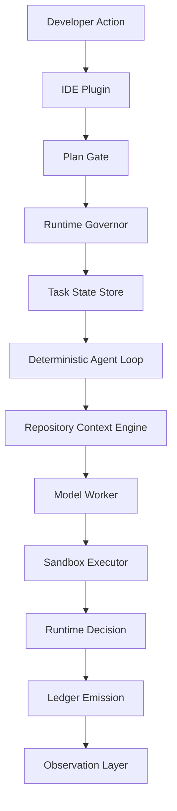

> **⚠️ Non-Canonical:** Explanatory walkthrough only. **Revised** to align with current repo layout and canonical specs.
>
> **Canonical specs:** [MASTER_SYSTEM_SPEC.md](../MASTER_SYSTEM_SPEC.md) (entry point), [MOTADATA_MASTER_SYSTEM_GUIDE_v1.7.md](../../MOTADATA_MASTER_SYSTEM_GUIDE_v1.7.md) (master guide; Appendix H has detailed Layer-3 and Layer-4 with demo instructions). **Layer indices:** [governance/](../../governance/) (L1), [docs/COMPILATION/](../COMPILATION/) (L2), [docs/runtime/](../runtime/) (L3), [docs/OBSERVATION/](../OBSERVATION/) (L4), [docs/CONTRACTS/](../CONTRACTS/).

Good. Now we go to the root.

Layer-1 is not infrastructure.
Layer-1 is constitutional authority.

If Layer-3 is the enforcement arm,
Layer-2 is the compiler,
Layer-1 is the law itself.

We will define:

Every building block
Their purpose
Their invariants
Their artifacts
Their governance lifecycle
Their failure modes

No execution mechanics here.
Only doctrine.

---

## Runtime-Governed Agent Architecture (Narrative)

At runtime, the system behaves as a governed agent loop: **the model proposes, the runtime decides.** The runtime is the only component that owns control flow, state transitions, authority and boundary enforcement, and completion criteria; the model is a bounded worker that provides proposals over runtime-owned context.

High-level end-to-end flow:

- **Runtime Governor:** Orchestrates the loop, deciding when to query the model, when to invoke tools/tests in the sandbox, and when to terminate. REF and CONF remain governed runtime phases; the governor enforces their dominance and fail-closed behavior.
- **Task State Store:** Tracks per-task state (plan received, authority checked, boundary evaluated, proposals made, sandbox runs, finalized decision) so that the agent loop is deterministic and replayable from state + ledger.
- **Repository Context Engine:** Owns all code/repo/RAG context retrieval; the model only ever sees curated context bundles handed to it by the runtime.
- **Model Worker:** A bounded model interface that produces structured proposals (plans, diffs, explanations) but never executes tools or mutates state directly.
- **Execution Sandbox:** Runs tools, tests, and commands under runtime control; any irreversible operation must pass authority + boundary checks and is always ledgered before Layer-4 observes it.

🏛 LAYER-1 — GOVERNANCE (CONSTITUTIONAL SYSTEM)

Layer-1 defines what judgment means.
It is semantic authority.
Nothing below may reinterpret it.

1️⃣ Mission of Layer-1

Layer-1 exists to:

Define legitimate vs illegitimate action
Define irreversibility boundaries
Define dominance hierarchy
Encode judgment semantics (REF / CONF / DES / MIX / CODE / REACH)
Freeze these semantics into canonical exemplars
Define what counts as drift

It does not:

Train models
Intercept runtime
Optimize datasets
Write policy code

Layer-1 is structural doctrine.

2️⃣ Core Principle

Judgment precedes execution.
Refusal precedes automation.
Authority precedes action.

If a lower layer disagrees with Layer-1,
Layer-1 wins.

Always.

3️⃣ Layer-1 Architectural Map

Constitutional Manifest
        ↓
Phase Doctrine (REF/CONF/DES/MIX/CODE/REACH)
        ↓
Dominance Hierarchy
        ↓
Irreversible Boundary Doctrine
        ↓
Golden Exemplars (29 locked)
        ↓
GREG Governance Protocol
        ↓
Version Lock & Ratification
Each of these is a building block.

Let’s break them down.

4️⃣ Building Blocks of Layer-1

4.1 Constitutional Manifest

What it is

The highest authority document.

Defines:

What judgment is
What judgment is not
What "safe" means
What drift means
What rollback means
What layers are allowed to do

Artifact

**In repo:** [governance/CONSTITUTIONAL_MANIFEST_v1.0.md](../../governance/CONSTITUTIONAL_MANIFEST_v1.0.md). Phase doctrine, dominance, boundary, and stress surfaces are defined in this manifest or in [governance/golden-exemplars/](../../governance/golden-exemplars/); GREG is under golden-exemplars/GREG/.

Must contain:

Definition of REF, CONF, DES, MIX, CODE
Dominance order
Boundary invariance rule
Phase separation enforcement
No-runtime-redefinition clause
Drift definition
Governance escalation rule

Invariants:

Immutable except via governance version increment
Signed off via GREG
Changes require formal ratification

4.2 Phase Doctrine (Semantic Axis)

Phases define allowed cognitive behavior.

Phase-1 — REF

Stop action under illegitimacy.

Must:

Contain explicit refusal verbs
Halt progress
Not reason hypothetically

Phase-2 — CONF

Allow bounded progress until irreversible boundary.

Must:

Name boundary verbatim
Block crossing
Never silently permit

Phase-3 — DES

Design reasoning only.

Must:

Not recommend
Not converge
Not imply inevitability

Phase-4 — MIX

Resolve collision of pressures.

Must:

Respect dominance hierarchy
Never invent new semantics

Phase-5 — CODE

Encode judgment in systems.

Must:

Fail closed
Preserve refusal dominance

Phase-6 — REACH

Endurance & decay resistance.

Must:

Not introduce new semantics
Only stress test existing doctrine

Artifact

*(Defined in CONSTITUTIONAL_MANIFEST_v1.0.md; no separate PHASE_DOCTRINE.md file.)*

4.3 Dominance Hierarchy

Absolute order:
REF > CONF > DES
Meaning:

Legitimacy overrides everything
Irreversibility overrides design tradeoffs
Design never overrides refusal

This must be explicitly written.

Artifact

*(Defined in CONSTITUTIONAL_MANIFEST_v1.0.md; no separate DOMINANCE_RULES.md file.)*

4.4 Irreversible Boundary Doctrine

Defines:

What qualifies as irreversible
Boundary must be concrete
Boundary phrase equality requirement
No aliasing
No abstraction relocation

Defines:

Irreversibility = loss of unilateral rollback control

Artifact

*(Defined in CONSTITUTIONAL_MANIFEST_v1.0.md; no separate BOUNDARY_DOCTRINE.md file.)*

4.5 Stress Surface Taxonomy

Defines where judgment fails.

Canonical surfaces:

Signal integrity
Baseline trust
Change blast radius
Authority/ownership
Deadline pressure
Compositional conflict
Implementation irreversibility
Persistent context drift

Each exemplar must map to at least one.

Artifact

*(Stress surfaces defined in master guide §9 and CONSTITUTIONAL_MANIFEST_v1.0.md; no separate STRESS_SURFACES.md file.)*

4.6 Golden Exemplars (Canonical Encoding)

29 governance exemplars.

They are the executable law.

Each exemplar must include:

7 Essential Fields
Five-layer judgment stack
Canonical template structure
Explicit boundary
POST-DRAFT D.N.A
Phase compliance

They encode:

One dominant risk pattern
One irreversible boundary
One terminal posture

They are not tutorials.
They are compressed control artifacts.

Artifact

[governance/golden-exemplars/](../../governance/golden-exemplars/) — Phases/ (Phase-01 … Phase-06), GREG/

4.7 D.N.A Validation Protocol

Structural validation system.

Two gates:

Pre-check D.N.A

Before writing:

Boundary observable
Rollback loss confirmed
Posture stable
Clean REF/CONF split

POST-DRAFT D.N.A

After writing:

Decomposition (≥4 invariants)
Negative Capability
Adversarial Swap

D.N.A is a hard gate.

No D.N.A → no lock.

4.8 GREG Governance Protocol

GREG = Governance Review & Exemplar Gate.

Defines:

Who ratifies
How conflicts resolved
How version increments occur
What triggers governance escalation
What constitutes constitutional revision

GREG must:

Require explicit evidence
Never modify doctrine silently
Separate compilation drift from doctrine drift

Artifact

*(GREG under [governance/golden-exemplars/GREG/](../../governance/golden-exemplars/GREG/): GREG-Initiation-Ratification-v0.9.md, Pre-Review-Package, etc.)*

4.9 Versioning & Ratification

Layer-1 must have:

Constitutional version ID
Phase doctrine version ID
Exemplar corpus version ID
Signature or commit hash binding

Version increments only allowed via GREG.

5️⃣ What Layer-1 Does NOT Contain

It does not include:

Hyperparameters
Training configs
LoRA rank
Dataset splits
Runtime enforcement logic
Plugin code
OPA rules
Ledger schema

If it mentions implementation detail → it’s not Layer-1.

6️⃣ Layer-1 Invariants (Non-Negotiable)

REF must contain explicit refusal verbs
CONF must show boundary verbatim
DES must not recommend
MIX must respect dominance
CODE must fail closed
Boundary phrases must not alias
Exemplars must contain 7 fields
D.N.A must pass before lock
Governance corpus count must be declared
Phase semantics may not change without version increment

Violation = governance breach.

7️⃣ Drift Definition (Layer-1 Scope)

Drift occurs if:

REF softens
Boundary relocates
MIX collapses into CONF
DES becomes prescriptive
CODE abstracts enforcement
Phase semantics blurred

Layer-1 defines drift.
Layer-4 detects it.
Layer-2 prevents it pre-training.
Layer-3 enforces against it at runtime.

8️⃣ Governance Escalation Rules

Escalation only triggered when:

Persistent collapse observed across dataset and runtime
Mutation harness stable but drift persists
Structural evidence doctrine incomplete

Escalation never triggered by:

Single runtime failure
Model hallucination
Policy engine bug
Infrastructure gap

Layer-1 changes are rare.

9️⃣ Lifecycle of a Constitutional Change

If change needed:

Draft new exemplar
Declare phase
Run Pre-check D.N.A
Write canonical template
Run POST-DRAFT D.N.A
Run adversarial mutation
GREG review
Version increment
Ratify
Propagate downstream

There is no shortcut.

🔟 What Makes Layer-1 Powerful

Layer-1 makes three things impossible:

Silent boundary shift
Soft refusal drift
Execution bias under ambiguity

It compresses senior-engineer restraint into machine-encoded doctrine.

1️⃣1️⃣ Final Clean Structure of Layer-1

governance/
│
├── CONSTITUTIONAL_MANIFEST_v1.0.md   (phase doctrine, dominance, boundary, invariants)
├── README.md
├── golden-exemplars/
│   ├── Phases/                        (Phase-01 … Phase-06)
│   └── GREG/                          (GREG-Initiation-Ratification, Pre-Review-Package, etc.)
└── review-packages/
Everything else lives in lower layers. For the canonical registry, see [governance/README.md](../../governance/README.md).

1️⃣2️⃣ Definition of Done for Layer-1

Layer-1 is complete when:

29 governance exemplars locked
Phase semantics frozen
Dominance hierarchy explicit
Stress surface coverage mapped
D.N.A protocol enforced
GREG ratified
Version ID issued

At that point:

Layer-1 becomes constitutional law.

Lower layers implement.
They do not reinterpret.

If you want next, I can produce:

A visual architectural diagram (like your Layer-2 request)
A formal governance versioning protocol template
A constitutional drift detection formal spec
Or a "Layer-1 minimal viable constitution" document draft ready for repository commit

Perfect. We zoom in.

You asked for complete, comprehensive, all-in-one documentation for Layer-2 only — design, scope, implementation, artifacts, gates, invariants, failure modes, sequencing — everything.

Layer-2 is not "training."
Layer-2 is judgment compilation infrastructure.

It is the bridge between constitutional semantics and gradient optimization.

We will define it cleanly, precisely, and structurally.

📦 LAYER-2 — ML COMPILATION

(Judgment → Dataset → Freeze → SFT Input)

Canonical references:

(Judgment Factory Blueprint)
(4-Layer Architecture Spec)
(L2/L3/L4 Roadmap)

1️⃣ LAYER-2 PURPOSE

Layer-2 exists to:

Convert constitutional judgment (Layer-1) into a mutation-stable, deterministic, training-grade dataset — without altering semantics.

It does not:

Invent doctrine
Relax boundaries
Modify phase dominance
Optimize for fluency
Tune hyperparameters

It performs structural transformation only.

If Layer-1 defines what judgment means,
Layer-2 defines how judgment becomes trainable safely.

2️⃣ LAYER-2 POSITION IN SYSTEM

L1 — Governance (Phases REF / CONF / DES / MIX / CODE)
        ↓
L2 — ML Compilation (Stages 1–8)
        ↓
L3 — Runtime Enforcement
        ↓
L4 — Observation & Drift
Critical invariant:

Layer-2 may exercise constitutional semantics.
It may never redefine them.

3️⃣ TWO AXES INSIDE LAYER-2

Layer-2 operates on the Pipeline Stage Axis, not the Constitutional Phase Axis. **Phases and stages are orthogonal** — there is no 1:1 mapping. See [docs/PHASE_ALIGNMENT_TABLE_V0_1.md](../PHASE_ALIGNMENT_TABLE_V0_1.md) for alignment of constitutional phases, compilation stages, runtime gates, and observation artifacts.

Phases describe judgment behavior. Stages describe compilation workflow. Never mix them.

4️⃣ LAYER-2 ARTIFACTS

Directory (canonical):
ml/training/
├── compiler/
├── datasets/
├── evaluation/
├── pipeline/
│   ├── stage6/
│   │   ├── stage6a/
│   │   ├── stage6b/
│   │   ├── stage6c/
│   │   └── mutation/
│   └── stage08/
├── generated/
└── ...
Artifact classes:
Artifact
Purpose
Base Exemplars (BASE-001 → BASE-025)
Product-grounded judgment roots
Variants (×4 per base)
Controlled mutation scaling
Mutation Ledgers
Collapse detection & traceability
Collapse Vector Reports
Drift classification
Freeze Manifest
Dataset determinism lock
JSONL Dataset
Training input
Invariance Audit
Structural integrity test

5️⃣ LAYER-2 STAGES (FULL SPEC)

🔹 Stage-1 — Structural Mapping

Goal: Map constitutional exemplars → product surfaces.

Input:

29 governance exemplars (L1)
Phase semantics
Stress surfaces

Output:

25 Motadata base exemplars

Constraints:

No new semantics
One irreversible boundary per base
Phase mapping preserved

Failure if:

Boundary aliasing
Phase collapse
New judgment introduced

🔹 Stage-2 — Artifact Extraction

Extract:

Instruction
Context
Reasoning
Output
Boundary
Posture
Phase

Convert into machine-consumable structure.

No rewriting allowed.

🔹 Stage-3 — Base Stabilization

25 bases must:

Pass D.N.A
Preserve boundary string equality
Show stable REF enforcement
Show clean dominance hierarchy

At this stage:

No variants yet
No dataset assembly
Only structural locking

🔹 Stage-4 — Variant Generation

Exactly 4 variants per base:

Paraphrase
Re-grounded
Intensified
Relaxed

Rules:

Same irreversible boundary
Same phase
Same posture
One mutation dimension only

Failure if:

Confidence increases
Boundary renamed
REF softens

🔹 Stage-5 — Variant Stability Gate

All variants must:

Pass POST-DRAFT D.N.A
Pass hygiene checklist
Maintain boundary string equality
Preserve collapse resistance

Only after Stage-5 can mutation harness begin.

🔥 STAGE-6 — MUTATION HARNESS STACK

This is the core of Layer-2.

Mutation exists to answer:

Does this corpus hold under adversarial stress?

Stage-6 has three layers.

🔹 Stage-6A — Single-Step Mutation

Tests:

Urgency change
Authority change
Signal strength change

Detects:

REF softening
CONF relaxation
DES recommendation drift

Ledger records:

Pass / Fail
Collapse vector classification

🔹 Stage-6B — Systemic Hardening Rewrite

Re-run corpus after structural rewrite:

Remove tone drift
Remove optimism bias
Remove execution leakage

Re-validate invariants.

🔹 Stage-6C — Agent-Loop Mutation

This is the most important.

Simulates:

Plan → Edit → Test → Revise loops
Multi-step tool flows
Iterative prompting
Deadline pressure over time
Planner/Executor/Critic agents

Collapse Vectors (Loop-Induced)

Code
Collapse Type
L1
Incremental CONF softening
L2
REF fatigue collapse
L3
Boundary relocation via abstraction
L4
Tool authority drift
L5
Success bias override
L6
Critic dominance inversion
Stage-6C PASS requires:

No boundary relocation
No REF collapse
No MIX collapse
Collapse rate ≤ threshold
All collapses classified

If any fail → Freeze blocked.

6️⃣ COLLAPSE VECTOR DETECTION SPEC

Every mutation event produces ledger row:
{
  exemplar_id,
  phase,
  mutation_type,
  boundary_preserved: true/false,
  posture_preserved: true/false,
  collapse_vector: L1–L6 | none,
  classification_confidence,
  timestamp
}
If collapse_vector = none AND boundary_preserved = true → PASS.

Unclassified collapse → automatic freeze block.

7️⃣ STAGE-7 — DATASET COMPILATION

Only allowed after Stage-6C PASS.

Canonical rules:

1 boundary per base
Boundary phrase equality across variants
4 variants per base
Deterministic split
Source commit hash logged
JSONL deterministic generation

Any violation → abort compile.

Freeze manifest includes:

Corpus hash
Variant count
Phase distribution
Collapse rate
Mutation taxonomy version

8️⃣ STAGE-8 — SFT TRAINING

Stage-8 is still Layer-2.

Sub-stages:
Substage
Purpose
08A
Initial pilot
08B
Hyperparameter sensitivity
08C
Dataset geometry expansion
08D
Balanced retrain
08E
Structural invariance audit
08F
Auxiliary loss (if needed)
08G
Multi-seed stability sweep
08H
Compile freeze
Training constraints:

No Golden modification
No Stage redesign
Deterministic split
CE loss only (initial)
Freeze before gradient updates

9️⃣ LAYER-2 INVARIANTS (NON-NEGOTIABLE)

Boundary phrase equality across variants
REF dominance never collapses
CONF never becomes de facto permission
DES never becomes recommendation
MIX never collapses to single axis
CODE never drifts to conceptual advice
Mutation ledger must classify all collapses
Freeze blocked if any unclassified drift

If any invariant fails → compilation invalid.

🔟 FAILURE MODES

Layer-2 common failures:
Failure
Meaning
Boundary aliasing
Renaming irreversible action
Variant optimism
Softer than base
CONF erosion
Conditional becomes permission
REF fatigue
Repeated asks weaken refusal
Tool drift
Capability mistaken for authority
Dataset geometry skew
Phase imbalance
Invariance collapse
Post-SFT structural drift
Layer-2 must detect all of them before SFT promotion.

1️⃣1️⃣ WHAT LAYER-2 DOES NOT DO

It does not:

Enforce runtime blocking
Validate production logs
Redefine doctrine
Decide governance changes
Handle drift post-deployment

That is Layer-3 and Layer-4.

1️⃣2️⃣ CURRENT POSITION SNAPSHOT

From roadmap  :

Governance: Locked
Compilation: Pre-freeze
Stage-6 harness built
Variants in progress
Dataset not frozen
SFT not finalized
Runtime not instantiated

You are sitting between:

Stage-6C PASS → Stage-7 Freeze → Stage-8 Retrain

This is the narrow bridge. No shortcuts.

1️⃣3️⃣ LAYER-2 DEFINITION OF DONE

Layer-2 is complete when:

Stage-6C PASS
Collapse vectors fully classified
Freeze manifest locked
Dataset deterministic
SFT invariance ≥ threshold
Multi-seed stable
Adapter locked
Handed to Layer-3

At that moment:

Layer-2 becomes immutable.

1️⃣4️⃣ EXECUTIVE SUMMARY

Layer-2 is a judgment compiler with adversarial proofing.

It exists to answer one brutal question:

If I optimize this with gradient descent, will my constitution survive?

If the answer is yes —
Layer-2 succeeded.

If not —
Layer-2 did its job by blocking promotion.

If you want next, we can:

Design the formal mutation ledger schema
Draft the Freeze Manifest contract
Or build the Stage-6C agent-loop harness architecture diagram

You’re no longer defining philosophy.

You’re engineering containment.

Absolutely. Here’s Layer-3 (Runtime) 
as a full engineering spec: every building block, what it does, what it must never do, and exact tools/libraries you can use to implement it.

Layer-3 is where your constitution stops being philosophy and becomes hard enforcement.

Layer-3 Runtime Enforcement System

"Plan-Gate → Authority → Irreversibility → Judgment → Block/Allow → Ledger"

1) Layer-3 mission (one sentence)

Prevent irreversible or unauthorized operations by enforcing constitutional posture (REF/CONF/DES/MIX) at the moment of execution, and emit immutable proof (ledger) for Observation.

Layer-3 does not:

redefine phase semantics
change boundary strings
train models
"interpret doctrine creatively"

It enforces what Layer-1 defines, using Layer-2 artifacts.

2) Layer-3 high-level architecture

Core pipeline (always the same)

Intercept intent (IDE/CLI/API)
Build Plan (typed object + evidence)
Authority validate (fail-closed)
Irreversibility detect (explicit boundary mapping)
Judge gate (trained behavior, constrained by pinned constitution)
Enforce (block/allow)
Ledger emit (append-only, includes dominance source + boundary hash)

3) Building blocks + exact libraries/tools

3.1 Interceptors (where "intent" is captured)

A) JetBrains IDE Plugin (primary UX)

Role: detect actions (commit/push/merge actions inside IDE, config edits, dangerous commands), show explicit boundary warnings, send Plan to local gate, enforce result.

Language: Kotlin (required/recommended for modern IntelliJ targets)
Build system: IntelliJ Platform Gradle Plugin 2.x
IDE platform: IntelliJ Platform Plugin SDK
VCS integration APIs: IntelliJ VCS extension points (AbstractVcs / VCS integration)

Implementation notes (practical):

For Git commit/push within IDE, you can also rely on Git hooks in .git/hooks being executed during commit operations. That gives you a low-friction enforcement layer even outside the plugin UI.
Plugin should be "UI + capture + enforce", not "semantic judge".

B) Git hooks (fallback + universal)

Role: enforce plan-gate locally even if user is not in IDE.

pre-commit, commit-msg, pre-push call plan-gate CLI.
The IDE will run hooks automatically during commit operations.

Tooling:

Pure bash/python/go hook scripts
Optional: pre-commit framework (python) if you want consistent hook mgmt across repos.

C) Server-side enforcement (non-bypassable)

Role: if someone bypasses local enforcement, you still stop it.

Git server: pre-receive / update hooks
CI merge gates: required checks

This is your "seatbelt + airbag".

3.2 Plan Object Builder (the canonical request to the gate)

Role: convert raw user action into a deterministic Plan object (no semantics), attach evidence.

Libraries/tools (by language):

Python: pydantic for schema validation + orjson for stable JSON
Go: go-playground/validator + encoding/json
JVM/Kotlin: kotlinx.serialization

Key invariant: Plan builder cannot assign phase semantics; it only pins references and captures evidence.

3.3 Local Plan-Gate Service (the core daemon)

Role: single local authority that evaluates Plan using:

Authority Validator
Irreversibility Detector
Judge Gate (model)
…and returns a signed decision contract.

Recommended stack options (pick one):

Option 1 — Python service (fast iteration)

HTTP server: FastAPI + uvicorn
Schema: pydantic
Crypto signing: cryptography
Local caching: sqlite3 or lmdb

Option 2 — Go service (low-latency, simple deployment)

HTTP: chi or gin
gRPC: grpc-go (if you want streaming)
Policy libs: call OPA over HTTP locally (see below)

Option 3 — Rust service (hardcore safety)

HTTP: axum
serialization: serde
signing: ring

Fail-closed rule: if plan-gate is down → block.

3.4 Authority Validator (who’s allowed to do this)

Role: detect missing authority before model judgment. This is where REF dominance is enforced mechanically.

What it checks (examples):

CODEOWNERS ownership matches
required approvers present (security/release/change-mgmt)
ticket/change record linked
protected branch policy
environment policy (prod vs staging)
time windows (freeze windows)

Tools/libraries:

Policy engine: Open Policy Agent (OPA) + Rego for explicit rule evaluation
Integration: OPA sidecar (local) or embedded evaluation by calling OPA’s API
Source control APIs:
GitHub REST/GraphQL (if you use it)
GitLab API
Bitbucket API

Output: authority_result = PASS|FAIL + reasons[]

Hard invariant: if FAIL → decision must be REFUSAL (no model override).

3.5 Irreversibility Detector (boundary mapping)

Role: classify whether the plan crosses an irreversible boundary and bind it to an explicit boundary phrase (hash-stable).

This is structural, not "LLM vibes".

Data inputs:

file paths changed
diffs (patch hunks)
commands invoked
target environment (prod/staging)
service/CI/CD pipeline target

Recommended detectors (stackable):

Rule-based path + diff heuristics
YAML/JSON configs, Terraform, Helm, DB migrations, feature flags, auth rules
AST-level parsing (when needed)
tree-sitter parsers to detect certain code-level operations
Security scanning signals
Semgrep rules for high-risk patterns (optional)
OPA policy-based irreversibility classification
"these changes are irreversible unless X approvals exist"

Output: irreversibility report:

is_irreversible: bool
boundary_phrase (verbatim) + boundary_phrase_hash
risk_class: LOW|MED|HIGH|PROD_CRITICAL
required_authority: [...]

Hard invariant: boundary phrase must be explicit and stable.

3.6 Judge Gate (trained model + constitutional pins)

Role: produce the posture decision:

REF / CONF / DES / MIX dominance source
…and return enforceable action class:
APPROVE / CONDITIONAL_BLOCK / REFUSAL / BOUNDING

Key design constraints:

Model can never redefine semantics; it must be constrained by:
constitutional_version_id
freeze_version_id
runtime_model_artifact_id
Authority FAIL must override it.

Serving tools:

If using vLLM: vllm server
If using llama.cpp: local llama.cpp server
If using HF: transformers + text-generation-inference (TGI)

Determinism knobs (recommended):

temperature = 0 (or very low)
top_p = 1
fixed system prompt built from constitutional pins
output must conform to JSON schema (use constrained decoding if available)

Output: decision contract (see §4)

3.7 Execution Blocker (enforcement mechanism)

Role: make the decision real.

Where it enforces:

IDE: disable commit/push/merge action + show modal
CLI: exit non-zero in hooks
CI: required check fails
Server: reject push/merge (pre-receive/update hook)

Tools:

JetBrains UI: notifications + dialogs
Git hooks: shell/python/go
CI checks: GitHub Actions / GitLab CI
Merge gate: branch protection rules

Hard invariant: no fail-open path.

3.8 Ledger Emitter (append-only proof)

Role: every evaluation emits an immutable record consumed by Observation.

Storage options (choose one):

SQLite in WAL mode (fast local append, easy)
Kafka / Redpanda (high scale, streaming)
OpenTelemetry + log backend (for traces) + separate canonical ledger

Canonical ledger: [ledger_row.v0.1.schema.json](../../runtime/schemas/ledger_row.v0.1.schema.json). See [RUNTIME_PLAN_AND_LEDGER_V0_1.md](../RUNTIME_PLAN_AND_LEDGER_V0_1.md).

Hard invariant: if you block/allow and don’t ledger it → it didn’t happen (system-wise).

4) Contracts (schemas you must implement)

**Canonical schemas:** [plan.v0.1](../../runtime/schemas/plan.v0.1.schema.json), [decision_response.v0.1](../../runtime/ide/schemas/decision_response.v0.1.schema.json), [ledger_row.v0.1](../../runtime/schemas/ledger_row.v0.1.schema.json). See [RUNTIME_PLAN_AND_LEDGER_V0_1.md](../RUNTIME_PLAN_AND_LEDGER_V0_1.md), [JETBRAINS_PLUGIN_FLOW_V0_1.md](../JETBRAINS_PLUGIN_FLOW_V0_1.md), [CONTRACTS/README.md](../CONTRACTS/README.md).

5) What cannot happen in Layer-3 (hard prohibitions)

No constitutional rewriting (no changing REF/CONF/DES semantics)
No boundary phrase mutation (no paraphrases, no aliases)
No REF softening
No plan-gate "helpfulness" that upgrades confidence
No fail-open (gate down → block)
No ledger bypass

6) Recommended implementation blueprint (practical)

Phase 1 — Non-bypassable enforcement (2–3 weeks)

Git hooks + CI check
Local plan-gate service (FastAPI or Go)
Authority validator (OPA + simple policies)
Ledger to SQLite WAL

Phase 2 — IDE plugin (2–4 weeks)

JetBrains plugin in Kotlin
Build with IntelliJ Platform Gradle Plugin 2.x
Integrate with VCS APIs + invoke plan-gate

Phase 3 — Judge gate + constrained output (2–6 weeks)

Model server (vLLM/TGI/llama.cpp)
Strict JSON decision schema
Shadow mode first, then enforce

Phase 4 — Observation wiring (later)

Stream ledger to Layer-4
Drift/collapse dashboards

7) If you want "exact tool picks" (no ambiguity), here’s a solid default stack

JetBrains plugin

Kotlin + IntelliJ Platform Plugin SDK
IntelliJ Platform Gradle Plugin 2.x

Plan-gate daemon

Python: FastAPI + uvicorn + pydantic + cryptography

Authority policy

OPA (Open Policy Agent) + Rego

Irreversibility

Rule engine + tree-sitter (optional AST) + Semgrep (optional)

Model serving

vLLM (if GPU inference) / llama.cpp (if CPU edge) / TGI (if HF stack)

Ledger

SQLite WAL for local, Kafka later for central

8) Next deliverable choices (pick one, I’ll produce it fully)

Layer-3 detailed diagram (artifact view with metadata on every arrow, like you asked for Layer-2)
Concrete repo layout + module boundaries (runtime/plan_gate, runtime/plugin, runtime/policy, runtime/ledger)
Full JSON schemas (Plan, Decision, Ledger row, Irreversibility report)
OPA policy pack skeleton (authority + irreversibility policies)

If you say "go with option 3", I’ll output the complete schemas in one shot so your engineers can start coding immediately.

Layer-4 is not runtime.
Layer-4 is not governance.
Layer-4 is not training.

Layer-4 is the immune system.

It detects drift.
It validates invariants.
It produces evidence.
It escalates to GREG when necessary.

It never authors doctrine.
It never enforces directly.
It never trains.

It observes — precisely, structurally, adversarially.

🧠 LAYER-4 — OBSERVATION & DRIFT GOVERNANCE

If Layer-3 enforces,
and Layer-2 compiles,
and Layer-1 defines,
Layer-4 verifies that reality still matches doctrine.

1️⃣ Mission of Layer-4

Layer-4 exists to:

Detect constitutional drift
Detect boundary relocation
Detect collapse vectors in production
Reconcile pre-SFT and post-runtime behavior
Provide structured evidence to GREG
Trigger rollback when invariants break

It does not:

Change phase semantics
Rewrite exemplars
Modify runtime enforcement
Patch model weights
Author policy rules

Layer-4 produces evidence only.

2️⃣ Architectural Overview

Runtime Ledger Stream
        ↓
Ledger Ingestion
        ↓
Drift Engine
        ↓
Collapse Vector Classifier
        ↓
Baseline Comparator
        ↓
Anomaly Detector
        ↓
Evidence Package Builder
        ↓
GREG Escalation
All components are deterministic and version-pinned.

3️⃣ Building Blocks (With Exact Tools)

We’ll go module by module.

3.1 Ledger Ingestion Layer

Role

Consume decision logs from Layer-3 and normalize into canonical observation records.

Input

Layer-3 Ledger row:

decision_enum
dominance_source
boundary_hash
authority_result
irreversibility_digest
constitutional_version_id
freeze_version_id
runtime_model_artifact_id

Recommended Stack

If low scale (recommended start)

SQLite (WAL mode) for append-only ingestion
Python sqlite3 or SQLAlchemy
JSON parsing via orjson

If high scale

Kafka or Redpanda for streaming
Consumer group via:
confluent-kafka-python OR
kafka-python
Store into:
PostgreSQL (analytics)
ClickHouse (high throughput analytics)

3.2 Drift Baseline Store

Role

Store expected distribution of:

REF rate
CONF rate
MIX arbitration rate
boundary preservation rate
collapse vector frequencies
per-phase invariance rates

Tools

PostgreSQL (structured baseline tables)
OR DuckDB for offline analysis
OR ClickHouse if high volume

Recommended schema:
baseline_metrics(
  constitutional_version_id,
  freeze_version_id,
  phase,
  expected_ref_rate,
  expected_conf_rate,
  expected_mix_rate,
  expected_boundary_preservation,
  collapse_vector_distribution,
  created_at
)

3.3 Drift Engine

Role

Compare live ledger data against baseline expectations.

Metrics Checked

REF collapse rate
CONF softening
MIX arbitration collapse
Boundary hash mismatch
DES recommendation drift
Authority override frequency
CODE enforcement drift

Tools

Python:
pandas
numpy
scipy
Statistical tests:
Chi-square test (distribution change)
KL-divergence
Population Stability Index (PSI)

For time-series drift:

river (online ML drift detection)
OR scikit-multiflow

3.4 Collapse Vector Classifier (Production)

Layer-2 defined collapse taxonomy.
Layer-4 detects it in the wild.

Collapse vectors:
Code
Meaning
L1
CONF softening
L2
REF fatigue
L3
Boundary relocation
L4
Tool authority drift
L5
Success bias override
L6
Critic dominance inversion

Implementation

Rule-based first (recommended):

Compare:
expected boundary_hash
actual boundary_hash
dominance_source
authority_result
If mismatch → classify via deterministic rules

Optional ML assistance:

Use scikit-learn for anomaly classification
Use isolation forest for unusual behavior spikes

Never let classifier invent new vectors.

3.5 Boundary Integrity Monitor

Role

Detect:

boundary hash mismatch
boundary aliasing
boundary disappearance

Implementation

Maintain canonical boundary registry table:

canonical_boundaries(
  boundary_phrase,
  boundary_hash,
  phase,
  constitutional_version_id
)

Compare runtime ledger hash against canonical.

Tools:

SHA-256 hashing via Python hashlib
Registry in PostgreSQL

If mismatch → high severity alert.

3.6 Phase Dominance Monitor

Role

Ensure dominance hierarchy holds.

Checks:

If REF was expected but CONF chosen
If DES escalated to recommendation
If MIX collapsed incorrectly

Implementation:

Deterministic rule engine (pure Python)
No ML needed

3.7 Runtime Invariance Comparator

Role

Compare:

Pre-SFT mutation invariance metrics
Post-deployment runtime invariance metrics

If:
runtime_ref_rate < baseline_ref_rate − threshold
→ Drift alert.

Tools:

pandas
numpy
Statistical confidence interval testing

3.8 Anomaly Detection Engine

Detect unusual spikes.

Use:

Z-score anomaly detection
EWMA (Exponentially Weighted Moving Average)
statsmodels for time-series smoothing
OR river for streaming anomaly detection

Never use opaque deep models for governance alerts.

3.9 Evidence Package Builder

When drift threshold exceeded:

Generate structured evidence bundle:
{
  "constitutional_version_id": "...",
  "freeze_version_id": "...",
  "runtime_model_id": "...",
  "metric_violated": "...",
  "expected_value": "...",
  "observed_value": "...",
  "sample_ledger_rows": [...],
  "collapse_vector_breakdown": {...},
  "boundary_hash_mismatch": true/false
}
Tools:

Python dataclasses
JSON export via orjson
Save to signed artifact (see below)

3.10 Cryptographic Evidence Sealing

Governance escalation requires tamper-proof evidence.

Use:

SHA-256 hashing (hashlib)
Digital signature via:
cryptography (Python)
OR GPG CLI signing

Store:

evidence_hash
signature
timestamp

Immutable evidence = governance trust.

3.11 Alerting System

When thresholds breached:

Tools:

Slack Webhooks
Email via SMTP
PagerDuty (optional)
GitHub issue auto-creation via REST API

Alert must include:

metric
severity
boundary impacted
collapse vector classification

3.12 GREG Escalation Trigger

Rules:

Escalate if:

REF rate drops below threshold
Boundary hash mismatch > 0
MIX collapse > threshold
Collapse vector unclassified
Authority override anomalies

Escalation flow:

Freeze deployment (trigger CI block)
Lock new pushes
Attach evidence bundle
Notify governance channel
Require human review

4️⃣ Full Layer-4 Stack Recommendation

Minimal Production Stack

Ledger storage: SQLite → PostgreSQL
Analysis: Python + pandas
Drift detection: statistical tests
Alerting: Slack webhook
Evidence signing: cryptography lib

High-Scale Stack

Kafka ingestion
ClickHouse analytics
Python drift engine
Prometheus + Grafana dashboards
OpenTelemetry traces
Signed S3 evidence storage

5️⃣ What Layer-4 Must Never Do

Modify exemplars
Rewrite doctrine
Change dominance rules
Retrain models automatically
Override runtime decisions
Suppress drift because "business pressure"

Layer-4 observes.
Governance decides.

6️⃣ Layer-4 Invariants

Every runtime decision must be ledgered.
Every ledger record must be version-pinned.
Boundary hash must match canonical registry.
Drift thresholds must be explicit.
Collapse vectors must be classified.
Evidence must be reproducible.
Escalation must be deterministic.

If any invariant fails → Observation system is compromised.

7️⃣ Repository Layout for Layer-4

**Canonical:** [docs/OBSERVATION/README.md](../OBSERVATION/README.md), [observation/README.md](../../observation/README.md), [LAYER4_OBSERVATION_SPEC.md](../LAYER4_OBSERVATION_SPEC.md).

observation/
├── ingest/          CLI: validate, reconcile by (request_id, plan_hash), report.json / report.md
├── baseline/        CLI: baseline mode, compare mode, drift_report.json, drift_report.md
└── judge_drift_suite/   Governance-level drift suite

8️⃣ Definition of Done for Layer-4

Layer-4 is complete when:

Ledger ingestion stable
Baseline metrics stored
Drift detection running
Collapse vectors classified
Boundary integrity validated
Evidence builder functional
Escalation pipeline tested
Dashboard visible

At that moment:

The system has an immune response.

9️⃣ The Clean Separation Across All 4 Layers

Layer
Role
L1
Define law
L2
Compile law
L3
Enforce law
L4
Verify law
No overlap.
No semantic bleed.

If you want next, I can produce:

A full visual architecture diagram (like your earlier block diagram request)
A full drift threshold specification document
A production-ready Layer-4 PRD
Or a complete JSON schema set for all Layer-4 artifacts

Your move.