# Full-System Audit Plan — Motadata AI Coding Assistant

**Planning-only.** No code or doc changes; no destructive git operations; no report files created until a separate execution run.

---

## 1. Repository Discovery Summary

### 1.1 Top-level structure (inspection result)

- **Root:** `m-coder` with standard layout: `docs/`, `runtime/`, `governance/`, `ml/`, `observation/`, `jetbrains-plugin/`, `scripts/`, `tests/`, `archive/`, `.dvc/`, `.venv/`, `.spool/`.
- **Docs:** `docs/` holds many files; subdirs include `docs/runtime/`, `docs/governance/`, `docs/OBSERVATION/`, `docs/COMPILATION/`, `docs/CONTRACTS/`, `docs/demo/`, `docs/guides/`, `docs/reference/`, `docs/iterations/`, etc. Mixed case: `OBSERVATION`, `COMPILATION`, `CONTRACTS` (all exist under `docs/`).
- **Runtime:** `runtime/` contains: `emulator/`, `plan_gate_stub/`, `plan_gate_service/`, `plangate/`, `orchestrator/`, `state/`, `context/`, `sandbox/`, `ledger/`, `shadow/`, `shadow_runner/`, `execute_service/`, `ask_service/`, `ide/`, `ci_gate/`, `rag/`, `policies/`, `schemas/`, `tests/`. Sandbox drivers: `runtime/sandbox/sandbox_driver.py`, `container_sandbox_driver.py`; factory: `create_sandbox_driver()` in `runtime/sandbox/__init__.py`.
- **Tests:** `runtime/tests/` (e.g. `test_emulator_invariants.py`, `test_plangate_integration.py`, `test_sandbox_driver.py`, `test_container_sandbox_driver.py`, `test_sandbox_demo_e2e.py`, `test_ledger_completeness.py`, `test_execute_service.py`); `runtime/shadow/tests/`, `runtime/plan_gate_stub/tests/`, `runtime/plan_gate_service/tests/`, `runtime/ide/tests/`, `runtime/ci_gate/tests/`, `runtime/rag/tests/`.
- **Verification:** `docs/runtime/verification/` currently has 4 reports: `LAYER3_INTEGRATION_MERGE_READINESS_REPORT.md`, `LAYER3_MILESTONE_NORMALIZATION_REPORT.md`, `LAYER3_PARALLEL_BRANCH_AUDIT_REPORT.md`, `LAYER3_RUNTIME_COMPLETION_REPORT.md`. No SYSTEM_CANONICAL_STATE_AUDIT, REPOSITORY_LAYOUT_AND_NAMING_AUDIT, NOMENCLATURE_AND_IDENTIFIER_AUDIT, GIT_PROVENANCE_AND_RELEASE_AUDIT, DOCS_CODE_ALIGNMENT_AUDIT, LAYER3_RUNTIME_INTEGRITY_AUDIT, E2E_GOVERNED_SYSTEM_VALIDATION, or SYSTEM_AUDIT_MASTER_SUMMARY yet (planned outputs only).

### 1.2 Git inventory (read-only)

- **Branches (local):** `main` (current), `Layer-2-ML-Compilation-Stage-8-Controlled-SFT`, `feature/m3.10-m3.11-execution-isolation`, `feature/m3.6-shadow`, `integration/layer3-next-verification`, `integration/layer3-runtime-stack`, `layer3-plangate-decomposition`, `layer3-plugin-runtime-bridge`, `layer3-runtime-docs-emulator`.
- **Remote:** `origin/main`, `origin/feature/m3.1-orchestrator`, `origin/feature/m3.5-ledger`, `origin/feature/m3.10-m3.11-execution-isolation`, `origin/layer3-`*, `origin/cursor/`*, `origin/repo-restructure-stratification`, `origin/runtime_hardening_v1.1`, etc.
- **Tags:** `layer3-runtime-baseline`, `layer3-runtime-governed-v1`, `GE_SFT_DATASET_v1_FROZEN`, `stage6c-checkpoint-2026-03-03`.
- **Tag resolution (verified):** `layer3-runtime-baseline` → commit `0283a2ed` (merge "Layer-3 baseline (M3.2–M3.4)"); `layer3-runtime-governed-v1` → commit `23395b6` (merge "Layer-3 governed runtime (M3.1, M3.5, M3.6)").
- **Note:** Existing report [docs/runtime/verification/LAYER3_PARALLEL_BRANCH_AUDIT_REPORT.md](docs/runtime/verification/LAYER3_PARALLEL_BRANCH_AUDIT_REPORT.md) states baseline tag "points to 999f41c..."; actual `git rev-parse layer3-runtime-baseline^{commit}` is `0283a2e`. Discrepancy to be recorded in provenance audit (do not overwrite report; note in new audit).

### 1.3 Canonical truth sources (by AGENT_EXECUTION_RULES and LIVE_ROADMAP_TRACKER)

- **Roadmap authority:** [docs/LIVE_ROADMAP_TRACKER.md](docs/LIVE_ROADMAP_TRACKER.md) — single canonical Layer-3 table M3.0–M3.18; last updated 2026-03-13.
- **Agent rules:** [AGENT_EXECUTION_RULES.md](AGENT_EXECUTION_RULES.md) — branch discipline, file safety, runtime invariants, branch execution notes under `docs/runtime/branch_execution_notes/<branch>.md`.
- **Release chain:** Tags `layer3-runtime-baseline`, `layer3-runtime-governed-v1`; main branch as integration target.
- **Milestone docs:** `docs/runtime/milestones/` — M3.1, M3.3, M3.4, M3.10, M3.11 (M3.2, M3.5–M3.9 referenced in tracker but some milestone docs may live in tracker §4.3.2 / §6).

---

## 2. Audit Surfaces Map

```mermaid
flowchart TB
  subgraph canonical [Canonical truth]
    Tracker[LIVE_ROADMAP_TRACKER.md]
    Roadmap[ROADMAP / SYSTEM_EXECUTION_ROADMAP]
    Completion[Completion reports in docs/runtime/verification]
    Tags[Tags layer3-runtime-baseline governed-v1]
    Main[main branch]
  end
  subgraph structure [Structure / naming]
    DocsDir[docs/ vs mixed-case]
    RuntimeLayout[runtime/ layout]
    MilestoneDocs[docs/runtime/milestones]
    VerificationDir[docs/runtime/verification]
    BranchNotes[docs/runtime/branch_execution_notes]
  end
  subgraph provenance [Provenance]
    Baseline[Baseline branch/merge/tag]
    Governed[Governed runtime merge/tag]
    Isolation[feature/m3.10-m3.11-execution-isolation merge]
    FeatureBranches[feature/m3.1 m3.5 m3.6 integration/*]
  end
  subgraph runtime [Runtime integrity]
    Orchestrator[orchestrator loop_controller]
    PlanGate[plangate plan_gate_service]
    Sandbox[sandbox executor drivers]
    Container[container_sandbox_driver]
    Ledger[ledger]
    Shadow[shadow shadow_runner]
    Plugin[IDE plugin bridge]
  end
  subgraph e2e [E2E scenarios]
    Demos[demos demo_governed_execution shadow_runner]
    ScenarioTests[scenario tests]
    Replay[ledger replay]
    ContainerTests[container driver tests]
    PluginTests[plugin/runtime tests]
  end
  Tracker --> canonical
  Main --> Tags
  structure --> DocsDir
  provenance --> Baseline
  runtime --> Orchestrator
  e2e --> Demos
```

- **A. Canonical truth surfaces:** Tracker; roadmap docs (LIVE_ROADMAP_TRACKER, ROADMAP_L2_L3_L4, SYSTEM_EXECUTION_ROADMAP); completion/verification reports; tags; main.
- **B. Structure/naming surfaces:** `docs/` vs `docs/OBSERVATION`, `docs/COMPILATION`, `docs/CONTRACTS`; `runtime/` layout; `docs/runtime/milestones/`; `docs/runtime/verification/`; `docs/runtime/branch_execution_notes/`.
- **C. Provenance surfaces:** Baseline tag and merge (`0283a2e`); governed-v1 tag and merge (`23395b6`); execution-isolation merge (`302fae2`); feature and integration branches listed above.
- **D. Runtime integrity surfaces:** Orchestrator (`runtime/orchestrator/`, `loop_controller.py`); plan-gate (`runtime/plangate/`, `runtime/plan_gate_service/`); sandbox executor and drivers (`runtime/sandbox/`); container runtime (`container_sandbox_driver.py`); ledger (`runtime/ledger/`); shadow (`runtime/shadow/`, `runtime/shadow_runner/`); plugin bridge (`jetbrains-plugin/.../bridge/`).
- **E. E2E scenario surfaces:** `runtime/sandbox/demo_governed_execution.py`, `runtime/shadow_runner/run_demo.py`, `runtime/ledger/demo_trace`; `runtime/tests/test_sandbox_demo_e2e.py`, `test_emulator_invariants.py`, `test_plangate_integration.py`, `test_container_sandbox_driver.py`; plugin tests (`jetbrains-plugin` Gradle).

---

## 3. Proposed Audit Sequence

Recommended order to maximize reuse and avoid duplicate work:

1. **Canonical state** — Establish current “truth” snapshot (tracker, tags, main HEAD) so other audits can reference it.
2. **Repository layout and naming** — Enumerate dirs/files and naming rules; feeds nomenclature and docs-code.
3. **Nomenclature / milestone-ID** — M3.0–M3.18 vs M3.E0/M3X.*/legacy in docs and code; consistency with tracker.
4. **Git provenance and release** — Tags, merge bases, branch ancestry; baseline vs governed-v1 chain.
5. **Docs–code alignment** — Required artifacts per milestone (tracker §4.3.2, §6) vs actual paths and exports.
6. **Layer-3 runtime integrity** — Invariants, fail-closed, plan-gate/sandbox/ledger/shadow/plugin wiring.
7. **E2E governed system validation** — Demos and scenario tests; pass/skip conditions (e.g. container runtime).
8. **Master summary** — Aggregate findings, pass/fail per audit, risks; no new findings, references only.

---

## 4. Per-Audit Execution Plan

### 4.1 SYSTEM_CANONICAL_STATE_AUDIT

- **Purpose:** Snapshot of canonical sources and their stated state (no interpretation).
- **Inspect:** `docs/LIVE_ROADMAP_TRACKER.md` (header, §4.3.1 table, §5, §6 evidence log); `AGENT_EXECUTION_RULES.md`; `docs/MAIN_MERGE_READINESS_REPORT.md`; `docs/LAYER3_BASELINE_COMPLETION_REPORT.md`; `docs/runtime/verification/LAYER3_RUNTIME_COMPLETION_REPORT.md`.
- **Commands:** `git rev-parse main layer3-runtime-baseline^{commit} layer3-runtime-governed-v1^{commit}`; `git log -1 --oneline main`; `git status`.
- **Output:** `docs/runtime/verification/SYSTEM_CANONICAL_STATE_AUDIT.md` (date, HEAD/tag SHAs, tracker “current focus” and M3.0–M3.11 status, list of canonical doc paths).
- **Pass/fail:** Pass if tracker and tags exist, main is clean or documented; fail if tag SHAs missing or tracker unreadable.
- **Ambiguity:** Tracker says “M3.0–M3.11 complete on main”; M3.0/M3.2 still marked VALIDATING in table — treat as “complete for audit” per header, note table nuance.

### 4.2 REPOSITORY_LAYOUT_AND_NAMING_AUDIT

- **Purpose:** Directory tree and naming consistency; protected vs allowed areas per AGENT_EXECUTION_RULES.
- **Inspect:** Full tree (excluding `.git`, `.venv`, `.dvc/cache`, `node_modules`, `jetbrains-plugin/build`) via `find` or `tree`; `docs/` and `runtime/` structure; `governance/`, `ml/`, `observation/` top-level.
- **Commands:** `find . -maxdepth 4 -type d ! -path './.git*' ! -path './.venv*' ! -path './.dvc/cache*' ! -path './node_modules*' ! -path './jetbrains-plugin/build*' | sort`; list `docs/runtime/verification/`, `docs/runtime/branch_execution_notes/`, `docs/runtime/milestones/`, `runtime/sandbox/`, `runtime/plangate/`, `runtime/ledger/`, `runtime/shadow/`, `runtime/shadow_runner/`.
- **Output:** `docs/runtime/verification/REPOSITORY_LAYOUT_AND_NAMING_AUDIT.md` (tree summary, mixed-case dirs under docs, runtime layout, protected surfaces list).
- **Pass/fail:** Pass if layout matches expected surfaces; fail if protected areas (e.g. `runtime/schemas/`**, `governance/`**) are unexpectedly empty or renamed.
- **Ambiguity:** `docs/reference/DIRECTORY_STRUCTURE_ANALYSIS.md` describes an older layout; treat as historical; do not treat as current canonical layout.

### 4.3 NOMENCLATURE_AND_IDENTIFIER_AUDIT

- **Purpose:** Single canonical M3.0–M3.18 usage; identify residual M3.E0, M3X.*, M3.6A/M3.6B or legacy labels.
- **Inspect:** Tracker §4.3.1 and §6; all `docs/**/*.md` and key `runtime/**/*.py` for milestone IDs; `README.md`; `docs/runtime/RUNTIME_STATE_TRANSITIONS.md`; `docs/runtime/milestones/*.md`; normalization report.
- **Commands:** `rg -l 'M3\.E0|M3X\.|m3\.e0|M3\.T0' --glob '*.md' .`; `rg -l 'M3\.E0|M3X\.' --glob '*.py' .`; manual check of LIVE_ROADMAP_TRACKER and RUNTIME_STATE_TRANSITIONS.
- **Output:** `docs/runtime/verification/NOMENCLATURE_AND_IDENTIFIER_AUDIT.md` (canonical list M3.0–M3.18; table of files with legacy labels; mapping note from LAYER3_MILESTONE_NORMALIZATION_REPORT).
- **Pass/fail:** Pass if live roadmap and milestone tables use only M3.0–M3.18; legacy only in historical/reference docs with note; fail if tracker or milestone tables use M3.E0/M3X.*.
- **Ambiguity:** RUNTIME_STATE_TRANSITIONS and some milestone docs intentionally keep “M3.E0” as historical mapping; do not flag as failure if normalization report or tracker states “historical preserved.”

### 4.4 GIT_PROVENANCE_AND_RELEASE_AUDIT

- **Purpose:** Tag and merge chain correctness; branch ancestry; no rewriting.
- **Inspect:** Tags, merge commits, branch merge bases; reports that reference tag SHAs.
- **Commands:** `git tag -l`; `git rev-parse layer3-runtime-baseline^{commit} layer3-runtime-governed-v1^{commit}`; `git log --oneline --decorate -20 main`; `git merge-base main layer3-runtime-baseline`; `git merge-base main layer3-runtime-governed-v1`; `git branch -a --contains layer3-runtime-baseline`; `git log -1 --format='%H %s' layer3-runtime-baseline layer3-runtime-governed-v1`.
- **Output:** `docs/runtime/verification/GIT_PROVENANCE_AND_RELEASE_AUDIT.md` (tag→commit table; merge commit SHAs; branch containment; discrepancy with LAYER3_PARALLEL_BRANCH_AUDIT_REPORT SHA for baseline).
- **Pass/fail:** Pass if both tags resolve, main contains both tags’ commits, merge history matches known chain; fail if a tag is missing or points to wrong lineage.
- **Ambiguity:** LAYER3_PARALLEL_BRANCH_AUDIT_REPORT says baseline “points to 999f41c”; actual is 0283a2e — document as “report SHA typo/legacy” and do not overwrite that report.

### 4.5 DOCS_CODE_ALIGNMENT_AUDIT

- **Purpose:** Required artifacts per milestone (tracker §4.3.2 and §6) exist at stated paths and are wired.
- **Inspect:** For each M3.0–M3.11: artifact list in tracker vs `runtime/` and `docs/runtime/`; file existence; key exports/imports (e.g. `SandboxDriver`, `ContainerSandboxDriver`, `create_sandbox_driver`, `PlanGateService`, `LoopController`, `ContextEngine`, ledger store, shadow runner).
- **Commands:** `test -f <path>` for each required path; `rg 'def |class ' <key_files>` for public contracts; optional `python3 -c 'import runtime.sandbox; import runtime.plangate'` (no execution).
- **Output:** `docs/runtime/verification/DOCS_CODE_ALIGNMENT_AUDIT.md` (per-milestone artifact table: path, exists, notes).
- **Pass/fail:** Pass if every required artifact path exists and matches doc; fail if any required file missing or mislocated.
- **Ambiguity:** “Repository context architecture note” and similar prose artifacts — treat as “doc in docs/runtime/” (e.g. REPOSITORY_CONTEXT_ENGINE.md); optional “at least one E2E example” may be in tests or demos.

### 4.6 LAYER3_RUNTIME_INTEGRITY_AUDIT

- **Purpose:** Runtime invariants (fail-closed, plan-gate enforcement, append-only ledger, no bypass, REF dominance, shadow no boundary cross); component wiring.
- **Inspect:** AGENT_EXECUTION_RULES §4; `runtime/plangate/`, `runtime/sandbox/sandbox_executor.py`, `runtime/ledger/`, `runtime/shadow_runner/`, `runtime/execute_service/handlers.py`; `jetbrains-plugin` bridge and governed actions; tests that assert invariants (`test_emulator_invariants.py`, `test_plangate_integration.py`).
- **Commands:** Read-only code inspection; `rg 'fail.closed|REF|safe_execute|plangate_refused|append' --glob '*.py' runtime/`; list test files that encode invariants.
- **Output:** `docs/runtime/verification/LAYER3_RUNTIME_INTEGRITY_AUDIT.md` (invariant checklist with file/line or test reference; wiring diagram references; gaps if any).
- **Pass/fail:** Pass if each invariant has clear implementation or test reference; fail if a stated invariant has no code or test backing.
- **Ambiguity:** “Shadow never crosses boundary” — evidence in shadow runner and test_emulator_invariants; container driver “fail-closed when runtime unavailable” in container_sandbox_driver.py.

### 4.7 E2E_GOVERNED_SYSTEM_VALIDATION

- **Purpose:** Demos and scenario tests run (or skip with documented reason); no silent failure.
- **Inspect:** `runtime/sandbox/demo_governed_execution.py`, `runtime/shadow_runner/run_demo.py`, `runtime/ledger/demo_trace`; `runtime/tests/test_sandbox_demo_e2e.py`, `test_emulator_invariants.py`, `test_plangate_integration.py`, `test_container_sandbox_driver.py`; plugin `./gradlew test`.
- **Commands (read-only where possible; execution is optional in plan phase):** `python3 -m pytest runtime/tests/test_emulator_invariants.py runtime/tests/test_plangate_integration.py runtime/tests/test_sandbox_demo_e2e.py -v --collect-only`; `python3 -m pytest runtime/tests/test_container_sandbox_driver.py -v --collect-only`; list demo entry points.
- **Output:** `docs/runtime/verification/E2E_GOVERNED_SYSTEM_VALIDATION.md` (scenario list; expected commands; pass/skip criteria; container-runtime-dependent tests marked; plugin test command).
- **Pass/fail:** Pass if all non–environment-dependent tests are defined and runnable; skip conditions (e.g. no podman/docker) documented; fail if critical E2E tests are missing or always skip without reason.
- **Ambiguity:** Container driver tests may skip when no runtime; document as “expected skip when no podman/docker”; do not fail audit for that skip.

### 4.8 SYSTEM_AUDIT_MASTER_SUMMARY

- **Purpose:** Single summary of all audits; no new findings; references only.
- **Inspect:** All seven audit reports above (once produced).
- **Commands:** None beyond reading the seven reports.
- **Output:** `docs/runtime/verification/SYSTEM_AUDIT_MASTER_SUMMARY.md` (audit list; pass/fail per audit; link to each report; risks/ambiguities list; go/no-go summary).
- **Pass/fail:** N/A (summary).
- **Ambiguity:** None.

---

## 5. Commands That Will Be Used (Read-Only / Non-Destructive)

- `git status`, `git branch -a`, `git tag -l`
- `git log --oneline --decorate --graph --max-count=50`
- `git rev-parse <ref>`, `git rev-parse <tag>^{commit}`
- `git merge-base main layer3-runtime-baseline` (and governed-v1)
- `git log -1 --format='%H %s' <ref>`
- `find . -maxdepth N -type d ... ! -path './.git*' ... | sort`
- `rg <pattern> --glob '*.md' .` / `rg <pattern> --glob '*.py' .` (grep only)
- `test -f <path>` for artifact existence
- Optional (execution phase): `pytest ... --collect-only` (no test run required for plan)
- No: `git checkout`, `git merge`, `git reset`, `git push`, `git tag -d`, file writes, doc edits

---

## 6. Planned Report Files

| Report                         | Path                                                              | Created by |
| ------------------------------ | ----------------------------------------------------------------- | ---------- |
| System canonical state         | `docs/runtime/verification/SYSTEM_CANONICAL_STATE_AUDIT.md`       | Audit 4.1  |
| Repository layout and naming   | `docs/runtime/verification/REPOSITORY_LAYOUT_AND_NAMING_AUDIT.md` | Audit 4.2  |
| Nomenclature and identifier    | `docs/runtime/verification/NOMENCLATURE_AND_IDENTIFIER_AUDIT.md`  | Audit 4.3  |
| Git provenance and release     | `docs/runtime/verification/GIT_PROVENANCE_AND_RELEASE_AUDIT.md`   | Audit 4.4  |
| Docs–code alignment            | `docs/runtime/verification/DOCS_CODE_ALIGNMENT_AUDIT.md`          | Audit 4.5  |
| Layer-3 runtime integrity      | `docs/runtime/verification/LAYER3_RUNTIME_INTEGRITY_AUDIT.md`     | Audit 4.6  |
| E2E governed system validation | `docs/runtime/verification/E2E_GOVERNED_SYSTEM_VALIDATION.md`     | Audit 4.7  |
| Master summary                 | `docs/runtime/verification/SYSTEM_AUDIT_MASTER_SUMMARY.md`        | Audit 4.8  |

Existing reports in `docs/runtime/verification/` are **not** to be overwritten by this plan; new audits only add new files or, if an execution run explicitly updates one, do so with a version/date and note.

---

## 7. Risks / Ambiguities to Watch

- **Baseline tag SHA:** LAYER3_PARALLEL_BRANCH_AUDIT_REPORT says `layer3-runtime-baseline` points to `999f41c`; actual is `0283a2e`. Record in GIT_PROVENANCE audit; do not “fix” the old report in the audit run unless explicitly requested.
- **Mixed-case dirs:** `docs/OBSERVATION/`, `docs/COMPILATION/`, `docs/CONTRACTS/` exist; links from other docs use these; no collision with root `observation/` (different role). Audit should list them, not treat as errors.
- **Legacy labels (M3.E0, M3X.*):** Present in RUNTIME_STATE_TRANSITIONS, README, M3.3 milestone doc, LAYER3_MILESTONE_NORMALIZATION_REPORT. Tracker and normalization report state “historical preserved.” Nomenclature audit should list locations and mark “acceptable if documented as historical.”
- **Stale milestone labels:** Historical completion reports and branch execution notes may use older IDs; do not overwrite; note in nomenclature audit.
- **Reports that should not be overwritten:** LAYER3_PARALLEL_BRANCH_AUDIT_REPORT, LAYER3_INTEGRATION_MERGE_READINESS_REPORT, LAYER3_MILESTONE_NORMALIZATION_REPORT, LAYER3_RUNTIME_COMPLETION_REPORT — reference them; add new reports only.
- **Container-runtime-dependent checks:** Tests in `test_container_sandbox_driver.py` may skip when podman/docker absent; E2E audit should document as expected; not a failure.
- **Tracker table nuance:** M3.0 and M3.2 “VALIDATING” vs header “M3.0–M3.11 complete” — treat header as authority for “complete on main”; note table status for traceability.

---

## 8. Recommended Execution Order

1. SYSTEM_CANONICAL_STATE_AUDIT
2. REPOSITORY_LAYOUT_AND_NAMING_AUDIT
3. NOMENCLATURE_AND_IDENTIFIER_AUDIT
4. GIT_PROVENANCE_AND_RELEASE_AUDIT
5. DOCS_CODE_ALIGNMENT_AUDIT
6. LAYER3_RUNTIME_INTEGRITY_AUDIT
7. E2E_GOVERNED_SYSTEM_VALIDATION
8. SYSTEM_AUDIT_MASTER_SUMMARY

Dependencies: (2) and (3) can run in parallel after (1); (5) benefits from (2); (6) benefits from (5); (7) can run after (6); (8) last.

---

## 9. Go / No-Go Recommendation

- **Go:** Repository state is sufficiently well-defined to run the audit deterministically: canonical sources exist (LIVE_ROADMAP_TRACKER, AGENT_EXECUTION_RULES, tags, main), layout and runtime surfaces are identifiable, and all planned audits have clear read-only commands and pass/fail criteria. One known SHA discrepancy in an existing report is documented and does not block the plan.
- **No-Go conditions (for execution phase):** If during execution the tracker or tags become unreadable, or main is in an unexpected detached/conflicted state, pause and report; do not create or overwrite verification reports until the repo is in a clean, readable state.

**Conclusion:** Proceed with execution in a separate Cursor run using this plan; use read-only commands only; create only the eight planned reports under `docs/runtime/verification/`; do not modify code, existing docs, or git history.